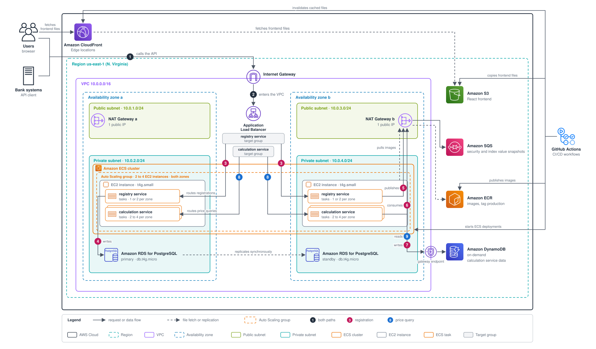
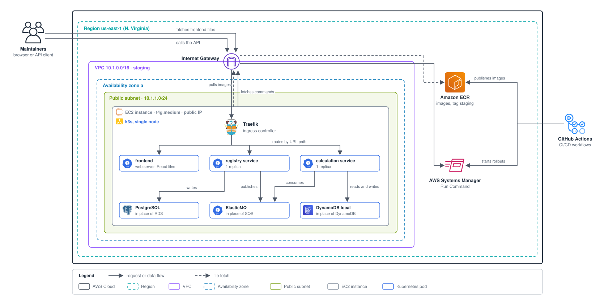
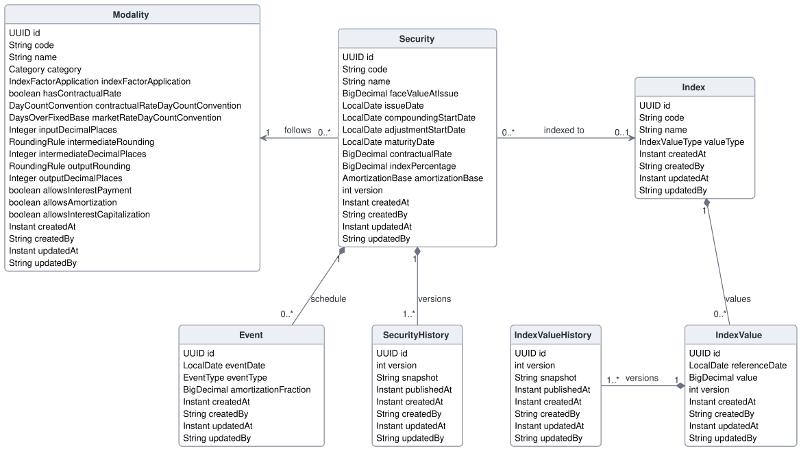

#  A reference system for Brazilian fixed-income securities

> This document is the result of a partnership between its author and AI. It was built over many iterations, in which the two studied each topic, drafted the text and revised it together. The author reviewed the final version in full.

finmathly records [securities](#211-loan-and-security), such as government bonds, debentures (bonds issued by companies) and bank deposit certificates, together with their contractual rules, and it calculates their [prices](#22-calculations) for any applicable date.

The system is made of two (2) services. The [registry service](#332-write-side-the-registry-service) receives every change to the data and keeps the source of truth: [securities](#211-loan-and-security), their [modalities](#2112-modalities), their [events](#2110-events), [indexes](#216-index-its-values-and-index-factor) and [index values](#216-index-its-values-and-index-factor). The [calculation service](#333-read-side-the-calculation-service) answers calculation requests from its own copy of the part of that data that it needs. A web frontend lets users work with both.

For now, the calculation service offers two (2) calculations: (i) the [par unit price](#224-par-unit-price-pu-par) (PU par), the value of one (1) [unit](#211-loan-and-security) under the contract rules, calculated for every security with a contractual remuneration (a [contractual rate](#219-contractual-rate-and-rate-factor), an [index](#216-index-its-values-and-index-factor), or both); and (ii) the [unit price](#225-unit-price-pu) (PU), the value of one (1) unit at a [market rate](#225-unit-price-pu) supplied by the user, calculated for [fixed-rate](#2111-categories) securities.

More calculations are planned for the same service as finmathly grows, as explained in [2.4](#24-what-finmathly-calculates-and-what-it-doesnt).

This document explains what finmathly contains, how it was designed and why it was designed that way.

- [1. Approach: strategic programming with AI](#1-approach-strategic-programming-with-ai)
- [2. Business domain: fixed-income mathematics](#2-business-domain-fixed-income-mathematics)
  - [2.1 Securities](#21-securities)
    - [2.1.1 Loan and security](#211-loan-and-security)
    - [2.1.2 Dates](#212-dates)
    - [2.1.3 Face value and face value at issue (VNE)](#213-face-value-and-face-value-at-issue-vne)
    - [2.1.4 Amortizations](#214-amortizations)
    - [2.1.5 Outstanding face value (VNe)](#215-outstanding-face-value-vne)
    - [2.1.6 Index, its values and index factor](#216-index-its-values-and-index-factor)
    - [2.1.7 Adjustment factor and monetary adjustment](#217-adjustment-factor-and-monetary-adjustment)
    - [2.1.8 Adjusted face value (VNA)](#218-adjusted-face-value-vna)
    - [2.1.9 Contractual rate and rate factor](#219-contractual-rate-and-rate-factor)
    - [2.1.10 Events](#2110-events)
    - [2.1.11 Categories](#2111-categories)
    - [2.1.12 Modalities](#2112-modalities)
  - [2.2 Calculations](#22-calculations)
    - [2.2.1 Compound interest](#221-compound-interest)
    - [2.2.2 Compounding factor of a security](#222-compounding-factor-of-a-security)
    - [2.2.3 Payment schedule](#223-payment-schedule)
    - [2.2.4 Par unit price (PU par)](#224-par-unit-price-pu-par)
    - [2.2.5 Unit price (PU)](#225-unit-price-pu)
  - [2.3 Reading a price](#23-reading-a-price)
  - [2.4 What finmathly calculates and what it doesn't](#24-what-finmathly-calculates-and-what-it-doesnt)
  - [2.5 Rate and time conventions](#25-rate-and-time-conventions)
    - [2.5.1 Effective annual rates](#251-effective-annual-rates)
    - [2.5.2 Day count conventions](#252-day-count-conventions)
    - [2.5.3 Rounding and truncation](#253-rounding-and-truncation)
  - [2.6 Glossary](#26-glossary)
- [3. System design](#3-system-design)
  - [3.1 Quality requirements](#31-quality-requirements)
    - [3.1.1 Availability](#311-availability)
    - [3.1.2 Scalability](#312-scalability)
    - [3.1.3 Consistency](#313-consistency)
  - [3.2 Production on AWS](#32-production-on-aws)
    - [3.2.1 Containers on Amazon ECS](#321-containers-on-amazon-ecs)
    - [3.2.2 Load balancing](#322-load-balancing)
    - [3.2.3 Scaling](#323-scaling)
    - [3.2.4 Databases](#324-databases)
    - [3.2.5 Network](#325-network)
    - [3.2.6 Path of a registration](#326-path-of-a-registration)
    - [3.2.7 Path of a price query](#327-path-of-a-price-query)
  - [3.3 CQRS](#33-cqrs)
    - [3.3.1 What it is](#331-what-it-is)
    - [3.3.2 Write side: the registry service](#332-write-side-the-registry-service)
    - [3.3.3 Read side: the calculation service](#333-read-side-the-calculation-service)
    - [3.3.4 Synchronization](#334-synchronization)
    - [3.3.5 Why](#335-why)
  - [3.4 Transactional outbox](#34-transactional-outbox)
    - [3.4.1 Problem](#341-problem)
    - [3.4.2 Solution](#342-solution)
  - [3.5 Staging](#35-staging)
  - [3.6 CI/CD](#36-cicd)
    - [3.6.1 Version numbers](#361-version-numbers)
    - [3.6.2 Semantic Versioning](#362-semantic-versioning)
    - [3.6.3 Tags](#363-tags)
    - [3.6.4 Releases rebuilt from builds](#364-releases-rebuilt-from-builds)
    - [3.6.5 From a pull request to production](#365-from-a-pull-request-to-production)
    - [3.6.6 Updates of production and staging](#366-updates-of-production-and-staging)
    - [3.6.7 Rollback and build promotion](#367-rollback-and-build-promotion)
  - [3.7 Authentication and authorization](#37-authentication-and-authorization)
    - [3.7.1 User and machine access](#371-user-and-machine-access)
    - [3.7.2 OAuth 2.0 and OpenID Connect](#372-oauth-20-and-openid-connect)
    - [3.7.3 User flow](#373-user-flow)
    - [3.7.4 Machine flow](#374-machine-flow)
    - [3.7.5 Check of a call](#375-check-of-a-call)
    - [3.7.6 Renewal and the session with the provider](#376-renewal-and-the-session-with-the-provider)
    - [3.7.7 CSRF and XSS](#377-csrf-and-xss)
  - [3.8 Formats](#38-formats)
- [4. Data model](#4-data-model)
  - [4.1 Class diagram](#41-class-diagram)
  - [4.2 Conventions](#42-conventions)
  - [4.3 Database indexes](#43-database-indexes)
  - [4.4 Registry tables](#44-registry-tables)
    - [4.4.1 modality](#441-modality)
    - [4.4.2 security](#442-security)
    - [4.4.3 event](#443-event)
    - [4.4.4 security_history](#444-security_history)
    - [4.4.5 index and index_value](#445-index-and-index_value)
    - [4.4.6 index_value_history](#446-index_value_history)
  - [4.5 Calculation tables](#45-calculation-tables)
    - [4.5.1 Keys and items](#451-keys-and-items)
    - [4.5.2 Versioning and the snapshots](#452-versioning-and-the-snapshots)
  - [4.6 Validations](#46-validations)
- [5. Software design](#5-software-design)
  - [5.1 Quality requirements](#51-quality-requirements)
    - [5.1.1 Maintainability](#511-maintainability)
    - [5.1.2 Testability](#512-testability)
    - [5.1.3 Correctness](#513-correctness)
    - [5.1.4 Efficiency](#514-efficiency)
  - [5.2 Complexity](#52-complexity)
  - [5.3 Principles](#53-principles)
    - [5.3.1 Deep modules and information hiding](#531-deep-modules-and-information-hiding)
    - [5.3.2 High cohesion, low coupling and behavior with its data](#532-high-cohesion-low-coupling-and-behavior-with-its-data)
    - [5.3.3 Precise and consistent names](#533-precise-and-consistent-names)
    - [5.3.4 Functions that do one thing](#534-functions-that-do-one-thing)
    - [5.3.5 Comments that say what the code cannot](#535-comments-that-say-what-the-code-cannot)
    - [5.3.6 Errors defined out of existence, and early failure](#536-errors-defined-out-of-existence-and-early-failure)
    - [5.3.7 SOLID](#537-solid)
      - [5.3.7.1 Single responsibility: one reason to change](#5371-single-responsibility-one-reason-to-change)
      - [5.3.7.2 Open/closed: new variants as new code](#5372-openclosed-new-variants-as-new-code)
      - [5.3.7.3 Liskov substitution: implementations that keep the contract](#5373-liskov-substitution-implementations-that-keep-the-contract)
      - [5.3.7.4 Interface segregation: interfaces shaped by their clients](#5374-interface-segregation-interfaces-shaped-by-their-clients)
      - [5.3.7.5 Dependency inversion: interfaces owned by the business rules](#5375-dependency-inversion-interfaces-owned-by-the-business-rules)
    - [5.3.8 Simplicity](#538-simplicity)
    - [5.3.9 Refactoring protected by tests](#539-refactoring-protected-by-tests)
  - [5.4 Design patterns](#54-design-patterns)
    - [5.4.1 Strategy](#541-strategy)
    - [5.4.2 Repository](#542-repository)
    - [5.4.3 Adapter](#543-adapter)

## 1. Approach: strategic programming with AI

AI tends to write code quickly, and by default it programs tactically: it makes the current request work and moves on to the next one. Each shortcut taken this way adds a little [complexity](#52-complexity), and over time the code becomes hard to understand and hard to change. finmathly is built with AI help, so the approach is designed to counter that tendency.

Tactical programming has one (1) goal: working code now. Whatever design the code ends up with is a by-product of getting the change to work. Strategic programming has a different goal: a good design. Working code is still necessary, but it is not enough, and every change invests a little in the design, because [complexity](#52-complexity) is incremental. It does not arrive in one (1) large decision but accumulates one (1) shortcut at a time, so it can only be contained if every change takes care of it. The terms tactical programming and strategic programming come from [*A Philosophy of Software Design*↗](https://www.amazon.com/Philosophy-Software-Design-2nd/dp/173210221X), by John Ousterhout.

In this sense, good design is design that keeps complexity low, so that the system remains easy to understand and easy to change. finmathly pursues it at the code level, through its [software design](#5-software-design), which deals with how the code inside each service is organized.

The [quality requirements](#51-quality-requirements) of the software design are [maintainability](#511-maintainability), which combines analysability (readability) and modifiability, together with [testability](#512-testability), [correctness](#513-correctness) and [efficiency](#514-efficiency). The software design is built on [principles](#53-principles) such as [information hiding](#531-deep-modules-and-information-hiding), [cohesion](#532-high-cohesion-low-coupling-and-behavior-with-its-data), [precise names](#533-precise-and-consistent-names), [SOLID](#537-solid) and [simple design](#538-simplicity), and on [design patterns](#54-design-patterns) such as [Strategy](#541-strategy), [Repository](#542-repository) and [Adapter](#543-adapter).

Here, good design is reasoned about in five (5) steps:

1. the [quality attribute](#51-quality-requirements) that is wanted;
2. the [symptom](#52-complexity) that shows the attribute is missing;
3. the [cause](#52-complexity) that produces the symptom;
4. the [principle](#53-principles) that removes the cause;
5. the [design pattern](#54-design-patterns) that offers a proven way to apply the principle.

The AI used in this repository is directed through skills: written instructions that coding agents load whenever they work here. [`finmathly-strategic-coder`](.claude/skills/finmathly-strategic-coder/SKILL.md) is one (1) of these skills. It makes the AI program strategically, rather than tactically: the AI identifies the causes and symptoms of bad design and applies principles and design patterns to achieve the required quality attributes.

The person behind the AI stays in control through code review. Every line of code is read and approved by that person before it is committed. Readable code is what makes this review possible, which is why analysability (readability) is treated as a requirement rather than a preference.

## 2. Business domain: fixed-income mathematics

This section describes the business domain: the fixed-income concepts finmathly works with and the formulas it applies. finmathly aims to follow the conventions of the Brazilian fixed-income market, but it has its own model, which may differ from the market and differs from it significantly in four (4) points:

1. the [index percentage](#216-index-its-values-and-index-factor), which finmathly accepts for any index, the IPCA included, and applies to the variation of each period, as detailed in [2.1.6](#216-index-its-values-and-index-factor);
2. the [categories](#2111-categories), a classification specific to finmathly, as detailed in [2.1.11](#2111-categories);
3. the [monthly index numbers](#216-index-its-values-and-index-factor), such as the IPCA, which the market prorates over a partial month and finmathly does not, so it accepts only whole months, as detailed in [2.1.6](#216-index-its-values-and-index-factor);
4. the [rounding and truncation](#253-rounding-and-truncation), for which finmathly has only three (3) stages of a calculation, with one (1) rule for each, while the market sets a rule for each value, as detailed in [2.5.3](#253-rounding-and-truncation).

Several names in this section, such as PU or VNE, are abbreviations of the Portuguese names that the Brazilian market uses, listed in the [glossary](#26-glossary). In every formula and every calculation, each rate and percentage is written as a decimal, so $100$ per cent is written as $1.00$, as explained in [2.5](#25-rate-and-time-conventions).

For consistency, each concept has exactly one (1) entry in the [glossary](#26-glossary) and is always called by the names of that entry, as detailed in [2.6](#26-glossary).

### 2.1 Securities

#### 2.1.1 Loan and security

A loan has a borrower, who received the money and must repay it, and a lender, who has the right to receive it back. The principal is the amount the borrower must repay, without [interest](#221-compound-interest). It belongs to the debt itself: it does not depend on who holds the debt or on the price paid for it.

A security is a loan divided into equal units that can be traded separately. The borrower of a security is called the issuer, and the lender, who holds its units, is called the investor.

#### 2.1.2 Dates

Five (5) dates frame the life of a [security](#211-loan-and-security):

1. the issue date, the date the security is created;
2. the compounding start date, the date from which [interest](#221-compound-interest) starts to accrue, which is usually the issue date, although the contract may set another one, before or after it;
3. the adjustment start date, the date from which [monetary adjustment](#217-adjustment-factor-and-monetary-adjustment) starts to accrue, which exists only in a security with monetary adjustment, as detailed in [2.1.7](#217-adjustment-factor-and-monetary-adjustment), and is usually the compounding start date, never after it;
4. the maturity date, the last date of the contract, on which the [issuer](#211-loan-and-security) repays the remaining [principal](#211-loan-and-security) of each [unit](#211-loan-and-security) with its monetary adjustment, that is, its [adjusted face value](#218-adjusted-face-value-vna) (VNA), and pays the interest accrued and not yet paid;
5. the calculation date, the date for which [prices](#22-calculations) are calculated, which is never before the issue date or the compounding start date, nor after the maturity date.

The issue date and the two (2) start dates can all differ. The monetary adjustment of a security may run from a date years before its issue. Its interest may run from the last date of its [coupon payment](#2110-events) calendar before issue, a date on which this security itself paid nothing.

The NTN-B is a concrete example. It is a bond of the National Treasury (Tesouro Nacional), which issues the debt of the Brazilian federal government, and it is indexed to the [IPCA](#216-index-its-values-and-index-factor), the official consumer price index. The monetary adjustment of every NTN-B runs from the same date, 15 July 2000, whatever its issue date. The NTN-B maturing on 15 May 2031, issued on 14 January 2026, therefore has 15 July 2000 as its adjustment start date, and 15 November 2025, the last coupon date before issue, as its compounding start date.

Every NTN-B pays its coupons every six (6) months, on one (1) of two (2) calendars set by the year of its maturity: every 15 May and 15 November when it matures in an odd year, as the one of 2031 does, and every 15 February and 15 August when it matures in an even year. Each coupon pays the interest of a whole semester. A buyer on the issue date therefore pays, in the price, the interest accrued from 15 November 2025 to the purchase, and receives it back in the first coupon, so no interest is paid on money not yet lent.

The two (2) start dates may also fall after the issue date, when the money of the [investors](#211-loan-and-security) comes in later than the issue date. Interest and monetary adjustment then usually run from the day that money comes in, for the same reason: no interest is paid on money not yet lent.

A debenture is a concrete example: its contract may start both its interest and its monetary adjustment on the first date the investors pay for it, days or weeks after its issue date.

#### 2.1.3 Face value and face value at issue (VNE)

The face value is the principal of one (1) [unit](#211-loan-and-security). The face value at issue (VNE) is the face value set in the contract, and it never changes. It is stated without monetary adjustment: in a security with monetary adjustment, it is the face value on the [adjustment start date](#212-dates), such as R$ 1,000.00 on 15 July 2000 for every NTN-B, and otherwise on the [issue date](#212-dates).

The face value itself changes over the life of a security, and finmathly measures it in two (2) ways: the [outstanding face value](#215-outstanding-face-value-vne) (VNe), without monetary adjustment, and the [adjusted face value](#218-adjusted-face-value-vna) (VNA), with it. The abbreviations VNE and VNe differ only in the case of their last letter. The market does not keep the two apart, and either abbreviation can mean the face value at issue or its outstanding balance, so this distinction is a convention of finmathly.

#### 2.1.4 Amortizations

The [face value](#213-face-value-and-face-value-at-issue-vne) is repaid through amortizations: each intermediate amortization repays part of it, and the final amortization repays what remains. The contract defines the amortization fraction, the fraction repaid on each date, and the amortization base that the fraction applies to, which is either the [face value at issue](#213-face-value-and-face-value-at-issue-vne) (VNE) or the [outstanding face value](#215-outstanding-face-value-vne) (VNe).

An amortization in the [event schedule](#2110-events), before maturity, is an intermediate amortization. On the [maturity date](#212-dates), a final amortization always repays the whole outstanding face value (VNe) that remains, with its monetary adjustment, that is, the [adjusted face value](#218-adjusted-face-value-vna) (VNA), as explained in [2.1.10](#2110-events).

#### 2.1.5 Outstanding face value (VNe)

The outstanding face value (VNe) is the [face value](#213-face-value-and-face-value-at-issue-vne) on a given date, without [monetary adjustment](#217-adjustment-factor-and-monetary-adjustment). It starts equal to the [face value at issue](#213-face-value-and-face-value-at-issue-vne) (VNE) and changes in two (2) ways: (i) each [interest capitalization](#2110-events) adds the capitalized interest divided by the [adjustment factor](#217-adjustment-factor-and-monetary-adjustment); and (ii) each [amortization](#214-amortizations) subtracts the [amortization fraction](#214-amortizations) of its [amortization base](#214-amortizations).

The capitalized interest is divided by the adjustment factor to remove its monetary adjustment, because the outstanding face value (VNe) is kept without it. The adjustment factor adds the monetary adjustment back on every date.

#### 2.1.6 Index, its values and index factor

Many [securities](#211-loan-and-security) are tied to an index. In finmathly, an index is a market reference indicator whose values meet two (2) conditions: (i) the contract of a security depends on them but does not set them, and neither does the [issuer](#211-loan-and-security); and (ii) they are known only later, when they are published, usually by a third party. Examples are the IPCA consumer price index, the IGP-M general price index, the DI interbank rate and the Selic rate, which is the average overnight rate of the Selic system of the Central Bank of Brazil.

The DI and the Selic are, by nature, daily rates, which the market also uses as indexes. finmathly treats them only as indexes, because their values meet both conditions, like those of the IPCA.

The index factor is how much an index grew between two (2) dates, written as a multiplier: an index factor of $1.05$ means a growth of $5$ per cent. It is built from the values of the index, as explained below.

Each value of an index, published for a reference date, is an index value. The index value type of an index is one (1) of two (2): (i) a monthly index number, as for the IPCA and the IGP-M, is one (1) index number per month, with the first day of that month as its reference date, and it is a level that accumulates every variation since the index began, so that dividing two (2) of them gives the variation between their months; or (ii) a daily rate, as for the DI and the Selic, is one (1) annual rate per [business day](#252-day-count-conventions), written as a decimal, with that business day as its reference date.

[Floating-rate](#2111-categories) and [hybrid](#2111-categories) securities are remunerated by a percentage of their index, often $100$ per cent, and that index percentage is included in the index factor. finmathly accepts an index percentage for any index, the IPCA included. A [fixed-rate](#2111-categories) security is a security without an index, so its index factor is $1$.

The index value type determines how the index factor is calculated from the index values between two (2) dates. In both types, the index factor is calculated period by period, with each period immediately following the previous one: (i) for a monthly index number, each period consists of one (1) month and ends, in the following month, on the same day of the month as the date from which the months are counted, as explained below, or on the last day of that month if that day does not exist; and (ii) for a daily rate, each period consists of one (1) business day. The start date is included, and the end date is excluded, following the same rule used by the [day count conventions](#252-day-count-conventions), as explained in [2.5.2](#252-day-count-conventions).

The variation of a period is how much the index grew in it, written as a decimal: (i) for a monthly index number, the index value of the month divided by that of the previous month, minus $1$; and (ii) for a daily rate, the index value, an annual rate, converted into one (1) business day, out of the $252$ in a year:

$$\text{monthly variation} = \frac{\text{index value of the month}}{\text{index value of the previous month}} - 1 \qquad \text{daily variation} = (1 + \text{index value})^{1/252} - 1$$

finmathly applies to every monthly index number the lag that the Treasury uses for the NTN-B: each date uses the index value of the month before its own, so the index factor between two (2) dates uses the index values of the months before them. For example, the month from 15 January to 15 February uses the index values of December and January, so its variation is the index value of January divided by that of December, minus $1$.

Each period has a period factor: $1$ plus the variation multiplied by the index percentage. The index percentage is therefore applied to each variation, before $1$ is added:

$$\text{period factor} = 1 + \text{index percentage} \cdot \text{variation}$$

A period factor less than or equal to $0$ is rejected, as listed in [4.6](#46-validations).

With an index percentage of $100$ per cent, the percentage does not change the variation, so each period factor is $1$ plus the variation:

$$\text{period factor} = 1 + \text{variation}$$

The index factor is the product of the period factors, not of the variations:

$$\text{index factor} = \prod \text{period factor}$$

Once calculated, the index factor enters the calculation in one (1) of two (2) places. Which one depends not on the index but on the [modality](#2112-modalities), through its index factor application. The index factor either: (i) multiplies the [outstanding face value](#215-outstanding-face-value-vne) (VNe), which is how inflation indexes such as the IPCA usually work and how the Treasury applies the Selic rate in its LFT bonds; or (ii) multiplies the [rate factor](#219-contractual-rate-and-rate-factor), which is how the DI rate usually works.

The monthly periods are counted from the [adjustment start date](#212-dates) when the index factor multiplies the [outstanding face value](#215-outstanding-face-value-vne) (VNe), and from the [compounding start date](#212-dates) when it multiplies the [rate factor](#219-contractual-rate-and-rate-factor).

For a partial month, the market prorates the index exponentially: it raises $1$ plus the variation of the month to the fraction of the month elapsed, projecting that variation while it is not yet published. finmathly does not prorate a partial month, so only whole months are accepted: both the start and the end of every index factor must fall on a monthly anniversary of the date from which the months are counted, and any other date is rejected. A security indexed to a monthly index number therefore has a [par unit price](#224-par-unit-price-pu-par) (PU par) only on those anniversaries, as explained in [2.2.4](#224-par-unit-price-pu-par).

#### 2.1.7 Adjustment factor and monetary adjustment

Monetary adjustment corrects the principal by an index, usually an inflation index, so that the principal keeps its value over time.

When the [index factor](#216-index-its-values-and-index-factor) multiplies the [rate factor](#219-contractual-rate-and-rate-factor), it keeps its name and becomes part of the [compounding factor of the security](#222-compounding-factor-of-a-security). When it multiplies the [outstanding face value](#215-outstanding-face-value-vne) (VNe) instead, it is called the adjustment factor, measured from the [adjustment start date](#212-dates) to the date being calculated: the [calculation date](#212-dates) for a [price](#22-calculations), or the date of each [event](#2110-events) in the [payment schedule](#223-payment-schedule). The change that the adjustment factor makes to the outstanding face value (VNe) is the monetary adjustment. Only a security whose index factor multiplies the outstanding face value (VNe) has monetary adjustment, and only such a security has an adjustment start date.

The adjustment factor is $1$, and there is no monetary adjustment, in two (2) cases: (i) in a [fixed-rate](#2111-categories) security, whose index factor is $1$, as explained in [2.1.6](#216-index-its-values-and-index-factor); and (ii) when the index factor multiplies the rate factor instead of the outstanding face value (VNe).

#### 2.1.8 Adjusted face value (VNA)

The adjusted face value (VNA) is the [face value](#213-face-value-and-face-value-at-issue-vne) on a given date, with its [monetary adjustment](#217-adjustment-factor-and-monetary-adjustment), that is, the [outstanding face value](#215-outstanding-face-value-vne) (VNe) multiplied by the [adjustment factor](#217-adjustment-factor-and-monetary-adjustment). It is the value on which [interest](#221-compound-interest) is calculated.

#### 2.1.9 Contractual rate and rate factor

The contractual rate is the [interest](#221-compound-interest) rate set in the contract, and it does not change with the market. The rate factor is the part of the [compounding factor of a security](#222-compounding-factor-of-a-security) that comes from the contractual rate. The other part is the [index factor](#216-index-its-values-and-index-factor), when it multiplies the rate factor. Otherwise, the compounding factor is the rate factor alone.

The rate factor uses the [term in years](#221-compound-interest) $n$ from the start of the current [interest period](#222-compounding-factor-of-a-security) to the date being calculated, given by the [day count convention](#252-day-count-conventions) of the contractual rate:

$$\text{rate factor} = (1 + \text{contractual rate})^n$$

A security without a contractual rate has a rate factor of $1$.

#### 2.1.10 Events

What happens to a [security](#211-loan-and-security) over its life is described by its event schedule. Each event has an event date and one (1) of three (3) event types:

1. an interest payment, also called a coupon payment, in which the accrued [interest](#221-compound-interest) is paid;
2. an [intermediate amortization](#214-amortizations), or simply amortization, in which part of the [face value](#213-face-value-and-face-value-at-issue-vne) is repaid before maturity;
3. an interest capitalization, in which the accrued interest is not paid but added to the [outstanding face value](#215-outstanding-face-value-vne) (VNe).

finmathly does not list maturity in the schedule, because the same two (2) implicit events always happen on the [maturity date](#212-dates), in this order, as explained in [2.1.2](#212-dates): (i) an interest payment, in which the [issuer](#211-loan-and-security) pays all the interest accrued and not yet paid, the [kept interest](#223-payment-schedule) included; and (ii) a final amortization, which repays the whole outstanding face value (VNe) that remains, with its monetary adjustment, that is, the [adjusted face value](#218-adjusted-face-value-vna) (VNA). In a [fixed-rate](#2111-categories) security without a contractual rate, there is no interest, and the implicit interest payment pays nothing.

A grace period is an initial stretch of the schedule without interest payments, without amortizations, or without both.

The payment on a date is the amount paid per [unit](#211-loan-and-security) on that date: the interest paid plus the [adjusted amortized face value](#223-payment-schedule) repaid. The list of payments is the [payment schedule](#223-payment-schedule), which differs from the event schedule: the event schedule comes from the contract and says what happens on each date, while the payment schedule is calculated from the event schedule and says how much is paid on each date, including the payment at maturity. How each payment is calculated is detailed in [2.2.3](#223-payment-schedule).

#### 2.1.11 Categories

finmathly classifies securities into three (3) categories by how they are remunerated. The category of a security is set by its [modality](#2112-modalities):

1. a fixed-rate security is a security without an [index](#216-index-its-values-and-index-factor): it is remunerated only by its [contractual rate](#219-contractual-rate-and-rate-factor), if it has one, or by the difference between its [price](#22-calculations) and the [face value](#213-face-value-and-face-value-at-issue-vne) it repays, so all its [payments](#2110-events) are known at issue;
2. a floating-rate security is remunerated by a percentage of an index, often $100$ per cent, without a contractual rate;
3. a hybrid security is remunerated by a percentage of an index, often $100$ per cent, plus a contractual rate.

This classification is specific to finmathly.

#### 2.1.12 Modalities

The rules shared by a kind of [security](#211-loan-and-security) are held by a modality. A modality defines: (i) the [category](#2111-categories); (ii) the [index factor application](#216-index-its-values-and-index-factor), that is, where the index factor applies; (iii) whether there is a [contractual rate](#219-contractual-rate-and-rate-factor); (iv) the [day count conventions](#252-day-count-conventions) of the contractual rate and of the [market rate](#225-unit-price-pu); (v) the rules of [rounding and truncation](#253-rounding-and-truncation); and (vi) which [event types](#2110-events) are allowed.

For example, every NTN-B follows the same modality, and each NTN-B, such as the one maturing in 2031, is a security of that modality.

### 2.2 Calculations

This section builds, step by step, the two (2) prices that finmathly calculates for now: the [par unit price](#224-par-unit-price-pu-par) (PU par) and the [unit price](#225-unit-price-pu) (PU). It starts from [compound interest](#221-compound-interest), applies it to the [factors of a security](#222-compounding-factor-of-a-security), uses those factors to [turn the events into payments](#223-payment-schedule), and ends with the prices.

#### 2.2.1 Compound interest

The present value ($PV$) is the value at the start of a term, and the future value ($FV$) is the value at the end of it, the present value plus interest, so the interest is $FV - PV$. Over a term $n$ at a rate $i$:

$$FV = PV \cdot (1+i)^n \qquad PV = \frac{FV}{(1+i)^n}$$

Compounding carries a value forward in time by multiplying it by the compounding factor. Discounting brings a value back in time by multiplying it by the discounting factor, which is the inverse of the compounding factor:

$$\text{compounding factor} = (1+i)^n \qquad \text{discounting factor} = \frac{1}{(1+i)^n}$$

In finmathly, $i$ is always an [effective annual rate](#251-effective-annual-rates), as explained in [2.5.1](#251-effective-annual-rates), and $n$ is the term in years: the days of the term converted into years by the [day count convention](#252-day-count-conventions) of the rate, the rule that defines which days are counted and how many of them make a year, as explained in [2.5.2](#252-day-count-conventions). When several factors carry a value over the same term, the compounding factor is their product. finmathly calculates all interest as compound interest.

#### 2.2.2 Compounding factor of a security

The [compounding factor](#221-compound-interest) of a [security](#211-loan-and-security) is its [rate factor](#219-contractual-rate-and-rate-factor), multiplied by the [index factor](#216-index-its-values-and-index-factor) only when the [index factor application](#216-index-its-values-and-index-factor) of its [modality](#2112-modalities) is the rate factor. The index factor already includes the [index percentage](#216-index-its-values-and-index-factor), and both points are explained in [2.1.6](#216-index-its-values-and-index-factor). The compounding factor therefore has two (2) forms:

1. for a security without an index, or whose index factor application is the [outstanding face value](#215-outstanding-face-value-vne) (VNe):

$$\text{compounding factor} = \text{rate factor}$$

2. for a security whose index factor application is the rate factor:

$$\text{compounding factor} = \text{rate factor} \cdot \text{index factor}$$

When the index factor application is the outstanding face value (VNe), the index factor is the [adjustment factor](#217-adjustment-factor-and-monetary-adjustment). In every other case, the adjustment factor is $1$, as explained in [2.1.7](#217-adjustment-factor-and-monetary-adjustment). The outstanding face value (VNe) multiplied by the adjustment factor is the [adjusted face value](#218-adjusted-face-value-vna) (VNA), as explained in [2.1.8](#218-adjusted-face-value-vna).

An interest period starts on the [compounding start date](#212-dates) or on an [interest payment](#2110-events) or [interest capitalization](#2110-events), and it ends on the next interest payment or interest capitalization, or on the [maturity date](#212-dates).

The rate factor and the index factor in the compounding factor run from the start of the current interest period to the date being calculated. The adjustment factor runs from the [adjustment start date](#212-dates) to that date, as explained in [2.1.7](#217-adjustment-factor-and-monetary-adjustment).

#### 2.2.3 Payment schedule

The payment schedule is the list of the [payments](#2110-events) of a [security](#211-loan-and-security), calculated by processing its [events](#2110-events) in date order. Each event starts from the [outstanding face value](#215-outstanding-face-value-vne) (VNe) left by the previous one.

The interest accrued up to the event is the [future value](#221-compound-interest) ($FV$) minus the [present value](#221-compound-interest) ($PV$), as explained in [2.2.1](#221-compound-interest). Here, the present value is the base on which the interest accrues: the [adjusted face value](#218-adjusted-face-value-vna) (VNA) on the date of the event, that is, the outstanding face value (VNe) left by the previous event multiplied by the [adjustment factor](#217-adjustment-factor-and-monetary-adjustment) on the date of this event, as explained in [2.1.8](#218-adjusted-face-value-vna). The future value is the present value multiplied by the [compounding factor of the security](#222-compounding-factor-of-a-security), as explained in [2.2.2](#222-compounding-factor-of-a-security):

$$\text{interest} = FV - PV$$

$$\text{interest} = PV \cdot \text{compounding factor} - PV$$

$$\text{interest} = PV \cdot (\text{compounding factor} - 1)$$

$$\text{interest} = \text{adjusted face value} \cdot (\text{compounding factor} - 1)$$

If the event is an [interest payment](#2110-events), the interest is paid. If it is an [interest capitalization](#2110-events), the interest is added to the outstanding face value (VNe). Otherwise, the interest keeps accruing until the end of its [interest period](#222-compounding-factor-of-a-security).

The amortized face value is the part of the face value that an amortization subtracts from the outstanding face value (VNe): the [amortization fraction](#214-amortizations) of the [amortization base](#214-amortizations). The adjusted amortized face value is the amortized face value with its [monetary adjustment](#217-adjustment-factor-and-monetary-adjustment):

$$\text{amortized face value} = \text{amortization fraction} \cdot \text{amortization base}$$

$$\text{adjusted amortized face value} = \text{amortized face value} \cdot \text{adjustment factor}$$

An [amortization](#214-amortizations) may fall on a date without an interest payment or interest capitalization. finmathly then splits the interest of the period in two (2) parts, a rule of its own:

1. the kept interest, the interest that the amortized face value accrued from the start of the interest period up to the amortization date;
2. the interest on the adjusted face value (VNA) of the outstanding face value (VNe) that remains, which keeps accruing from the start of the interest period, as before.

The first part is kept because, on the amortization date, there is neither an interest payment, which would pay it, nor an interest capitalization, which would add it to the outstanding face value (VNe). The amortization repays only the adjusted amortized face value, without its interest. The interest of the next interest payment or interest capitalization, or of the maturity date, is calculated on the adjusted face value (VNA) of the outstanding face value (VNe) that remains, which no longer includes the amortized part. Without being kept, the interest of that part would be lost.

The kept interest belongs to the amortized face value: it is the interest that this part of the face value earned while it was still owed. Like all interest, it is calculated on a value with monetary adjustment, as explained in [2.1.8](#218-adjusted-face-value-vna). Here, that value is the adjusted amortized face value, so on the amortization date the kept interest is:

$$\text{kept interest} = \text{adjusted amortized face value} \cdot (\text{compounding factor} - 1)$$

The debt is what the [issuer](#211-loan-and-security) still owes: the adjusted face value (VNA) plus the interest accrued and not yet paid, the kept interest included. Until the next interest payment or interest capitalization, or the maturity date, the kept interest grows like the rest of the debt: it is multiplied by the growth of the compounding factor and of the adjustment factor since the amortization date. The growth of a factor is its value on the date being calculated divided by its value on the amortization date.

When several amortizations fall in the same interest period, each one keeps its own interest, grown from its own date, and the kept interest is their sum. The interest on the next interest payment or interest capitalization date, or on the maturity date, is then:

$$\text{interest} = \text{adjusted face value} \cdot (\text{compounding factor} - 1) + \text{kept interest}$$

What an event $k$ of a date pays ($p_k$) is the interest paid, if any, plus the adjusted amortized face value, if any, as explained in [2.1.10](#2110-events):

$$p_k = \text{interest paid} + \text{adjusted amortized face value}$$

The event then leaves a new outstanding face value (VNe) for the next one, with the capitalized interest added without its monetary adjustment, as explained in [2.1.5](#215-outstanding-face-value-vne):

$$\text{new outstanding face value} = \text{outstanding face value} + \frac{\text{interest capitalized}}{\text{adjustment factor}} - \text{amortized face value}$$

When an amortization falls on the same date as an interest payment or an interest capitalization, the interest event is processed first, and the amortization after it. The interest of that date therefore accrues on the adjusted face value (VNA) of the outstanding face value (VNe) before the amortization. The interest event pays or capitalizes all the interest accrued, that of the amortized part included, so no interest is kept.

An interest payment and an interest capitalization never fall on the same date, because each one settles all the accrued interest. Together, the events of a date form a single payment ($p$), the sum of what each event of that date pays:

$$p = \sum_k p_k$$

At maturity, the two (2) implicit events of [2.1.10](#2110-events) settle the whole debt: the interest accrued and not yet paid, the kept interest included, is paid, and the final amortization repays the [adjusted face value](#218-adjusted-face-value-vna) (VNA), so the outstanding face value (VNe) reaches zero.

#### 2.2.4 Par unit price (PU par)

The par unit price (PU par) is the value of one (1) [unit](#211-loan-and-security) on the [calculation date](#212-dates) under the contract rules. It equals the [adjusted face value](#218-adjusted-face-value-vna) (VNA) plus the [interest](#221-compound-interest) accrued since the start of the current [interest period](#222-compounding-factor-of-a-security), plus the kept interest of the amortizations in that period, which is $0$ when there is none, as explained in [2.2.3](#223-payment-schedule):

$$PU_{par} = \text{adjusted face value} \cdot \text{compounding factor} + \text{kept interest}$$

This formula holds for every [security](#211-loan-and-security) with a contractual remuneration (a [contractual rate](#219-contractual-rate-and-rate-factor), an [index](#216-index-its-values-and-index-factor), or both). The adjusted face value (VNA) comes from the outstanding face value (VNe) left by the events up to the calculation date, as explained in [2.2.3](#223-payment-schedule). On an event date, the par unit price (PU par) is the value after the events of that date, just as the [unit price](#225-unit-price-pu) (PU) counts only the payments after the calculation date. On an interest payment date, for example, a new interest period starts, and the interest just paid is no longer in the price.

The formula needs only [index values](#216-index-its-values-and-index-factor) up to the calculation date. If one of them is not yet published, the calculation date is rejected. For a security indexed to a [monthly index number](#216-index-its-values-and-index-factor), the calculation date must also fall on a monthly anniversary, because finmathly does not prorate a partial month, as explained in [2.1.6](#216-index-its-values-and-index-factor).

There is no par unit price (PU par) for a [fixed-rate](#2111-categories) security without a contractual rate, such as the LTN, a Treasury bill that makes no payment before maturity: its contract only sets the [face value](#213-face-value-and-face-value-at-issue-vne) it repays. This is the only kind of security without a contractual remuneration, because every security without an index is fixed-rate.

The [contractual rate](#219-contractual-rate-and-rate-factor) may be negative. The formula is valid for any rate greater than $-1$, so only contractual rates less than or equal to $-1$ are rejected. With a negative rate, an interest payment is negative, which means that the investor pays the issuer. A negative rate or an interest capitalization can make an intermediate amortization leave a zero or negative outstanding face value (VNe), or a negative debt. This case is rejected when the price is calculated, as listed in [4.6](#46-validations).

#### 2.2.5 Unit price (PU)

The unit price (PU) is the value of one (1) [unit](#211-loan-and-security) on the [calculation date](#212-dates) at a given market rate, the rate a buyer requires today. Market rates change with every trade, so finmathly does not record them: the user supplies the market rate. Like every other rate, the market rate is an [effective annual rate](#251-effective-annual-rates), as explained in [2.5.1](#251-effective-annual-rates).

The unit price (PU) is the sum of the future [payments](#2110-events) ($p_j$), those after the calculation date, each discounted at the market rate ($i_m$) from the date of the payment back to the calculation date:

$$PU = \sum_j \frac{p_j}{(1+i_m)^{n_j}}$$

Here, $n_j$ is the [term in years](#221-compound-interest) from the calculation date to payment $j$, given by the [day count convention](#252-day-count-conventions) of the market rate, which the [modality](#2112-modalities) sets, as explained in [2.5.2](#252-day-count-conventions).

A [fixed-rate](#2111-categories) security without a contractual rate and without [intermediate amortizations](#214-amortizations) has a single payment: the final amortization, which repays the [face value at issue](#213-face-value-and-face-value-at-issue-vne) (VNE) at maturity. For such a security, before the maturity date, the formula reduces to the face value at issue (VNE) discounted to the calculation date, where $n$ is the [term in years](#221-compound-interest) to the [maturity date](#212-dates):

$$PU = \frac{\text{face value at issue}}{(1+i_m)^{n}}$$

Only fixed-rate securities have future [payments](#2110-events) known in advance, as explained in [2.1.11](#2111-categories). With an index, the future payments depend on future index values, which are unknown, so fixed-rate securities are the only ones whose unit price (PU) finmathly calculates.

The market rate may be negative. The formula is valid for any rate greater than $-1$, so only rates less than or equal to $-1$ are rejected.

### 2.3 Reading a price

Only a [fixed-rate](#2111-categories) security with a [contractual rate](#219-contractual-rate-and-rate-factor) has both prices in finmathly. Comparing its [unit price](#225-unit-price-pu) (PU) with its [par unit price](#224-par-unit-price-pu-par) (PU par) tells whether it trades: (i) at par, when the two are equal; (ii) at a premium, when the unit price (PU) is higher; or (iii) at a discount, when it is lower.

A [market rate](#225-unit-price-pu) below the contractual rate usually means a premium, and one above it a discount. Equal rates give exactly par only when both use the same [day count convention](#252-day-count-conventions). In an [NTN-F](#252-day-count-conventions), the coupon always pays the interest of half a year, while the market rate counts business days over $252$, so the two (2) prices differ slightly even at equal rates.

A fixed-rate security without a contractual rate has no par unit price (PU par), as explained in [2.2.4](#224-par-unit-price-pu-par), so its unit price (PU) is compared with its [face value at issue](#213-face-value-and-face-value-at-issue-vne) (VNE) instead. Without [intermediate amortizations](#214-amortizations) and at a positive market rate, it always trades at a discount to its face value at issue (VNE) before maturity. The only exception is a [term in years](#221-compound-interest) of zero, which happens under a [convention of business days](#252-day-count-conventions) when no business day is left before maturity. The unit price (PU) then equals the face value at issue (VNE). On the maturity date itself, no payment remains, so the unit price (PU) is $0$.

### 2.4 What finmathly calculates and what it doesn't

The [calculation service](#333-read-side-the-calculation-service) currently offers two (2) calculations: (i) the [par unit price](#224-par-unit-price-pu-par) (PU par) of every security with a contractual remuneration (a contractual rate, an index, or both), using historical [index values](#216-index-its-values-and-index-factor); and (ii) the [unit price](#225-unit-price-pu) (PU) of [fixed-rate](#2111-categories) securities, with or without a contractual rate, at a [market rate](#225-unit-price-pu) supplied by the user. New calculations will be added to the same service.

For now, finmathly does not calculate the unit price (PU) of securities with an [index](#216-index-its-values-and-index-factor), because that would require projecting the index, as explained in [2.2.5](#225-unit-price-pu).

finmathly also does not:

1. model the operations of the primary market, where new securities are issued, or of the secondary market, where existing ones are traded, or broker fees, which fall outside its purpose as a reference system;
2. model contract changes such as rate renegotiation, which would require knowing from which date each version of a contract applies;
3. prorate a partial month of a [monthly index number](#216-index-its-values-and-index-factor), unlike the market, so it accepts only whole months and calculates the par unit price (PU par) of a security indexed to a monthly index number only on monthly anniversaries, as explained in [2.1.6](#216-index-its-values-and-index-factor);
4. calculate simple interest, because every calculation uses compound interest, as explained in [2.2.1](#221-compound-interest);
5. support the 30/360 [day count convention](#252-day-count-conventions), which counts every month as 30 days and has its own end-of-month rules.

### 2.5 Rate and time conventions

All rates and percentages in finmathly are written as decimals, so, for example, $10$ per cent is written as $0.10$, in every formula and every calculation.

#### 2.5.1 Effective annual rates

Every rate in finmathly is an effective annual rate: it is quoted for one (1) year and compounded once in that year. This holds for the [contractual rate](#219-contractual-rate-and-rate-factor) and for the [market rate](#225-unit-price-pu). So no rate needs to record whether it is quoted per month or per year, and each calculation uses the [term in years](#221-compound-interest) given by the [day count convention](#252-day-count-conventions) of the rate.

#### 2.5.2 Day count conventions

Rates are quoted per year, but the terms between dates are counted in days, so every calculation needs a rule that turns days into years. That rule is the day count convention. It defines two (2) things together: the type of day that is counted, and the base, the number of those days that make a year. The days can be business days ($bd$), which exclude weekends and holidays, or calendar days ($cd$), which count every day. In both cases the start date is counted and the end date is not. The [term in years](#221-compound-interest) is the number of days divided by the base:

$$n = \frac{\text{days}}{\text{base}}$$

finmathly supports four (4) conventions. Three (3) of them have a fixed base, the same for every term: (i) business days over $252$, which gives $n = bd / 252$; (ii) calendar days over $365$, which gives $n = cd / 365$; and (iii) calendar days over $360$, which gives $n = cd / 360$.

The fourth, business days over a semiannual period, has a period base: its base is taken from the current [interest period](#222-compounding-factor-of-a-security), as the business days of the whole period ($bd_{\text{period}}$) multiplied by the $2$ periods that make a year. The days are counted from the start of the interest period:

$$n = \frac{bd}{bd_{\text{period}} \cdot 2}$$

A whole interest period is therefore always exactly half a year, whatever its number of business days. This convention serves securities whose semiannual coupon always pays $(1 + i)^{1/2} - 1$ of the [adjusted face value](#218-adjusted-face-value-vna) (VNA). With business days over $252$, a semester of $124$ business days would pay $(1 + i)^{124/252} - 1$ instead. The [NTN-B](#212-dates) and the NTN-F, a fixed-rate Treasury bond, are concrete examples.

The methodology of the Treasury defines only the coupon of a whole semester. The term inside a semester, which the [par unit price](#224-par-unit-price-pu-par) (PU par) needs on any date, is a choice of finmathly: it grows in proportion to the business days elapsed in the period and reaches exactly half a year on the date of the coupon. For this to hold, every interest period of the security must last exactly six (6) months, a rule validated as listed in [4.6](#46-validations).

Each [modality](#2112-modalities) sets two (2) conventions, as explained in [2.1.12](#2112-modalities): (i) the convention of the [contractual rate](#219-contractual-rate-and-rate-factor), which can be any of the four (4) and exists only when the modality has a contractual rate; and (ii) the convention of the [market rate](#225-unit-price-pu), which always has a fixed base and exists only for [fixed-rate](#2111-categories) modalities, the only ones with a [unit price](#225-unit-price-pu) (PU), as explained in [2.2.5](#225-unit-price-pu).

The market rate always has a fixed base because it discounts each payment over the days until that payment, as explained in [2.2.5](#225-unit-price-pu), so there is no interest period from which to take a base. A fixed-rate security with this semiannual coupon, such as the NTN-F, uses business days over a semiannual period for its contractual rate and business days over $252$ for its market rate.

Neither convention applies to the [index factor](#216-index-its-values-and-index-factor), which is calculated by the rule of the [index value type](#216-index-its-values-and-index-factor) of the index, as explained in [2.1.6](#216-index-its-values-and-index-factor). A daily rate such as the DI rate, for example, always compounds per business day, out of the $252$ in a year, whatever the modality says.

#### 2.5.3 Rounding and truncation

A calculation produces numbers with more decimal places than a price needs, so a number may be cut to a fixed number of places in one (1) of two (2) ways: (i) rounding, which keeps the nearest value and, in a tie, the one farther from zero, so $2.6789$ becomes $2.68$ at two (2) places; or (ii) truncation, which drops the extra places, so $2.6789$ becomes $2.67$ at two (2) places. The official methodologies do not name the rule for a tie, so this one is a choice of finmathly. Cutting at every step and cutting only at the end give different results, so a rule must also say where it applies.

The market sets a rule for each value of each kind of security. The [Treasury methodology↗](https://cdn.tesouro.gov.br/sistemas-internos/apex/producao/sistemas/thot/arquivos/publicacoes/26310_1658601/Metodologia%20de%20Calculo%20-%20290424.pdf), for example, truncates the term in years of an [LTN](#224-par-unit-price-pu-par), its business days divided by $252$, at fourteen (14) places, and its unit price (PU) at six (6). finmathly has its own model, with three (3) stages, each with one (1) rule, defined by the [modality](#2112-modalities):

1. the input, made of the [contractual rate](#219-contractual-rate-and-rate-factor), the [index percentage](#216-index-its-values-and-index-factor) and the [market rate](#225-unit-price-pu), has a maximum number of decimal places and rejects a value with more;
2. the intermediate stage, made of every value calculated on the way to a price, such as the [term in years](#221-compound-interest), the factors, the [adjusted face value](#218-adjusted-face-value-vna) (VNA), the interest and the present values, all of which are cut by the same rule: rounded or truncated at a number of decimal places, or left uncut;
3. the output, made of the [par unit price](#224-par-unit-price-pu-par) (PU par) and the [unit price](#225-unit-price-pu) (PU), both cut by the same rule: rounded or truncated at a number of decimal places, or left uncut.

The places are counted in the decimal form in which every rate and percentage is written, as explained in [2.5](#25-rate-and-time-conventions), so $0.135678$ has six (6) places. [Index values](#216-index-its-values-and-index-factor) and [face values](#213-face-value-and-face-value-at-issue-vne) are accepted as given, with any number of places.

A price that is a sum, such as the unit price (PU) as the sum of the present values, adds the values already cut at the intermediate stage, and the sum is then cut by the output rule. A value left uncut keeps the working precision of every calculation, $34$ significant digits.

Because the market uses a different rule for each value, a price calculated by finmathly may differ from the official price in its last decimal places.

### 2.6 Glossary

Each concept of the domain has one (1) entry, with its English name and its Portuguese name, and each name is used for that concept and for nothing else. When finmathly uses two (2) names for the same concept, both are listed in its entry.

Name in code is the English term in `camelCase`, in `PascalCase` for a type, or in `UPPER_SNAKE_CASE` for a value of an enumeration.

Name in database is the table and column, in `snake_case`, where the registry service stores the value, derived from the [class diagram](#41-class-diagram), as explained in [4.2](#42-conventions).

A dash means that the value is not applicable.

| English term | Portuguese term | Name in code | Name in database |
| --- | --- | --- | --- |
| [Adjusted amortized face value](#223-payment-schedule) | Valor nominal amortizado atualizado | `adjustedAmortizedFaceValue` | — |
| [Adjusted face value](#218-adjusted-face-value-vna) | Valor nominal atualizado (VNA) | `adjustedFaceValue` | — |
| [Adjustment factor](#217-adjustment-factor-and-monetary-adjustment) | Fator de atualização | `adjustmentFactor` | — |
| [Adjustment start date](#212-dates) | Data de início da atualização monetária, data-base | `adjustmentStartDate` | `security.adjustment_start_date` |
| [Amortization](#214-amortizations) | Amortização | `amortization`, `AMORTIZATION` | `event.event_type` |
| [Amortization base](#214-amortizations) | Base de amortização | `amortizationBase` | `security.amortization_base` |
| [Amortization fraction](#214-amortizations) | Fração de amortização | `amortizationFraction` | `event.amortization_fraction` |
| [Amortized face value](#223-payment-schedule) | Valor nominal amortizado | `amortizedFaceValue` | — |
| [At par](#23-reading-a-price) | Ao par | `atPar` | — |
| [Borrower](#211-loan-and-security) | Devedor | `borrower` | — |
| [Business days](#252-day-count-conventions) | Dias úteis | `businessDays` | — |
| [Business days over 252](#252-day-count-conventions) | Dias úteis sobre 252 | `BUSINESS_252` | `modality.contractual_rate_day_count_convention`, `modality.market_rate_day_count_convention` |
| [Business days over a semiannual period](#252-day-count-conventions) | Dias úteis sobre período semestral | `BUSINESS_SEMIANNUAL` | `modality.contractual_rate_day_count_convention` |
| [Calculation date](#212-dates) | Data do cálculo | `calculationDate` | — |
| [Calendar days](#252-day-count-conventions) | Dias corridos | `calendarDays` | — |
| [Calendar days over 360](#252-day-count-conventions) | Dias corridos sobre 360 | `ACTUAL_360` | `modality.contractual_rate_day_count_convention`, `modality.market_rate_day_count_convention` |
| [Calendar days over 365](#252-day-count-conventions) | Dias corridos sobre 365 | `ACTUAL_365` | `modality.contractual_rate_day_count_convention`, `modality.market_rate_day_count_convention` |
| [Category](#2111-categories) | Classe | `category` | `modality.category` |
| [Compounding](#221-compound-interest) | Capitalizar | `compounding` | — |
| [Compounding factor](#221-compound-interest) | Fator de capitalização | `compoundingFactor` | — |
| [Compounding start date](#212-dates) | Data de início da rentabilidade | `compoundingStartDate` | `security.compounding_start_date` |
| [Contractual rate](#219-contractual-rate-and-rate-factor) | Taxa do contrato | `contractualRate` | `security.contractual_rate` |
| [Daily rate](#216-index-its-values-and-index-factor) | Taxa diária | `DAILY_RATE` | `index.value_type` |
| [Day count convention](#252-day-count-conventions) | Convenção de contagem de dias | `contractualRateDayCountConvention`, `marketRateDayCountConvention` | `modality.contractual_rate_day_count_convention`, `modality.market_rate_day_count_convention` |
| [Discount](#23-reading-a-price) | Deságio | `discount` | — |
| [Discounting](#221-compound-interest) | Descontar | `discounting` | — |
| [Discounting factor](#221-compound-interest) | Fator de desconto | `discountingFactor` | — |
| [Effective annual rate](#251-effective-annual-rates) | Taxa efetiva anual | `effectiveAnnualRate` | — |
| [Event](#2110-events) | Evento | `event` | `event` |
| [Event date](#2110-events) | Data do evento | `eventDate` | `event.event_date` |
| [Event schedule](#2110-events) | Agenda de eventos | `eventSchedule`, `events` | — |
| [Event type](#2110-events) | Tipo de evento | `eventType` | `event.event_type` |
| [Face value](#213-face-value-and-face-value-at-issue-vne) | Valor nominal | — | — |
| [Face value at issue](#213-face-value-and-face-value-at-issue-vne) | Valor nominal de emissão (VNE) | `faceValueAtIssue`, `FACE_VALUE_AT_ISSUE` | `security.face_value_at_issue`, `security.amortization_base` |
| [Final amortization](#214-amortizations) | Amortização final | — | — |
| [Fixed base](#252-day-count-conventions) | Base fixa | `DaysOverFixedBase` | — |
| [Fixed-rate](#2111-categories) | Prefixado | `FIXED_RATE` | `modality.category` |
| [Floating-rate](#2111-categories) | Pós-fixado | `FLOATING_RATE` | `modality.category` |
| [Future value](#221-compound-interest) | Montante | `futureValue` | — |
| [Grace period](#2110-events) | Carência | `gracePeriod` | — |
| [Hybrid](#2111-categories) | Híbrido | `HYBRID` | `modality.category` |
| [Index](#216-index-its-values-and-index-factor) | Indexador | `index` | `index` |
| [Index factor](#216-index-its-values-and-index-factor) | Fator do indexador | `indexFactor` | — |
| [Index factor application](#216-index-its-values-and-index-factor) | Incidência do fator do indexador | `indexFactorApplication` | `modality.index_factor_application` |
| [Index percentage](#216-index-its-values-and-index-factor) | Percentual do indexador | `indexPercentage` | `security.index_percentage` |
| [Index value](#216-index-its-values-and-index-factor) | Valor do indexador | `indexValue`, `value` | `index_value`, `index_value.value` |
| [Index value type](#216-index-its-values-and-index-factor) | Tipo de valor do indexador | `valueType`, `indexValueType` | `index.value_type` |
| [Interest](#221-compound-interest) | Juros | `interest` | — |
| [Interest capitalization](#2110-events) | Incorporação de juros | `INTEREST_CAPITALIZATION` | `event.event_type` |
| [Interest payment, coupon payment](#2110-events) | Pagamento de juros, pagamento de cupom | `INTEREST_PAYMENT` | `event.event_type` |
| [Interest period](#222-compounding-factor-of-a-security) | Período de juros | `interestPeriod` | — |
| [Intermediate amortization](#214-amortizations) | Amortização intermediária | `AMORTIZATION` | `event.event_type` |
| [Investor](#211-loan-and-security) | Investidor | `investor` | — |
| [Issue date](#212-dates) | Data de emissão | `issueDate` | `security.issue_date` |
| [Issuer](#211-loan-and-security) | Emissor | `issuer` | — |
| [Kept interest](#223-payment-schedule) | Juros retidos | `keptInterest` | — |
| [Lender](#211-loan-and-security) | Credor | `lender` | — |
| [Market rate](#225-unit-price-pu) | Taxa de mercado | `marketRate` | — |
| [Maturity date](#212-dates) | Data de vencimento | `maturityDate` | `security.maturity_date` |
| [Modality](#2112-modalities) | Modalidade | `modality` | `modality` |
| [Monetary adjustment](#217-adjustment-factor-and-monetary-adjustment) | Atualização monetária, correção monetária | `monetaryAdjustment` | — |
| [Monthly index number](#216-index-its-values-and-index-factor) | Número-índice mensal | `MONTHLY_INDEX_NUMBER` | `index.value_type` |
| [Outstanding face value](#215-outstanding-face-value-vne) | Saldo do valor nominal (VNe) | `outstandingFaceValue`, `OUTSTANDING_FACE_VALUE` | `modality.index_factor_application`, `security.amortization_base` |
| [Par unit price](#224-par-unit-price-pu-par) | PU ao par | `parUnitPrice` | — |
| [Payment](#2110-events) | Pagamento | `payment` | — |
| [Payment schedule](#223-payment-schedule) | Fluxo de pagamentos | `paymentSchedule` | — |
| [Period base](#252-day-count-conventions) | Base do período | `DaysOverPeriodBase` | — |
| [Period factor](#216-index-its-values-and-index-factor) | Fator do período | `periodFactor` | — |
| [Premium](#23-reading-a-price) | Ágio | `premium` | — |
| [Present value](#221-compound-interest) | Capital | `presentValue` | — |
| [Principal](#211-loan-and-security) | Principal | `principal` | — |
| [Rate factor](#219-contractual-rate-and-rate-factor) | Fator da taxa | `rateFactor`, `RATE_FACTOR` | `modality.index_factor_application` |
| [Reference date](#216-index-its-values-and-index-factor) | Data de referência | `referenceDate` | `index_value.reference_date` |
| [Rounding](#253-rounding-and-truncation) | Arredondamento | `ROUND` | `modality.intermediate_rounding`, `modality.output_rounding` |
| [Security](#211-loan-and-security) | Título | `security` | `security` |
| [Term in years](#221-compound-interest) | Prazo em anos | `termInYears` | — |
| [Truncation](#253-rounding-and-truncation) | Truncamento | `TRUNCATE` | `modality.intermediate_rounding`, `modality.output_rounding` |
| [Unit](#211-loan-and-security) | Unidade | `unit` | — |
| [Unit price](#225-unit-price-pu) | Preço unitário (PU) | `unitPrice` | — |
| [Variation](#216-index-its-values-and-index-factor) | Variação | `variation` | — |

## 3. System design

System design deals with how finmathly runs as a whole: on which machines, databases and networks, and how its two (2) services, the [registry service](#332-write-side-the-registry-service) and the [calculation service](#333-read-side-the-calculation-service), communicate. Its [quality requirements](#31-quality-requirements) are [availability](#311-availability), [scalability](#312-scalability) and [consistency](#313-consistency), and it applies two (2) architecture patterns: [CQRS](#33-cqrs) and [transactional outbox](#34-transactional-outbox). How each call is authenticated and authorized is detailed in [3.7](#37-authentication-and-authorization), and the formats in which its parts exchange data, in [3.8](#38-formats).

finmathly runs in two (2) environments. Production runs on [Amazon Web Services (AWS)↗](https://docs.aws.amazon.com/whitepapers/latest/aws-overview/introduction.html), the cloud of Amazon, as detailed in [3.2](#32-production-on-aws). Staging also runs on AWS and it is where each change is tried before it reaches production, as detailed in [3.5](#35-staging). The [CI/CD](#36-cicd) builds each change for staging and builds each release again for production.

Each environment is complete: its frontend calls its own API, and its services use their own databases and queue. The frontend of staging never calls the API of production, and the other way round.

In production, each service runs in [containers](#321-containers-on-amazon-ecs) on [Amazon EC2 instances↗](https://docs.aws.amazon.com/AWSEC2/latest/UserGuide/Instances.html), virtual machines rented from AWS, spread over two (2) [AWS Availability Zones↗](https://docs.aws.amazon.com/global-infrastructure/latest/regions/aws-availability-zones.html), separate data centers within the same [AWS Region↗](https://docs.aws.amazon.com/global-infrastructure/latest/regions/aws-regions.html).

There, the [registry service](#332-write-side-the-registry-service) stores its data in [Amazon RDS for PostgreSQL↗](https://docs.aws.amazon.com/AmazonRDS/latest/UserGuide/CHAP_PostgreSQL.html), a PostgreSQL database managed by [Amazon RDS↗](https://docs.aws.amazon.com/AmazonRDS/latest/UserGuide/Welcome.html) (Amazon Relational Database Service), the relational database service of AWS. The [calculation service](#333-read-side-the-calculation-service) stores its data in [Amazon DynamoDB↗](https://docs.aws.amazon.com/amazondynamodb/latest/developerguide/Introduction.html), a key-value database fully managed by AWS. [Amazon SQS↗](https://docs.aws.amazon.com/AWSSimpleQueueService/latest/SQSDeveloperGuide/welcome.html) (Amazon Simple Queue Service), the queue service of AWS, which is also fully managed, carries data from one (1) service to the other in a standard SQS queue, as detailed in [3.3.4](#334-synchronization).

### 3.1 Quality requirements

Each requirement below is described with the five (5) steps of the [approach](#1-approach-strategic-programming-with-ai): (i) the quality attribute that is wanted; (ii) the symptom of its absence; (iii) the cause of that symptom; (iv) the principle that removes the cause, with the place where finmathly applies it; and (v) the architecture pattern, [CQRS](#33-cqrs) or [transactional outbox](#34-transactional-outbox), named only where the principle is applied through one.

These requirements apply to production. Staging runs the same code, but it has no redundancy and no elasticity, so it lacks availability and scalability, and a restart of its queue can lose messages, as explained in [3.5](#35-staging).

#### 3.1.1 Availability

Availability means that the system answers when someone needs it. Its absence shows as a system that is down, and the usual cause is a single point of failure: a component without a substitute, such as one (1) database running in a single availability zone on AWS. The principle that removes it is redundancy. The [tasks](#321-containers-on-amazon-ecs) of both services and the [registry database](#324-databases) run in two (2) availability zones of a region of AWS, as detailed in [3.2](#32-production-on-aws). The registry database is specifically a [Multi-AZ deployment↗](https://docs.aws.amazon.com/AmazonRDS/latest/UserGuide/Concepts.MultiAZ.html) of RDS, with a standby kept synchronized in the second zone, and DynamoDB keeps every table in three (3) availability zones.

A new version of a task also replaces the running ones without taking the system down, through a zero-downtime deployment, as detailed in [3.6.6](#366-updates-of-production-and-staging).

#### 3.1.2 Scalability

Scalability means handling more load without worse answers. Its absence shows as slow answers or errors, for example during a spike of [price queries](#327-path-of-a-price-query), and its cause is fixed capacity: resources that neither grow nor shrink with the load. The principle that removes it is elasticity.

Both services run as many [tasks](#321-containers-on-amazon-ecs) as their load needs: the [registry service](#332-write-side-the-registry-service), from two (2) to four (4), and the [calculation service](#333-read-side-the-calculation-service), from four (4) to eight (8). The tasks run on EC2 instances that are added when they no longer fit, as detailed in [3.2.3](#323-scaling), and DynamoDB runs in [on-demand mode↗](https://docs.aws.amazon.com/amazondynamodb/latest/developerguide/on-demand-capacity-mode.html) and scales by itself. Reads and writes are also handled by different services ([CQRS](#33-cqrs)), so a spike of price queries never reaches the registry service.

#### 3.1.3 Consistency

Since the [calculation service](#333-read-side-the-calculation-service) stores a copy of the data it needs from the [registry service](#332-write-side-the-registry-service), as detailed in [3.3.4](#334-synchronization), consistency means that the [registry service](#332-write-side-the-registry-service) and the [calculation service](#333-read-side-the-calculation-service) agree on that data. Its absence can show in three (3) ways: (i) a change confirmed in the registry service never reaches the calculation service; (ii) a change that was rolled back reaches it anyway; or (iii) the calculation service applies an old or repeated [snapshot](#452-versioning-and-the-snapshots), a complete copy of a security or of an index value at one (1) version.

There are two (2) causes: (i) a [dual write](#341-problem), which writes to the database and publishes to the queue as two (2) separate steps, so that one can fail without the other; and (ii) a queue that delivers each message at least once and without ordering guarantees.

Two (2) principles answer these causes: (i) atomicity, applied through the [transactional outbox](#34-transactional-outbox), records the change and its message in one (1) transaction, so either both happen or neither does; and (ii) idempotency makes processing the same message twice give the same result: a [snapshot](#452-versioning-and-the-snapshots) is written only if its version is higher than the stored one, as detailed in [3.3.4](#334-synchronization). The consistency obtained is [eventual↗](https://en.wikipedia.org/wiki/Eventual_consistency): after a short interval, the calculation service catches up, as detailed in [3.3.4](#334-synchronization).

### 3.2 Production on AWS

The diagram below shows the production environment of finmathly on AWS and the two (2) paths that cross it: the [path of a registration](#326-path-of-a-registration) and the [path of a price query](#327-path-of-a-price-query). The numbers mark the steps of each path, and their color tells the two (2) paths apart. How each step crosses the network is explained in [3.2.5](#325-network).



The frontend is a React application stored in [Amazon S3↗](https://docs.aws.amazon.com/AmazonS3/latest/userguide/Welcome.html) and delivered by [Amazon CloudFront↗](https://docs.aws.amazon.com/AmazonCloudFront/latest/DeveloperGuide/Introduction.html), which serves the files from edge locations, data centers of AWS close to the users.

CloudFront is the only component of AWS outside the `us-east-1` region, because its edge locations are spread around the world. All the other components of AWS run in the `us-east-1` region. The [Amazon VPC↗](https://docs.aws.amazon.com/vpc/latest/userguide/what-is-amazon-vpc.html) (Virtual Private Cloud) is the private network of finmathly in AWS. Outside it run S3, DynamoDB, SQS and [Amazon ECR↗](https://docs.aws.amazon.com/AmazonECR/latest/userguide/what-is-ecr.html). Inside it run the remaining components. ECR stores the images that the [CI/CD](#36-cicd) builds, as explained in [3.2.1](#321-containers-on-amazon-ecs). [GitHub Actions](#36-cicd), drawn outside AWS, puts each release into production, as detailed in [3.6.5](#365-from-a-pull-request-to-production).

The VPC spans two (2) availability zones, and each zone holds a public [subnet↗](https://docs.aws.amazon.com/vpc/latest/userguide/configure-subnets.html) and a private subnet, two (2) ranges of the addresses of the VPC whose difference is explained in [3.2.5](#325-network). The private subnets hold the registry database and the EC2 instances that run both services. Nothing in them has a [public IP address↗](https://docs.aws.amazon.com/vpc/latest/userguide/vpc-ip-addressing.html).

For the redundancy explained in [3.1.1](#311-availability), both availability zones hold the same kinds of components: a public subnet with one (1) NAT Gateway, explained below, and a private subnet with an RDS instance and EC2 instances that run tasks of both services. The diagram draws some steps of the paths in one (1) zone only, but the tasks of both zones take these steps in the same way, each zone through its own NAT Gateway.

Three (3) gateways handle the traffic between the VPC and what lies outside it:

1. the [Internet Gateway↗](https://docs.aws.amazon.com/vpc/latest/userguide/VPC_Internet_Gateway.html) connects the VPC to the Internet, in both directions;
2. the [NAT Gateway↗](https://docs.aws.amazon.com/vpc/latest/userguide/vpc-nat-gateway.html) in the public subnet of each zone lets the instances of the private subnet of that zone reach the Internet, through the Internet Gateway, but not be reached from it;
3. the [DynamoDB gateway endpoint↗](https://docs.aws.amazon.com/vpc/latest/privatelink/vpc-endpoints-ddb.html) takes the traffic to DynamoDB straight to it, without the NAT Gateway.

The [Application Load Balancer↗](https://docs.aws.amazon.com/elasticloadbalancing/latest/application/introduction.html) has a node in each public subnet. It receives the API calls and distributes them among the healthy tasks of both zones, as detailed in [3.2.2](#322-load-balancing).

#### 3.2.1 Containers on Amazon ECS

Each service is packaged as a [Docker↗](https://docs.docker.com/get-started/docker-concepts/the-basics/what-is-a-container/) image: a package that holds the service, the Java runtime and everything else the service needs, so that it runs the same way on any machine. A container is a running copy of an image. The images are stored in ECR (Amazon Elastic Container Registry), the image registry of AWS, where the [CI/CD](#36-cicd) publishes them.

[Amazon ECS↗](https://docs.aws.amazon.com/AmazonECS/latest/developerguide/Welcome.html) (Amazon Elastic Container Service) is the container orchestrator of AWS: it decides on which machine each container runs, starts it and replaces it when it fails. ECS has five (5) concepts:

1. a [task definition↗](https://docs.aws.amazon.com/AmazonECS/latest/developerguide/task_definitions.html) describes how to run a service: its image, the memory and processor share it reserves, and the port it listens on;
2. a task is a running copy of a task definition, here one (1) container of one (1) service;
3. an [ECS service↗](https://docs.aws.amazon.com/AmazonECS/latest/developerguide/ecs_services.html) keeps a wanted number of tasks of a task definition running, and replaces any task that stops;
4. a [cluster↗](https://docs.aws.amazon.com/AmazonECS/latest/developerguide/clusters.html) is a set of machines, here the EC2 instances in either zone, that ECS sees as one (1) and among which it distributes the tasks;
5. an [ECS deployment↗](https://docs.aws.amazon.com/AmazonECS/latest/developerguide/deployment-type-ecs.html) is an event with a start and an end: the replacement of all the tasks of an ECS service by tasks of a new version, so each update of an ECS service is one (1) ECS deployment, as detailed in [3.6.6](#366-updates-of-production-and-staging).

An ECS service is not the same as a service of finmathly, but each service of finmathly has exactly one (1) ECS service, which keeps its tasks running.

The instances of the cluster belong to a single [Amazon EC2 Auto Scaling group↗](https://docs.aws.amazon.com/autoscaling/ec2/userguide/auto-scaling-groups.html), which covers the private subnets of both zones. An Auto Scaling group keeps the number of EC2 instances within a range, here from two (2) to four (4), and replaces the ones that fail. The instances belong to no service: they are shared capacity, and the same instance can run tasks of both services.

The [capacity provider↗](https://docs.aws.amazon.com/AmazonECS/latest/developerguide/asg-capacity-providers.html) is the part of ECS that links the cluster to the Auto Scaling group. Through it, ECS asks for more instances when the tasks no longer fit, as detailed in [3.2.3](#323-scaling).

The memory of each EC2 instance is shared by its operating system, the tasks and the ECS agent, the program on each instance that talks to ECS. The instances are [`t4g.small`↗](https://docs.aws.amazon.com/ec2/latest/instancetypes/instance-types.html), with 2 GiB of memory, divided as follows:

1. the ECS agent reserves 256 MiB for the operating system and itself, through [`ECS_RESERVED_MEMORY`↗](https://docs.aws.amazon.com/AmazonECS/latest/developerguide/memory-management.html), so that the tasks never take the memory the system needs;
2. each task reserves 512 MiB, about what a service built with [Spring Boot↗](https://spring.io/projects/spring-boot), the Java framework of both services, needs. Three (3) tasks take 1536 MiB, which with the 256 MiB of the ECS agent makes 1792 MiB, within the 2 GiB of the instance. A fourth task would bring the total to 2304 MiB, beyond the 2 GiB of the instance, so each instance holds up to three (3) tasks.

The six (6) tasks of the smallest case therefore fill two (2) instances, and the twelve (12) tasks of the largest case fill four (4), as detailed in [3.2.3](#323-scaling).

The `t4g` instances use [AWS Graviton↗](https://aws.amazon.com/ec2/graviton/) processors, of the ARM architecture rather than x86, so the images are built for ARM, as explained in [3.6](#36-cicd).

The tasks run in the [bridge network mode↗](https://docs.aws.amazon.com/AmazonECS/latest/developerguide/networking-networkmode-bridge.html) with dynamic host ports, in which each task gets a free port of its instance when it starts. Two (2) tasks of the same service can therefore run on the same instance.

Each instance downloads the images from ECR through the NAT Gateway of its zone, and its ECS agent talks to ECS the same way, as explained in [3.2.5](#325-network). The task definition of each ECS service names the images by the tag `production`, as explained in [3.6.3](#363-tags), and each ECS deployment keeps the images that the tag named when it started, as explained in [3.6.6](#366-updates-of-production-and-staging).

#### 3.2.2 Load balancing

The Application Load Balancer, introduced in [3.2](#32-production-on-aws), receives every API call and spreads the calls among the healthy tasks. It does this through target groups.

A [target group↗](https://docs.aws.amazon.com/elasticloadbalancing/latest/application/load-balancer-target-groups.html) is a list of targets of the Application Load Balancer: the addresses to which it may send one (1) kind of call, together with the way to test the health of these targets. It belongs to the load balancer, not to ECS, and its targets may be instances, each with a port, IP addresses or functions of [AWS Lambda↗](https://docs.aws.amazon.com/lambda/latest/dg/welcome.html), which runs code on demand. Each task of finmathly is registered as its instance and the port that the instance gave it, as explained in [3.2.1](#321-containers-on-amazon-ecs).

finmathly has one (1) target group per service, because each service receives a different kind of call. A rule of the load balancer picks the target group by the URL path of the call, and the load balancer spreads the calls among the healthy tasks of that target group, in either zone. The load balancer sees each task only as an instance and a port, and knows nothing of the cluster, the services or the tasks.

ECS registers each task in the target group of its service when the task starts, and removes it when the task stops. Before ECS shuts a task down, the load balancer stops sending new calls to it and lets the calls in progress finish. The [health checks↗](https://docs.aws.amazon.com/elasticloadbalancing/latest/application/target-group-health-checks.html) take a task that fails out of use, and ECS replaces it.

#### 3.2.3 Scaling

finmathly scales at two (2) levels.

The first level is the number of tasks. [Service auto scaling↗](https://docs.aws.amazon.com/AmazonECS/latest/developerguide/service-auto-scaling.html) of ECS raises or lowers the number of tasks of an ECS service from a metric:

1. the [registry service](#332-write-side-the-registry-service), whose load tends to spike less, runs from two (2) to four (4) tasks, one (1) or two (2) in each zone;
2. the [calculation service](#333-read-side-the-calculation-service), which tends to receive the query spikes, as explained in [3.1.2](#312-scalability), runs from four (4) to eight (8) tasks, two (2) to four (4) in each zone.

For both services, ECS keeps the average processor use of the tasks near $70$ per cent and spreads new tasks over both zones on a best-effort basis. With a maximum percent of $100$ per cent, ECS does not rebalance running tasks, so the zones may stay uneven after a zone recovers.

The second level is the number of instances. When a new task does not fit in the existing instances, it waits to be placed, and the [capacity provider](#321-containers-on-amazon-ecs) asks the [Auto Scaling group](#321-containers-on-amazon-ecs) for more instances. When a new instance joins the cluster, ECS places the task on it. When the load falls, the tasks leave first, and the empty instances afterwards.

In the smallest case, each zone has one (1) instance with one (1) task of the registry service and two (2) of the calculation service, three (3) tasks that fill it. When the load grows, the new tasks no longer fit, and the Auto Scaling group adds instances up to four (4), two (2) per zone, which hold the twelve (12) tasks of the largest case. An update to a new version needs no extra instance, as explained in [3.6.6](#366-updates-of-production-and-staging).

#### 3.2.4 Databases

The [registry service](#332-write-side-the-registry-service) uses RDS for PostgreSQL on `db.t4g.micro` in a Multi-AZ deployment, with the primary in one (1) zone and the standby in the other, as explained in [3.1.1](#311-availability). It needs this durability and availability because it holds the source of truth, as explained in [3.3.2](#332-write-side-the-registry-service). The database belongs to a [DB subnet group↗](https://docs.aws.amazon.com/AmazonRDS/latest/UserGuide/USER_VPC.WorkingWithRDSInstanceinaVPC.html) made of the two (2) private subnets and has no public IP address. [Backups are automatic↗](https://docs.aws.amazon.com/AmazonRDS/latest/UserGuide/USER_WorkingWithAutomatedBackups.html) and kept for seven (7) days.

The [calculation service](#333-read-side-the-calculation-service) uses DynamoDB in on-demand mode, which has no instance to manage. It holds two (2) tables, `security_snapshot` and `index_value_snapshot`, described in [4.5](#45-calculation-tables). The tasks of the calculation service reach it through the gateway endpoint, as explained in [3.2.5](#325-network).

Because DynamoDB holds only a copy, it does not need backups of its own. If the copy were lost, the [registry service](#332-write-side-the-registry-service) could republish it: a routine clears the publication date of the latest version of each security and index value in the two (2) [outbox](#34-transactional-outbox) tables, and the [relay](#342-solution) then sends these [snapshots](#452-versioning-and-the-snapshots) again. After a restore of the registry database, DynamoDB may hold versions newer than the restored ones, so both services are stopped, the queue and its [dead-letter queue](#334-synchronization) are purged, and both DynamoDB tables are emptied. At least 60 seconds after the purge, which may take that long, the services start again and that routine runs.

#### 3.2.5 Network

This section explains the network of production, drawn in [3.2](#32-production-on-aws). The network of staging is explained in [3.5](#35-staging). A subnet is a range of the addresses of the VPC inside one (1) availability zone.

A [route table↗](https://docs.aws.amazon.com/vpc/latest/userguide/VPC_Route_Tables.html) is a list of routes, and each route pairs a destination, written as a range of IP addresses, with a target, such as a gateway. A range is written in CIDR notation: 10.0.0.0/16 covers every address that starts with 10.0, and 10.0.1.0/24 every address that starts with 10.0.1. The VPC has a router, which does not appear in the diagram because it is implicit.

For each packet, the router applies the route table of the subnet the packet leaves from and picks, among the routes whose destination contains the address of the packet, the most specific one. Every route table has the route `local` to 10.0.0.0/16, the range of the VPC, so traffic between subnets stays inside the VPC. The route to 0.0.0.0/0 contains every address, so it applies only when no more specific route does, which in practice means traffic to the Internet.

The route table is what makes a subnet public or private. A public subnet has a route to 0.0.0.0/0 whose target is the Internet Gateway, so what it holds with a public IP address can reach the Internet and be reached from it. A private subnet has no route to the Internet Gateway. Its route to 0.0.0.0/0 targets the NAT Gateway, which sits in a public subnet, replaces the private address of the instance with its own public IP address, and sends the traffic on through the route table of its public subnet to the Internet Gateway. The answers return through the NAT Gateway, but a connection started from the Internet does not reach the instance.

The two (2) public subnets, 10.0.1.0/24 in zone a and 10.0.3.0/24 in zone b, share one (1) route table. Each private subnet, 10.0.2.0/24 in zone a and 10.0.4.0/24 in zone b, has its own route table, so that its traffic to the Internet leaves through the NAT Gateway of the same zone. Losing one (1) zone therefore never cuts off the other.

The private route tables also have a route whose target is the gateway endpoint and whose destination is the DynamoDB [prefix list↗](https://docs.aws.amazon.com/vpc/latest/userguide/managed-prefix-lists.html), a set of IP ranges that AWS keeps with the addresses of DynamoDB in the region. This route is more specific than the route to 0.0.0.0/0, so traffic to DynamoDB goes straight to the gateway endpoint instead of the NAT Gateway, and the endpoint delivers it to DynamoDB without leaving the network of AWS.

In both paths of the diagram, detailed in [3.2.6](#326-path-of-a-registration) and [3.2.7](#327-path-of-a-price-query), the call arrives from the Internet through the Internet Gateway at a node of the load balancer, in a public subnet (1, 2). The load balancer reaches the tasks, on the instances of the private subnets, through the route `local` (3, 8), and the registry service reaches RDS in the same way (4). The traffic to SQS (5, 6), to ECR and to ECS matches only the route to 0.0.0.0/0 of the private route table, so it goes to the NAT Gateway of the zone, and from there to the Internet Gateway. The traffic to DynamoDB (7, 9) matches the route to the prefix list and goes through the gateway endpoint. The diagram shortens the path to SQS and ECR, drawing it from the NAT Gateway straight to them. The table below lists all the routes.

<details>
<summary>Route tables</summary>

| Route table | Subnets | Destination | Target |
| --- | --- | --- | --- |
| Public | 10.0.1.0/24, 10.0.3.0/24 | 10.0.0.0/16 | local |
| | | 0.0.0.0/0 | Internet Gateway |
| Private a | 10.0.2.0/24 | 10.0.0.0/16 | local |
| | | DynamoDB prefix list | DynamoDB gateway endpoint |
| | | 0.0.0.0/0 | NAT Gateway a |
| Private b | 10.0.4.0/24 | 10.0.0.0/16 | local |
| | | DynamoDB prefix list | DynamoDB gateway endpoint |
| | | 0.0.0.0/0 | NAT Gateway b |

</details>

#### 3.2.6 Path of a registration

The numbers in parentheses are the steps drawn in the diagram of [3.2](#32-production-on-aws). A registration starts when the browser, or a bank system, calls the API of the [registry service](#332-write-side-the-registry-service), for example, to register a [security](#211-loan-and-security) (1). The call enters the VPC through the Internet Gateway, which hands it to the load balancer (2). The load balancer then picks, in the [target group](#322-load-balancing) of the registry service, a healthy task in either zone and forwards the call to it (3), and the registry service reads and writes RDS. The response returns along the same path.

When a [security](#211-loan-and-security) is created or changed, the [registry service](#332-write-side-the-registry-service) writes the new [version](#452-versioning-and-the-snapshots) and its [snapshot](#452-versioning-and-the-snapshots) in a single transaction (4), and a [relay](#342-solution), as detailed in [3.4.2](#342-solution), then publishes the snapshot to the queue through the [NAT Gateway](#325-network) of its zone (5). The same process applies when an [index value](#216-index-its-values-and-index-factor) is created or corrected. The [calculation service](#333-read-side-the-calculation-service) consumes the queue, also through the NAT Gateway (6), and updates its copy in DynamoDB through the gateway endpoint (7), discarding any snapshot that is not newer than the one it already holds, as detailed in [3.3.4](#334-synchronization).

#### 3.2.7 Path of a price query

A price query calls the API of the [calculation service](#333-read-side-the-calculation-service) and enters the VPC in the same two (2) steps as a [registration](#326-path-of-a-registration): through the Internet Gateway to the load balancer (1, 2). The load balancer then picks, in the [target group](#322-load-balancing) of the calculation service, a healthy task in either zone and forwards the request to it (8). To answer, the [calculation service](#333-read-side-the-calculation-service) reads the [security snapshot](#452-versioning-and-the-snapshots) and the [index value snapshots](#452-versioning-and-the-snapshots) it needs from DynamoDB through the gateway endpoint (9). The response returns along the same path.

### 3.3 CQRS

#### 3.3.1 What it is

[CQRS↗](https://martinfowler.com/bliki/CQRS.html), or Command Query Responsibility Segregation, separates the model that changes data from the model that reads it. A command changes data, and a query reads it. In finmathly, each of these models is a service with its own database.

#### 3.3.2 Write side: the registry service

The registry service is the write side. It receives the commands: creating and changing [securities](#211-loan-and-security), [events](#2110-events), [modalities](#2112-modalities), [indexes](#216-index-its-values-and-index-factor) and [index values](#216-index-its-values-and-index-factor). It validates the data it receives, as listed in [4.6](#46-validations), and stores it in normalized form, in a [relational database](#324-databases). It is the source of truth of the system.

#### 3.3.3 Read side: the calculation service

The calculation service is the read side. It answers the queries: the [par unit price](#224-par-unit-price-pu-par) (PU par) and the [unit price](#225-unit-price-pu) (PU) of a [security](#211-loan-and-security) on a given date. It reads only [its own database](#324-databases), where the data is already shaped for these queries, in the form of the latest [snapshot](#452-versioning-and-the-snapshots) of each security and of each [index value](#216-index-its-values-and-index-factor). It never reads the registry database and never calls the registry API.

Prices are not stored. Each price is calculated and returned on request, so no stored price can become outdated.

#### 3.3.4 Synchronization

The [calculation service](#333-read-side-the-calculation-service) keeps a copy of only the part of the data of the [registry service](#332-write-side-the-registry-service) that the calculation needs, as two (2) kinds of [snapshot](#452-versioning-and-the-snapshots). A snapshot is a complete copy of a security or of an index value at one (1) version, with everything the calculation needs from it, as detailed in [4.5.2](#452-versioning-and-the-snapshots). So a snapshot is produced only by the creation or change of a [security](#211-loan-and-security), which includes its [event schedule](#2110-events), and the creation or correction of an [index value](#216-index-its-values-and-index-factor).

The calculation service keeps only the latest snapshot of each security and of each index value: when it receives a newer one, it replaces the stored one. The history of the versions stays in the registry service, in the history tables, as detailed in [3.4.2](#342-solution). The two (2) services share no code. What they share is only the [contract of the snapshots](#452-versioning-and-the-snapshots).

Between the write in the registry service and the arrival of the message in the calculation service there is a short interval, usually under a second. It is longer after a failure, such as a task that stops while it holds a message, as explained below. During this interval, the calculation service still uses the previous copy: if the rate of a [security](#211-loan-and-security) has just been corrected, a price requested at that instant still uses the old rate. Both sides agree again shortly after the message is processed. This is eventual consistency, as explained in [3.1.3](#313-consistency), and it is the cost of keeping the two (2) databases separate.

SQS is a message queue: each message exists to be processed once and then deleted, and the consumers compete for the messages, in the [competing consumers↗](https://www.enterpriseintegrationpatterns.com/patterns/messaging/CompetingConsumers.html) pattern. It differs from an event streaming platform, such as [Apache Kafka↗](https://kafka.apache.org/intro), which keeps the events in a log after they are read, so that every group of consumers reads all of them.

The queue consumer, the part of the calculation service that reads the queue, runs in every [task](#321-containers-on-amazon-ecs) of the calculation service. The queue hands each message to one (1) task at a time and hides it from the others until that task deletes it after processing it. If a [timeout↗](https://docs.aws.amazon.com/AWSSimpleQueueService/latest/SQSDeveloperGuide/sqs-visibility-timeout.html) expires first, the message becomes visible again for another task. While a message is hidden, the other messages stay visible, so the tasks process different messages in parallel and the queue never waits for a hidden message. Two (2) tasks may still handle the same security or index value at the same time, with a repeated message or with two (2) of its versions. The version of each snapshot resolves this, as explained below.

An [SQS standard queue↗](https://docs.aws.amazon.com/AWSSimpleQueueService/latest/SQSDeveloperGuide/standard-queues.html) may deliver a message more than once, or out of order, one (1) of the causes of inconsistency explained in [3.1.3](#313-consistency). finmathly tolerates both through idempotency, the principle also explained there. It uses a standard queue rather than an [SQS FIFO queue↗](https://docs.aws.amazon.com/AWSSimpleQueueService/latest/SQSDeveloperGuide/sqs-fifo-queues.html), which keeps the order of the messages of each group, such as the versions of one (1) security, but processes each group one (1) message at a time. The version of each snapshot already makes the order unnecessary, so the standard queue lets every task work in parallel.

Every [snapshot](#452-versioning-and-the-snapshots) carries a [version](#452-versioning-and-the-snapshots), which starts at $1$ and increases by $1$ on every change: the version of a security snapshot counts the changes of its [security](#211-loan-and-security), and the version of an index value snapshot counts the corrections of its [index value](#216-index-its-values-and-index-factor). The queue consumer writes a snapshot only if none is stored or its version is higher than the stored one, which is enforced by a [DynamoDB conditional write↗](https://docs.aws.amazon.com/amazondynamodb/latest/developerguide/WorkingWithItems.html#WorkingWithItems.ConditionalUpdate). A repeated message and an older, delayed one both fail the condition, so neither repetition nor delay can corrupt the copy.

The condition is evaluated by DynamoDB, and not by an `if` in the code, because the queue consumer runs in every task of the calculation service: two (2) tasks could read the same old version, both pass the check, and both write. DynamoDB evaluates the condition and the write as one (1) atomic operation, sent by `saveIfNewer`, shown in [5.3.7.4](#5374-interface-segregation-interfaces-shaped-by-their-clients). When the condition fails, the message is an old or a repeated one, so it is discarded and not treated as an error.

A message that keeps failing does not expire unnoticed: the queue has a [dead-letter queue↗](https://docs.aws.amazon.com/AWSSimpleQueueService/latest/SQSDeveloperGuide/sqs-dead-letter-queues.html) with a longer retention, and alarms watch its depth and the age of the oldest message. A lost version is republished by clearing the publication date of its row.

#### 3.3.5 Why

CQRS lets finmathly [scale](#312-scalability) reads without scaling writes, answer quickly with data that is already in the shape of the query, and give each side the database that fits its own requirements. Above all, it keeps a spike of price queries away from the [registry service](#332-write-side-the-registry-service), as explained in [3.1.2](#312-scalability).

The [registry service](#332-write-side-the-registry-service) needs integrity across tables, transactions and varied queries, which call for a relational database. The [calculation service](#333-read-side-the-calculation-service) makes two (2) fixed lookups by key and must scale by itself during a spike, which calls for a non-relational database. 

### 3.4 Transactional outbox

#### 3.4.1 Problem

The [registry service](#332-write-side-the-registry-service) must both write to its database and publish a message to the SQS queue that carries the snapshots to the [calculation service](#333-read-side-the-calculation-service), as explained in [3.3.4](#334-synchronization). This is a dual write, and no transaction spans the two. If it publishes before committing and the commit then fails, the [calculation service](#333-read-side-the-calculation-service) receives a [version](#452-versioning-and-the-snapshots) that never existed. If it publishes after committing and the publication then fails, the calculation service never learns about the new version.

#### 3.4.2 Solution

The [transactional outbox↗](https://microservices.io/patterns/data/transactional-outbox) writes the message into the database itself, in an outbox table, in the same transaction as the change. A separate process, the relay, reads the outbox, publishes each pending row and marks it as published. If a publication fails, the row stays pending and is retried in the next round. The requirement it meets is that every change the calculation needs, once confirmed in the [registry service](#332-write-side-the-registry-service), reaches the [calculation service](#333-read-side-the-calculation-service), and that no rolled-back change does, as explained in [3.1.3](#313-consistency).

In finmathly, the outboxes are the two (2) history tables, which keep one (1) row per [version](#452-versioning-and-the-snapshots): (i) [`security_history`](#444-security_history), which holds the [security snapshot](#452-versioning-and-the-snapshots) of each version of each [security](#211-loan-and-security); and (ii) [`index_value_history`](#446-index_value_history), which holds the [index value snapshot](#452-versioning-and-the-snapshots) of each version of each [index value](#216-index-its-values-and-index-factor). Each has a column for the publication date, empty when a row is written and filled by the relay once the row is published. The relay runs in every task of the [registry service](#332-write-side-the-registry-service), and the relays split the pending rows among themselves: each one locks the rows it selects, and the others skip them, through [`FOR UPDATE SKIP LOCKED`↗](https://www.postgresql.org/docs/current/sql-select.html#SQL-FOR-UPDATE-SHARE) of PostgreSQL. This plays the role that hiding a message plays in the queue, as explained in [3.3.4](#334-synchronization).

The flow has three (3) steps:

1. in one (1) transaction, the registry service writes the change and inserts a new row, without a publication date, in the matching history table: a security is created with version $1$ or changed with its version increased by $1$, with a row in `security_history`, and an index value is created or corrected in the same way, with a row in `index_value_history`;
2. the relay repeats a round, a transaction in which it selects a batch of pending rows, oldest first, skipping the rows another relay has locked, publishes each one to the queue and marks it as published;
3. the queue delivers each message to the [calculation service](#333-read-side-the-calculation-service) at least once and without ordering, and the calculation service writes it to DynamoDB only if its version is higher than the stored one, as explained in [3.3.4](#334-synchronization).

To find the pending rows quickly, each outbox has a [partial index↗](https://www.postgresql.org/docs/current/indexes-partial.html) that contains only the rows without a publication date, ordered by their creation date. The relay finds the pending rows at once, and the partial index stays tiny, because almost every row has already been published.

The outbox has one (1) side effect: if the relay publishes a message and stops before its round commits the publication date, the row stays pending, and the message is published again in a later round. The calculation service already tolerates repeated messages, through the version of each snapshot, as explained in [3.3.4](#334-synchronization).

### 3.5 Staging

Staging is the environment where each change is tried before it reaches production. Its images are built from the same code as those of production, as explained in [3.6.4](#364-releases-rebuilt-from-builds), but it does not have the [quality requirements](#31-quality-requirements) of production: it has no redundancy and no elasticity.

It runs on a single EC2 instance, a `t4g.medium` with 4 GiB of memory, in a VPC of its own, apart from the VPC of production, so that nothing in staging can reach the registry database of production. DynamoDB and SQS are outside any VPC, so what keeps staging away from them is the [IAM role↗](https://docs.aws.amazon.com/IAM/latest/UserGuide/id_roles.html) of the staging instance, the set of permissions that AWS gives it, which grants no access to the tables or the queue of production. The VPC of staging, 10.1.0.0/16, has one (1) public subnet, 10.1.1.0/24, and an Internet Gateway, and the instance has a public IP address. There is no NAT Gateway and no load balancer. The route table of the subnet has only the route `local` and a route to 0.0.0.0/0 whose target is the Internet Gateway, as explained in [3.2.5](#325-network).



The instance runs [k3s↗](https://docs.k3s.io/), a light distribution of [Kubernetes↗](https://kubernetes.io/docs/concepts/overview/), an open-source container orchestrator. Kubernetes plays the role that ECS plays in production, with names of its own:

1. a [pod↗](https://kubernetes.io/docs/concepts/workloads/pods/) is the equivalent of a task: here, one (1) running container;
2. a [deployment↗](https://kubernetes.io/docs/concepts/workloads/controllers/deployment/) is the equivalent of an ECS service: it keeps a wanted number of copies of a pod, its replicas, running;
3. a node is a machine of the cluster: here, the only node is at once the machine that controls the cluster and the one that runs the pods;
4. a [rollout↗](https://kubernetes.io/docs/concepts/workloads/controllers/deployment/#updating-a-deployment) is the equivalent of an ECS deployment: the replacement of all the pods of a deployment by new ones, so each update of a deployment is one (1) rollout.

The word deployment therefore names different things in the two (2) orchestrators. In Kubernetes, a deployment is a permanent object, the equivalent of an ECS service. An ECS deployment is an event with a start and an end, the replacement of the tasks of an ECS service, as explained in [3.2.1](#321-containers-on-amazon-ecs). The CI/CD does the same in both environments: in production it starts an ECS deployment of each ECS service, and in staging it starts a rollout of the deployments of the services and of the frontend. Either way, the new copies download the new image.

k3s runs the same Docker images as ECS, because they follow the [OCI↗](https://opencontainers.org/) standard, which both orchestrators read.

Everything runs as a pod on that instance, and each pod has a deployment of its own, as each service of finmathly has its own ECS service in production:

1. the frontend, in a web server with React files built from the same code as those that production serves from S3, as explained in [3.6.4](#364-releases-rebuilt-from-builds);
2. the [registry service](#332-write-side-the-registry-service) and the [calculation service](#333-read-side-the-calculation-service), with one (1) replica each;
3. PostgreSQL, in place of RDS;
4. [DynamoDB local↗](https://docs.aws.amazon.com/amazondynamodb/latest/developerguide/DynamoDBLocal.html), the version of DynamoDB that AWS distributes to run locally, in place of DynamoDB;
5. [ElasticMQ↗](https://github.com/softwaremill/elasticmq), an open-source queue that answers the API of SQS, in place of SQS.

PostgreSQL and DynamoDB local keep their data on the disk of the instance. ElasticMQ keeps its messages in memory, so a message not yet consumed is lost if its pod restarts. The copy of the calculation service can then be rebuilt by the republishing routine of [3.2.4](#324-databases).

[Traefik↗](https://docs.k3s.io/networking/networking-services), the ingress controller that comes with k3s, receives the calls at the public IP address. It sends each call, by its URL path, to the frontend, the registry service or the calculation service, as the load balancer does in production.

k3s has no Auto Scaling group and no capacity provider, and staging needs neither: each deployment keeps one (1) replica. The 4 GiB of the `t4g.medium` are divided as follows:

1. the operating system, k3s and Traefik keep about 2 GiB, the [minimum that k3s asks↗](https://docs.k3s.io/installation/requirements) of a machine that runs it;
2. each pod reserves memory through its [memory request↗](https://kubernetes.io/docs/concepts/configuration/manage-resources-containers/), the equivalent of the memory a task reserves in production: 512 MiB for each service of finmathly, 256 MiB each for PostgreSQL, ElasticMQ and DynamoDB local, and 64 MiB for the frontend. The six (6) pods take 1856 MiB, which with the 2 GiB of the system makes 3904 MiB, within the 4 GiB of the instance.

A `t4g.small`, with 2 GiB, would hold only the minimum of k3s, with no room for the pods.

Through the Internet Gateway, the instance downloads the images from ECR and receives the commands of [AWS Systems Manager↗](https://docs.aws.amazon.com/systems-manager/latest/userguide/run-command.html), which the CI/CD uses to start rollouts of its deployments, as explained in [3.6.5](#365-from-a-pull-request-to-production). Systems Manager runs a command on the instance through an agent installed there, which fetches the commands over the Internet, so the instance needs no open port for the CI/CD. Production needs no such service, because there the CI/CD asks ECS, itself a service of AWS, to start an ECS deployment, while k3s runs inside the instance. The instance always downloads the images of finmathly with the tag `staging`, as explained in [3.6.3](#363-tags).

The pods of the services and of the frontend are set to check ECR for their image every time they start, so a new pod always brings the latest version. The credentials of ECR last twelve (12) hours, so k3s gets them through the [ECR credential provider↗](https://docs.k3s.io/cli/agent), a plugin installed on the instance, which asks for new ones, with the role of the instance, whenever they are needed.

Both environments serve files of the frontend built from the same code, so each serves, next to them, a small configuration file with the address of its API, which the frontend reads when it opens. That file belongs to its environment: it is not copied with the files of a [release](#361-version-numbers), and it is served without cache, so a change takes effect at once. In production, where the frontend and the API have different addresses, the API allows the calls of the frontend ([CORS↗](https://developer.mozilla.org/en-US/docs/Web/HTTP/Guides/CORS)).

Both environments are served over HTTPS, each at a domain of its own, because a browser does not let a secure page call an insecure API, and the cryptography that [PKCE](#373-user-flow) needs exists only on a secure page. In production, CloudFront and the load balancer end the HTTPS connection, and in staging, Traefik does.

### 3.6 CI/CD

CI/CD, continuous integration and continuous delivery, is the automation that tests every change, builds each change to the code for staging, and builds each release again for production. finmathly runs it on [GitHub Actions↗](https://docs.github.com/en/actions/get-started/understand-github-actions), the automation service of GitHub. A release is a version that goes to production, and a build is a version made for staging, as detailed in [3.6.1](#361-version-numbers).

The flow follows the branches of the repository. Each change is made in a short branch created from `dev`, such as `feat/...` or `fix/...`, and goes back to `dev` through a [pull request↗](https://docs.github.com/en/pull-requests/reference/pull-requests), a request to merge one (1) branch into another, called a merge request in GitLab. The pull request shows the changes and runs the continuous integration, and the merge, done when the pull request is accepted, adds its commits to `dev` through a [merge commit↗](https://docs.github.com/en/repositories/configuring-branches-and-merges-in-your-repository/configuring-pull-request-merges/about-merge-methods-on-github). `dev` feeds staging, and goes to `main` only in releases, through a pull request from `dev` to `main`, merged the same way.

`dev` and `main` are [protected branches↗](https://docs.github.com/en/repositories/configuring-branches-and-merges-in-your-repository/managing-protected-branches/about-protected-branches): they change only through pull requests, and a pull request is merged only after the continuous integration passes.

The branches follow a simplified [Git Flow↗](https://nvie.com/posts/a-successful-git-branching-model/), a common model of branches. finmathly keeps the two (2) long-lived branches of Git Flow, one (1) for development, called `develop` in Git Flow, and one (1) for releases, as well as its short branches of features. It leaves out the two (2) other kinds of short branches:

1. a release branch, created from development to prepare each release, with its version number and its last fixes, because `dev` goes to `main` directly and the number of each release comes from the tags, as detailed in [3.6.3](#363-tags);
2. a hotfix branch, created from `main` to fix a release, because a fix goes through `dev` like any change, and may reach production through a build promotion, an alternative flow detailed in [3.6.7](#367-rollback-and-build-promotion).

`main` therefore receives only `dev`, so nothing has to be merged back into `dev`, unlike in Git Flow, which does so after each release and hotfix.

A workflow is a file of the repository that says which jobs run on which event, such as a pull request or a merge. Each job runs on a runner, a machine that GitHub provides for the run. The jobs that build the images run on [ARM runners↗](https://docs.github.com/en/actions/concepts/runners/github-hosted-runners), so that the images match the Graviton processors of the instances, as explained in [3.2.1](#321-containers-on-amazon-ecs).

The workflows reach AWS through [OpenID Connect↗](https://docs.github.com/en/actions/concepts/security/openid-connect). On each run, GitHub proves to AWS which repository and branch the run comes from, and AWS gives back credentials that expire, by default, after one (1) hour, so no AWS key is stored in GitHub.

#### 3.6.1 Version numbers

One (1) version covers the whole system: the jar of each service (the file that packages its compiled Java code), the images of the registry service and of the calculation service, the image of the frontend that a build makes for staging, and the files of the frontend, all built from the same commit. The API has no version of its own: its version is the version of the system.

Each version has a number of three (3) parts, such as 0.2.3:

1. the first part is the major version, which goes up in a release that breaks the API;
2. the second is the minor version, which goes up in every other release;
3. the third counts the builds since the latest release: 0.2.3 is the third build after the release 0.2.0.

A release therefore always ends in 0, such as 0.2.0, and a build ends in 1 or more.

A merge into `dev` that changes `backend/` or `frontend/` produces the next build, adding $1$ to the third part. A merge that changes nothing there, such as a change to the documentation, produces no build, because the jars and the images would be the same.

A merge of `dev` into `main` that brings at least one (1) build since the latest release produces a release, built again from the code of `main`, as detailed in [3.6.4](#364-releases-rebuilt-from-builds). To number it, the workflow compares the [OpenAPI↗](https://spec.openapis.org/oas/latest.html) specification of the API, the document that describes its endpoints and their fields, with the specification of the latest release, read from its [git tag](#363-tags). The comparison uses a tool such as [oasdiff↗](https://github.com/oasdiff/oasdiff), set to count as breaking every change it reports as an error or a warning:

1. if the specification shows a change that breaks the API, such as a removed field or endpoint, the release adds $1$ to the major version and sets the other two (2) parts to 0: after the build 0.2.3, the release is 1.0.0;
2. otherwise, it adds $1$ to the minor version and sets the third part to 0: after the build 0.2.3, the release is 0.3.0.

The first release has no earlier specification to compare with, so it adds $1$ to the minor version.

Only the API decides the major version. The formats of the [snapshots](#452-versioning-and-the-snapshots) never break, so they never raise it, as explained in [4.5.2](#452-versioning-and-the-snapshots).

The number of a build never changes once the build is made, and the number of a release exists only once the release is made. finmathly starts at 0.0.0, before any build or release. For example:

1. three (3) merges into `dev` produce the builds 0.0.1, 0.0.2 and 0.0.3, which run in staging;
2. a merge into `main` produces the first release, 0.1.0, which runs in production;
3. two (2) more merges into `dev` produce 0.1.1 and 0.1.2, and the next merge into `main` produces 0.2.0;
4. three (3) more merges into `dev` produce 0.2.1, 0.2.2 and 0.2.3, of which 0.2.2 breaks the API, and the next merge into `main` produces 1.0.0, so the new major version is carried by the release, not by the build 0.2.2.

#### 3.6.2 Semantic Versioning

finmathly follows an adapted form of [Semantic Versioning↗](https://semver.org/), the convention of the market for version numbers. It keeps the three (3) parts and their order, and differs in what makes each part go up:

1. the major version goes up, in both, in a release that breaks the API. Semantic Versioning makes one (1) exception, which finmathly does not: while the major version is 0, any change may break the API without raising it;
2. the minor version goes up, in Semantic Versioning, in a release that adds a feature without breaking the API, and in finmathly in every release that does not break it, even one that only fixes errors;
3. the third part, the patch version of Semantic Versioning, goes up there in a release that only fixes errors, while in finmathly it counts the builds since the latest release, whether they bring a feature or a fix: 0.2.3 is the third build after 0.2.0.

The third part resembles the way [`git describe`↗](https://git-scm.com/docs/git-describe) names a commit by the nearest earlier [tag](#363-tags) and the number of commits after it, except that finmathly counts builds, not commits.

A fix to a release therefore reaches production in the next release: a fix to 0.3.0, tried in staging as 0.3.1, goes to production as 0.4.0. In an alternative flow, the build itself may be promoted to production, as detailed in [3.6.7](#367-rollback-and-build-promotion). A promoted build then matches a patch of Semantic Versioning: a fix on top of a release, running in production.

#### 3.6.3 Tags

A tag is a name attached to something. Here it holds a version number in two (2) places:

1. a [git tag↗](https://git-scm.com/book/en/v2/Git-Basics-Tagging), such as `v0.2.3`, marks the commit each version was built from;
2. an image tag, such as `0.2.3`, names the images of that version in ECR, the image registry explained in [3.2.1](#321-containers-on-amazon-ecs), not to be confused with the [registry service](#332-write-side-the-registry-service).

Two (2) image tags are not versions, and both move:

1. `staging` moves to the images of each new build, and the instance of [staging](#35-staging) always downloads the images with this tag;
2. `production` moves to the images of each release, or of a promoted build, and the task definition of each ECS service of production always names the images with this tag.

The git tags form one (1) sequence for the whole repository, such as `v0.3.0`, `v0.3.1`, `v0.3.2` and `v0.4.0`. The tags of the releases mark commits of `main`, and those of the builds mark commits of `dev`.

The files of the repository hold no version number, only a placeholder for builds on the machine of a developer, so changing the number needs no commit. The workflow handles the number as follows:

1. the workflow finds the next number from all the git tags of the repository, not from the history of a branch: (i) for a build, it takes the highest version and adds $1$ to its third part; or (ii) for a release, it takes the highest release and applies the comparison of the API, as explained in [3.6.1](#361-version-numbers);
2. it passes the number to the build step, which writes it into the jars, through the [CI-friendly versions↗](https://maven.apache.org/guides/mini/guide-maven-ci-friendly.html) of Maven, and into the files of the frontend;
3. the workflows run [one (1) at a time↗](https://docs.github.com/en/actions/how-tos/write-workflows/choose-when-workflows-run/control-workflow-concurrency), in a concurrency group with `queue: max`, so that two (2) versions never take the same number and no waiting run is dropped. GitHub does not guarantee their order, so a run whose commit is already contained in the latest version of its branch stops without producing a version.

The history of `dev` does not hold the merge commits of `main`, but the builds that follow a release still count from it, because the workflow reads the tags of the whole repository: after the release 1.0.0, the next build of `dev` is 1.0.1, and no branch has to be changed.

#### 3.6.4 Releases rebuilt from builds

A release is built again from the code of the latest build, so the same code carries two (2) versions: the release 0.3.0, for example, may have the code of the build 0.2.7, which was tried in staging. The release 0.3.0 on GitHub names that build, so either number leads to the other.

Production therefore runs images built from the same code as those of staging, by the same steps, and tested again before they are published, not the very images that ran in staging. Only a build promotion, an alternative flow detailed in [3.6.7](#367-rollback-and-build-promotion), takes images of staging to production. Each image has a [digest↗](https://docs.docker.com/reference/cli/docker/image/pull/#pull-an-image-by-digest-immutable-identifier), a fingerprint calculated from its content, so the images of a release have digests of their own, different from those of the builds tried in staging.

#### 3.6.5 From a pull request to production

Each step of the flow starts with an event in the repository:

1. a pull request to `dev` or to `main` runs the continuous integration: it builds both services and the frontend, and runs their tests;
2. a merge into `dev` that changes code produces the next build, as explained in [3.6.1](#361-version-numbers). It builds the jar of each service and the files of the frontend, and from them one (1) image per service and one (1) image of the frontend for staging. It publishes the images to ECR with the tag of the version and the tag `staging`, adds the git tag to the commit, and attaches the jars and the files of the frontend to a [pre-release of GitHub↗](https://docs.github.com/en/repositories/releasing-projects-on-github/about-releases) with that version;
3. the same workflow updates staging: it asks AWS Systems Manager to start a rollout of the deployments of the services and of the frontend, as explained in [3.5](#35-staging). Each rollout stops the old pod before it starts the new one, which downloads the new image, because the instance has no memory for both;
4. a merge of `dev` into `main` produces a release, as explained in [3.6.1](#361-version-numbers). It runs the tests again and builds, from the code of `main`, the jar of each service, the files of the frontend and one (1) image per service. It publishes the images to ECR with the tag of the version and the tag `production`, adds the git tag to the commit, and attaches the jars and the files of the frontend to a [release of GitHub↗](https://docs.github.com/en/repositories/releasing-projects-on-github/about-releases) with that version;
5. the same workflow updates production. It asks ECS to start a new ECS deployment of each ECS service, a rolling update detailed in [3.6.6](#366-updates-of-production-and-staging), whose new tasks download the new images. Once every ECS service runs the new version, the workflow copies the files of the frontend to S3, leaving in place the configuration file of production, explained in [3.5](#35-staging), and tells CloudFront to drop the files it keeps from the previous version, through an [invalidation↗](https://docs.aws.amazon.com/AmazonCloudFront/latest/DeveloperGuide/Invalidation.html).

#### 3.6.6 Updates of production and staging

An update replaces the running version of a service with a new one. Kubernetes names two (2) opposite [strategies↗](https://kubernetes.io/docs/concepts/workloads/controllers/deployment/#strategy) for it: (i) a [rolling update↗](https://kubernetes.io/docs/concepts/workloads/controllers/deployment/#rolling-update-deployment), which replaces the old copies of a service a few at a time, so that some of them always keep answering; and (ii) a [recreate↗](https://kubernetes.io/docs/concepts/workloads/controllers/deployment/#recreate-deployment), which stops all the old copies before it starts the new ones, so that the service is down in between. Production follows the first, through ECS, and staging the second, through k3s.

When an ECS service of production is updated, ECS replaces its tasks in a [rolling update↗](https://docs.aws.amazon.com/AmazonECS/latest/developerguide/deployment-type-ecs.html), a zero-downtime deployment: the new version replaces the old one without taking the service down.

ECS starts tasks of the new version and stops old ones within two (2) limits of the ECS service: (i) its minimum healthy percent of $50$ per cent, so at least half of its tasks stay running and healthy; and (ii) its maximum percent of $100$ per cent, so it never runs more tasks than the ECS service asks for. A new task counts as healthy only after it passes the health checks of [3.2.2](#322-load-balancing).

The update therefore needs no extra instance. ECS stops up to half of the old tasks before it starts new ones in their place, so the tasks never outgrow the instances, even when they are full, as during a spike. The service keeps answering throughout, with less capacity for a few minutes.

When an ECS deployment starts, ECS [resolves↗](https://docs.aws.amazon.com/AmazonECS/latest/developerguide/deployment-type-ecs.html#deployment-container-image-stability) the tag `production` to the digest of the images it names, and every task of that ECS deployment, including those added later by scaling, runs those images. Moving the tag therefore changes nothing in production until the next ECS deployment, so every update, rollback and promotion starts one. The task definition of each ECS service sets `versionConsistency` to `enabled`, so that ECS does not continue without the digest when the instances are full at the start of the deployment.

During a rolling update, tasks of the old and of the new version use the same PostgreSQL database, and a rollback, detailed in [3.6.7](#367-rollback-and-build-promotion), brings the old version back to the schema that the new one left behind. Every change to the schema of the [registry tables](#44-registry-tables) must therefore also work with the previous version, the same rule that the snapshots follow, as explained in [4.5.2](#452-versioning-and-the-snapshots). Such a change follows the [expand and contract↗](https://martinfowler.com/bliki/ParallelChange.html) pattern: a release adds what the new code needs, such as a new column, without removing what the old code uses, and a later release removes what the old code used, once no running version uses it.

Staging follows the recreate strategy. Each of its deployments has one (1) pod, and each rollout stops the old pod before it starts the new one, as explained in [3.6.5](#365-from-a-pull-request-to-production). Each service of staging is therefore down while its new pod starts, which staging accepts, because it does not have the quality requirements of production, as explained in [3.5](#35-staging).

#### 3.6.7 Rollback and build promotion

A rollback goes back to the version that ran before, and it needs no build. It takes three (3) steps: (i) the files of the frontend of that version go back to S3, and CloudFront drops the files of the newer one, so that a newer frontend does not call an endpoint that the older API lacks; (ii) the tag `production` moves back to the images of that version, usually the previous release, which ECR keeps; and (iii) ECS starts a new ECS deployment of each ECS service.

A build promotion, an alternative flow, takes a build, such as one that fixes a release, to production with the same steps. A [manual run↗](https://docs.github.com/en/actions/how-tos/manage-workflow-runs/manually-run-a-workflow) of a workflow, given the version of the build, moves the tag `production` to the images of that build, ECS starts a new ECS deployment of each ECS service, and the files of the frontend of that build go to S3, with the same invalidation of CloudFront. The build must hold only the fix on top of the latest release, such as the build 0.3.1 on top of the release 0.3.0.

Production then runs images that were not built again, unlike those of a release, as explained in [3.6.4](#364-releases-rebuilt-from-builds). `main` stays at 0.3.0 until the next release, 0.4.0, which includes the fix and still compares its API with 0.3.0, the latest release.

### 3.7 Authentication and authorization

Every call to an operation of the API of finmathly passes two (2) checks, in this order: (i) authentication, which establishes which user or bank system the call represents; and (ii) authorization, which decides whether that user or bank system may perform the operation that the call requests.

finmathly does not check credentials itself. It delegates that check to an identity provider, a separate system that checks credentials and issues tokens. The provider keeps an account for each user and a registration for each application allowed to call the API. A token is a string that the provider issues after it checks the credentials. The application that calls the API, called the client, as explained in [3.7.1](#371-user-and-machine-access), then presents an access token instead of the credentials, and the services check that token, as detailed in [3.7.5](#375-check-of-a-call). Each environment has its own identity provider.

#### 3.7.1 User and machine access

finmathly supports two (2) kinds of access: (i) user access, in which a person uses finmathly through the browser, and the frontend calls the API on behalf of that person; and (ii) machine access, in which a bank system calls the API directly, with no person involved.

The provider supports OAuth 2.0, an open standard that defines how an application obtains tokens to call an API, as detailed in [3.7.2](#372-oauth-20-and-openid-connect). OAuth 2.0 calls that application a client. In finmathly, the frontend is the client in user access, and the bank system is the client in machine access. The frontend acts on behalf of a user, while the bank system acts on its own behalf.

Each client has a registration with the provider, as explained in [3.7](#37-authentication-and-authorization). That registration gives the client a client ID, which identifies it. OAuth 2.0 then distinguishes two (2) kinds of client: (i) a confidential client, which runs on a server and can keep a secret, so it also has a client secret, which serves as its password; and (ii) a public client, which runs where anyone can read its code, such as a browser, so it has no secret. The bank system is a confidential client, and the frontend is a public client.

Each kind of access therefore has its own credentials. In user access, the user has user credentials: a username and a password. The frontend identifies itself only by its client ID, so the provider authenticates the user, not the frontend. In machine access, the bank system has machine credentials: its client ID and its client secret, which are the credentials of the client itself.

In both kinds of access, the credentials go only to the provider, which returns tokens in exchange. Neither the frontend nor the two (2) services ever receive a password or a client secret.

#### 3.7.2 OAuth 2.0 and OpenID Connect

The identity provider supports two (2) open standards, so the frontend and the services can use libraries that already implement them.

[OAuth 2.0↗](https://oauth.net/2/) defines how a client obtains an access token to call an API, on behalf of a user or on its own behalf. Each way of obtaining a token is called a flow, and finmathly uses two (2) of them, one (1) for each kind of access: the user flow, detailed in [3.7.3](#373-user-flow), and the machine flow, detailed in [3.7.4](#374-machine-flow).

An access token represents the access granted to a client, on behalf of a user or on its own behalf. It carries the permissions that the provider grants to that user or bank system, and the API uses it in every call, both to authenticate and to authorize, as detailed in [3.7.5](#375-check-of-a-call).

[OpenID Connect↗](https://openid.net/developers/how-connect-works/) is a layer on top of OAuth 2.0. OAuth 2.0 gives the client an access token, which is meant for the API, but does not define how the client learns who signed in. OpenID Connect adds the ID token, which is meant for the client and tells it who signed in. Of the two (2) flows, only the user flow uses OpenID Connect, because the machine flow involves no person, as explained in [3.7.1](#371-user-and-machine-access).

The two (2) flows involve three (3) types of tokens:

1. the access token, which the client sends to the API in every call. It is valid for a few minutes, and both the frontend and the bank systems use it;
2. the refresh token, which the frontend sends only to the provider, to obtain a new access token when the current one expires. It is valid for hours and exists only in the user flow. In the machine flow, the bank system obtains a new access token with its machine credentials instead;
3. the ID token, which comes from OpenID Connect and tells the frontend who signed in, so that the page can, for example, show the name of the user. It exists only in the user flow and is never sent to the API.

The access token is short-lived because the services cannot cancel an access token once it is issued, as explained in [3.7.5](#375-check-of-a-call). The refresh token exists so that the short life of the access token does not send the user back to the sign-in page every few minutes.

#### 3.7.3 User flow

The user flow is the [authorization code flow with PKCE↗](https://oauth.net/2/pkce/) of OAuth 2.0. It takes four (4) steps:

1. the frontend sends the browser to the sign-in page of the provider, which has its own address and is not a page of the frontend;
2. the user types the user credentials on that page, and the provider checks them;
3. the provider sends the browser back to the frontend, with an authorization code in the address. The authorization code gives the flow its name, is short-lived and works only once;
4. the frontend exchanges the authorization code for the three (3) tokens listed in [3.7.2](#372-oauth-20-and-openid-connect), in a direct call to the provider.

The tokens do not travel in the address of step 3, because the browser keeps addresses in its history.

In step 4, the frontend hands the authorization code to the provider and receives the tokens in return. Before it returns the tokens, the provider must be sure that the authorization code comes from the frontend that started the sign-in, and not from someone who may have intercepted it in step 3. The frontend cannot prove it with a client secret, because it is a public client, as explained in [3.7.1](#371-user-and-machine-access). PKCE (Proof Key for Code Exchange) gives that proof without a secret.

#### 3.7.4 Machine flow

The machine flow is the [client credentials flow↗](https://oauth.net/2/grant-types/client-credentials/) of OAuth 2.0. The name says that the client obtains the token with its own credentials, and not with the credentials of a user. It takes one (1) step: the bank system, a confidential client, presents its machine credentials to the provider, in a direct call, and receives an access token. The machine flow has none of the four (4) steps of the user flow, because no person signs in: there is no browser, no sign-in page and no authorization code. The bank system receives no refresh token and no ID token, as explained in [3.7.2](#372-oauth-20-and-openid-connect).

#### 3.7.5 Check of a call

In both flows, the client sends the access token in the `Authorization` header of every call, as the word `Bearer` followed by the token, so the services check user access and machine access in the same way.

The access token is a [JSON Web Token (JWT)↗](https://jwt.io/introduction), a string that holds data about the user or the bank system, and a signature. The provider signs it with its private key, and publishes the matching public key. Anyone can read the data, but only the provider can produce the signature.

For authentication, each service checks four (4) things in the token: (i) the signature, checked with that public key and only with the algorithm that the service expects, which shows that the provider issued the token and that nobody changed it; (ii) the expiry, and the not-before time when the token has one; (iii) the token issuer, which must be the provider of that environment; and (iv) the audience, which must be the API of finmathly. A call without a valid token receives the status [401↗](https://developer.mozilla.org/en-US/docs/Web/HTTP/Reference/Status/401).

For authorization, the service reads the permissions that the token also carries, and compares them with what the call needs. A call without the permission receives the status [403↗](https://developer.mozilla.org/en-US/docs/Web/HTTP/Reference/Status/403).

The service does not call the provider for each check: the token holds the data that the check needs, and the service keeps the public key of the provider in a cache, fetching it again when a token names a key it does not know. The services therefore keep no session, that is, no record of who has signed in, so any [task](#321-containers-on-amazon-ecs) can answer any call. Since the check does not ask the provider about the token, a service also cannot cancel an access token that was already issued, which is why that token is valid for only a few minutes.

#### 3.7.6 Renewal and the session with the provider

The frontend keeps the tokens only in the memory of the page. When the access token expires, the frontend sends the refresh token to the provider and receives a new access token and a new refresh token, which replaces the previous one, and the user notices nothing. The frontend does this again every time the access token expires, while the refresh token is valid.

The frontend loses the tokens in two (2) cases: (i) the user closes, reloads or leaves the page, which erases the memory of the page; and (ii) the refresh token expires or is cancelled. In both cases, the frontend starts the user flow again, from step 1 of [3.7.3](#373-user-flow).

Starting the user flow again does not always make the user type the user credentials again, because of the session with the provider. A session is the record that the provider keeps of a browser in which a user has signed in. The provider opens it on the first sign-in, and keeps it for a limited time.

The browser keeps a cookie that identifies that session. The cookie belongs to the address of the provider, so the browser sends it back on every visit to the sign-in page, and neither the frontend nor the API ever receives it.

When the user flow starts again, the session decides whether the user types the user credentials:

1. while the session is valid, the provider skips step 2 of [3.7.3](#373-user-flow). It does not show the form, and sends the browser back at once with a new authorization code, which the frontend exchanges for new tokens. The browser goes to the sign-in page and comes back, and the user types nothing;
2. when the session has expired, the provider shows the form, and the user types the user credentials again, as on the first sign-in.

No other session exists in the authentication of finmathly: this one belongs to the provider, and the services keep none, as explained in [3.7.5](#375-check-of-a-call).

All of this applies only to the user flow. In the machine flow, the bank system has no refresh token and no session: when its access token expires, it repeats the one (1) step of [3.7.4](#374-machine-flow) and receives a new access token.

#### 3.7.7 CSRF and XSS

This subsection covers two (2) attacks on applications that run in a browser: CSRF, which the design of finmathly prevents, and XSS, which the frontend prevents and the design limits.

In [cross-site request forgery (CSRF)↗](https://developer.mozilla.org/en-US/docs/Web/Security/Attacks/CSRF), a page of another site makes the browser of a signed-in user call the API. The attacker never sees the credentials of the user, so the attack works only when the browser attaches a credential to the call by itself.

A browser attaches three (3) kinds of credentials by itself: (i) cookies, the most common; (ii) [HTTP authentication↗](https://developer.mozilla.org/en-US/docs/Web/HTTP/Guides/Authentication), a username and a password that the user typed in a window of the browser itself, and that the browser repeats on every call to the same site; and (iii) a [client certificate↗](https://en.wikipedia.org/wiki/Client_certificate) installed in the browser.

The API of finmathly accepts none of these credentials. It accepts only the access token, which the browser never attaches by itself: only the frontend puts it in the call, as explained in [3.7.5](#375-check-of-a-call). A call that another site makes through the browser therefore carries no token and, if it reaches the API, receives the status 401.

The cookie of the session with the provider, described in [3.7.6](#376-renewal-and-the-session-with-the-provider), does not change this, because the browser sends it only to the provider, never to the API.

In [cross-site scripting (XSS)↗](https://developer.mozilla.org/en-US/docs/Web/Security/Attacks/XSS), an attacker exploits a flaw in a page to run a script inside it, for example a text that contains a script, which the page later shows as code. The frontend prevents it: it shows every text through React, which treats it as text and never as code, so such a script does not run. The frontend never uses `dangerouslySetInnerHTML` and never puts a text received from outside in an address such as `href`, the main cases in which React does not give this protection.

If a flaw still let a script run, that script would act as the frontend, so it could read the tokens that the frontend keeps in the memory of the page, as explained in [3.7.6](#376-renewal-and-the-session-with-the-provider). Two (2) facts limit the damage of a stolen token: (i) a stolen access token expires in a few minutes; and (ii) the provider can cancel a stolen refresh token once it detects its reuse. Neither fact stops a script from starting a new user flow: while the session with the provider is valid, the script obtains new tokens of its own.

Stopping a script from obtaining tokens would take a server between the frontend and the API. That server is called a [backend for frontend (BFF)↗](https://www.rfc-editor.org/rfc/rfc10017.html#section-6.1). It signs the user in as a confidential client, keeps the tokens to itself, and gives the browser only a session cookie that scripts cannot read. The browser then sends every call to the BFF with that cookie, and the BFF calls the API with the access token.

A BFF does not solve everything: (i) a script injected by XSS can still make calls through the page while the page is open, although it cannot take the tokens away; and (ii) the session cookie brings back the risk of CSRF, so the BFF needs its own protection against it. finmathly has no BFF: its frontend is a set of static files that calls the API directly, as explained in [3.2](#32-production-on-aws).

### 3.8 Formats

This section sets the formats in which the parts of finmathly exchange data, through the API, the snapshots and the messages, and in which the frontend shows that data.

Every rate and percentage is a decimal in the code, the databases, the messages and the API, as explained in [2.5](#25-rate-and-time-conventions). The only exception is the frontend: users type and read rates and percentages as percentages, the format the market reads, and the frontend converts them to decimals before sending them to the backend.

Every JSON of finmathly, in the API and in the [snapshots](#452-versioning-and-the-snapshots), carries every decimal as a JSON string holding a plain decimal number, with a point as the decimal separator and no thousands separator, such as `"1004.567891"`. A JSON number would be read by JavaScript as a binary floating-point number, which can lose digits. The snapshots never reach JavaScript, but they follow the same rule, so that every JSON of the system has one (1) format.

Dates follow [ISO 8601↗](https://www.iso.org/iso-8601-date-and-time-format.html) as `YYYY-MM-DD`, the `full-date` of [RFC 3339↗](https://www.rfc-editor.org/rfc/rfc3339), such as `"2026-10-21"`. A date with a time, such as the audit attributes of [4.2](#42-conventions), follows the `date-time` of RFC 3339 in UTC, ending in `Z`, such as `"2026-10-21T14:30:15.123456Z"`.

Errors follow [Problem Details↗](https://www.rfc-editor.org/rfc/rfc9457), the format of RFC 9457, with each value of the message in its own field, so that the frontend can build the message in the language of the user, as explained in [5.3.6](#536-errors-defined-out-of-existence-and-early-failure).

The frontend has two (2) languages, identified by [BCP 47↗](https://www.rfc-editor.org/info/bcp47) tags: Portuguese (`pt-BR`) and English (`en-US`). It shows each value in the format of the language of the user: `pt-BR` shows `1.004,567891` and `21/10/2026`, and `en-US` shows `1,004.567891` and `10/21/2026`.

The frontend shows a date with a time in the time zone of the browser, such as `America/Sao_Paulo`, which the language tag does not determine. For example, the time `"2026-10-21T14:30:15.123456Z"` shows as 11:30:15 to a user in São Paulo and as 10:30:15 to a user in Manaus, both in `pt-BR`.

In each language, the frontend uses the term of each concept in that language in the [glossary](#26-glossary).

The frontend calculates nothing. Every value it shows, totals included, such as the total of the [payment schedule](#223-payment-schedule), comes ready from the API, already [cut by the output rule](#253-rounding-and-truncation), when it has one.

## 4. Data model

The data model describes how finmathly organizes and stores its data: the classes of the [registry service](#332-write-side-the-registry-service) and the tables they become in PostgreSQL, with their database indexes, the tables of the [calculation service](#333-read-side-the-calculation-service) in DynamoDB, how each change produces a new [version](#452-versioning-and-the-snapshots) and its [snapshot](#452-versioning-and-the-snapshots), and the rules validated before the data is stored.

### 4.1 Class diagram

The class diagram below shows the classes of the [registry service](#332-write-side-the-registry-service), with their attributes, drawn with [PlantUML↗](https://pdf.plantuml.net/PlantUML_Language_Reference_Guide_en.pdf), and the relationships between them.



The diagram uses two (2) kinds of UML relationship: (i) an association links a [security](#211-loan-and-security) to objects that exist on their own (its [modality](#2112-modalities) and its [index](#216-index-its-values-and-index-factor)); and (ii) a composition links a whole to parts that exist only inside it (a security to its [events](#2110-events) and its history, an index to its [values](#216-index-its-values-and-index-factor), and an index value to its history).

### 4.2 Conventions

Each class of the registry service becomes a table named in `snake_case`, and each attribute becomes a column in `snake_case` too, so `publishedAt` becomes `published_at`. In the prose of this part, a name in `camelCase` is the class or attribute, and a name in `snake_case` is the table or column it becomes, the form that constraints and database indexes use.

Every table has a primary key called `id`, a [UUID version 7↗](https://www.postgresql.org/docs/current/datatype-uuid.html) stored in a PostgreSQL `uuid` column. The backend generates it with the `@UuidGenerator` of Hibernate in the `VERSION_7` style, available from Hibernate 7, which Spring Boot 4.0 brings. Hibernate is the library that implements JPA (Jakarta Persistence), the standard Java API that maps classes to tables.

Version 7 starts with the creation time, so new ids come out in order and the database index does not fragment. The API also does not expose a sequence that anyone could guess, although each id reveals when its row was created.

Enumerations are stored as text (`EnumType.STRING`), protected by a `CHECK` constraint. Text keeps the meaning readable in the database and survives a reordering of the values of the enumeration. The convention of the contractual rate, whose type is an interface, as explained in [5.3.7.3](#5373-liskov-substitution-implementations-that-keep-the-contract), is stored as text in the same way, through a JPA converter that looks the name up in both enumerations of conventions. For that reason, the constants of the two (2) enumerations never share a name.

A field that does not apply to a row is left `null`, never zero, so that "not applicable" can never be mistaken for a real value. Rates and percentages are stored as decimals, as explained in [2.5](#25-rate-and-time-conventions). Every decimal is stored in a `numeric` column without precision or scale, which keeps every digit.

Every table also has four (4) audit attributes: `createdAt` and `createdBy` record when and by whom a row was created, and `updatedAt` and `updatedBy` record when and by whom it was last changed. They are stored in the columns `created_at`, `created_by`, `updated_at` and `updated_by`, and the [auditing of Spring Data JPA↗](https://docs.spring.io/spring-data/jpa/reference/auditing.html) fills them through `@CreatedDate`, `@CreatedBy`, `@LastModifiedDate` and `@LastModifiedBy`. The user comes from the access token of the call, as explained in [3.7](#37-authentication-and-authorization), and changes made by the system itself, such as those of the outbox [relay](#342-solution), record the user `system`.

The attributes that hold a time, `createdAt`, `updatedAt` and the `publishedAt` of [`security_history`](#444-security_history) and [`index_value_history`](#446-index_value_history), are of the Java type `Instant`, a point in time with no time zone. They are stored in `timestamptz` columns, which PostgreSQL keeps in UTC with microsecond precision. Every `Instant` is truncated to microseconds before it is stored, so that the value in memory and the value read back are the same.

The audit columns stay in the [registry service](#332-write-side-the-registry-service) and are not sent in messages. The API of the registry service returns them with each resource, and it also returns the history of each security and each index value, with each version and its `publishedAt`.

Securities and [index values](#216-index-its-values-and-index-factor) are never deleted. Only their creation or change produces a [snapshot](#452-versioning-and-the-snapshots), as explained in [3.3.4](#334-synchronization), so the [calculation service](#333-read-side-the-calculation-service) would never learn of a deletion and would keep calculating with the deleted data. A wrong security or index value is corrected instead, and the correction, like any change, produces a new snapshot, as detailed in [4.5.2](#452-versioning-and-the-snapshots).

A [modality](#2112-modalities) or an [index](#216-index-its-values-and-index-factor) can be deleted only while it is not locked, as detailed in [4.4.1](#441-modality) and [4.4.5](#445-index-and-index_value). While it is unlocked, no current security or index value refers to it, so its deletion affects no current data, although an older version in a history table may still hold a copy of its data. The backend refuses to delete a locked modality or index and the database adds a second guard: the foreign keys use `ON DELETE RESTRICT`, so PostgreSQL refuses to delete a row that another row still references, such as a modality with a security or an index with a value.

### 4.3 Database indexes

PostgreSQL automatically creates one (1) database index for each primary key and for each unique constraint, on its columns, and these database indexes cover most of the searches. In this section, an index of the domain, such as the IPCA, is always called an [index](#216-index-its-values-and-index-factor) of finmathly, to keep the two (2) meanings apart. The unique constraints of [`event`](#443-event), [`index_value`](#445-index-and-index_value), [`security_history`](#444-security_history) and [`index_value_history`](#446-index_value_history) combine more than one (1) column, and their first column is the [foreign key↗](https://www.postgresql.org/docs/current/ddl-constraints.html#DDL-CONSTRAINTS-FK) that references the security, the index of finmathly or the index value. A database index on several columns [also serves a search on its first column alone↗](https://www.postgresql.org/docs/current/indexes-multicolumn.html), so these database indexes also find the rows of a [security](#211-loan-and-security), an index of finmathly or an [index value](#216-index-its-values-and-index-factor).

Four (4) more database indexes are created explicitly, because PostgreSQL does not create them automatically. Two (2) of them are on the two (2) foreign keys of `security`, `modality_id` and `index_id`. They find the securities of a [modality](#2112-modalities) or of an index of finmathly, which are the searches that check the [modality lock](#441-modality) and the [index lock](#445-index-and-index_value):

```sql
CREATE INDEX security_modality_id_idx ON security (modality_id);

CREATE INDEX security_index_id_idx ON security (index_id);
```

The other two (2) are [partial indexes↗](https://www.postgresql.org/docs/current/indexes-partial.html), one (1) per history table. A partial index contains only the rows that meet a condition: here, the rows without a publication date. These are the rows that the [relay](#342-solution) looks for in each round in the [outboxes](#34-transactional-outbox), oldest first. These database indexes are on `created_at`, so they already hold these rows in the order the relay reads them. Almost every row has already been published, so the partial indexes stay small while the history grows, as explained in [3.4.2](#342-solution):

```sql
CREATE INDEX security_history_pending_publication_idx
    ON security_history (created_at) WHERE published_at IS NULL;

CREATE INDEX index_value_history_pending_publication_idx
    ON index_value_history (created_at) WHERE published_at IS NULL;
```

### 4.4 Registry tables

This section describes each table of the [registry service](#332-write-side-the-registry-service) in PostgreSQL: its primary key, its unique constraints, its columns and the rules that apply to it. The `index` and `index_value` tables are described together, in [4.4.5](#445-index-and-index_value).

#### 4.4.1 modality

The `modality` table holds the [modalities](#2112-modalities), the rules of each kind of [security](#211-loan-and-security). Its primary key is `id`, and its `code` is unique. Every modality has a `code`, a `name` and a [`category`](#2111-categories), which is `FIXED_RATE`, `FLOATING_RATE` or `HYBRID`. The [`indexFactorApplication`](#216-index-its-values-and-index-factor), either `OUTSTANDING_FACE_VALUE` or `RATE_FACTOR`, is filled only for [floating-rate](#2111-categories) and [hybrid](#2111-categories) modalities and is `null` for [fixed-rate](#2111-categories) ones.

The flag `hasContractualRate` is always present, and its value depends on the category: (i) for fixed-rate modalities, it is set when the modality is registered, since a fixed-rate security may be with or without a [contractual rate](#219-contractual-rate-and-rate-factor), as explained in [2.1.11](#2111-categories); (ii) for floating-rate modalities, it is always false; and (iii) for hybrid modalities, it is always true.

The [day count conventions](#252-day-count-conventions) take two (2) attributes, as explained in [2.5.2](#252-day-count-conventions): (i) `contractualRateDayCountConvention`, which is `BUSINESS_252`, `ACTUAL_365`, `ACTUAL_360` or `BUSINESS_SEMIANNUAL`, and is filled if, and only if, `hasContractualRate` is true; and (ii) `marketRateDayCountConvention`, which is `BUSINESS_252`, `ACTUAL_365` or `ACTUAL_360`, and is filled if, and only if, the modality is fixed-rate.

The [rounding and truncation](#253-rounding-and-truncation) rules take five (5) attributes: (i) `inputDecimalPlaces`, the maximum number of decimal places of the contractual rate, the index percentage and the market rate, or `null` for any number; (ii) `intermediateRounding` and `outputRounding`, each `ROUND`, `TRUNCATE` or `NONE`; and (iii) `intermediateDecimalPlaces` and `outputDecimalPlaces`, filled only when the matching rule is not `NONE`.

The [event types](#2110-events) a modality allows are recorded in three (3) boolean attributes, all false by default: (i) `allowsInterestPayment`, for `INTEREST_PAYMENT` events; (ii) `allowsAmortization`, for `AMORTIZATION` events; and (iii) `allowsInterestCapitalization`, for `INTEREST_CAPITALIZATION` events. A modality without interest allows no interest payment and no interest capitalization: a fixed-rate modality without a contractual rate, or a floating-rate modality whose index factor multiplies the outstanding face value (VNe). These attributes become columns rather than a separate table because the event types are few, defined by the market and stable, as explained in [5.3.7.2](#5372-openclosed-new-variants-as-new-code), so a join table would add a table, joins and code without adding any rule.

A modality is locked while at least one (1) security references it: during that time, it can be neither changed nor deleted. So that a security is never created or moved while its modality is being changed, creating or moving a security first reads its modality with `SELECT ... FOR SHARE`, and changing a modality first takes `SELECT ... FOR NO KEY UPDATE` and only then checks whether the modality is locked. A modality has no snapshot of its own. Its attributes reach the [calculation service](#333-read-side-the-calculation-service) only as a copy inside the snapshot of each security, as detailed in [4.5.2](#452-versioning-and-the-snapshots), and that copy is replaced only when the security gets a new version, as explained in [3.3.4](#334-synchronization).

A change to a modality that already has securities would therefore cause two (2) problems: (i) in the calculation service, the new rule would reach each security only at its next version, made for another reason; and (ii) in the [registry service](#332-write-side-the-registry-service), a security could stay registered under a rule it breaks, because it is validated against its modality only when it is created or changed, as detailed in [4.6](#46-validations).

A deletion would leave the securities without their rules, and PostgreSQL refuses it, as explained in [4.2](#42-conventions). To change a locked modality, a new one is registered, and the securities are then moved to it. Moving a security is an ordinary change of that security, validated in full against the rules of the new modality. A modality keeps no history of its own, because the rules that the calculation used for each [version](#452-versioning-and-the-snapshots) of a security are stored inside the security snapshot of that version.

#### 4.4.2 security

The `security` table holds each [security](#211-loan-and-security) with the values of its contract. Its primary key is `id`, its `code` is unique, and `modality_id` and `index_id` are indexed, as explained in [4.3](#43-database-indexes).

Every security has a `code`, a `name`, a [`modality`](#2112-modalities), a [`faceValueAtIssue`](#213-face-value-and-face-value-at-issue-vne), an [`issueDate`](#212-dates), a [`compoundingStartDate`](#212-dates), a [`maturityDate`](#212-dates) and a `version`. The `version` starts at $1$ and increases by $1$ on every change, as detailed in [4.5.2](#452-versioning-and-the-snapshots). A security can be moved to another modality or another index, as explained in [4.4.1](#441-modality) and [4.4.5](#445-index-and-index_value). The frontend suggests the issue date as the compounding start date.

The remuneration attributes depend on the [category](#2111-categories) of the modality:

- [fixed-rate](#2111-categories): the security is without an index, and the [`contractualRate`](#219-contractual-rate-and-rate-factor) is present if, and only if, the modality has a contractual rate, as explained in [4.4.1](#441-modality);
- [floating-rate](#2111-categories): the [`index`](#216-index-its-values-and-index-factor) and the [`indexPercentage`](#216-index-its-values-and-index-factor) are present, and the security is without a contractual rate;
- [hybrid](#2111-categories): the contractual rate, the index and the index percentage are all present.

The frontend suggests an index percentage of $1.00$, that is, $100$ per cent. The [`adjustmentStartDate`](#212-dates) is present if, and only if, the [index factor application](#216-index-its-values-and-index-factor) of the modality is `OUTSTANDING_FACE_VALUE`, the only case with [monetary adjustment](#217-adjustment-factor-and-monetary-adjustment), and the frontend suggests the compounding start date for it. Whatever the category, the [`amortizationBase`](#214-amortizations), either `FACE_VALUE_AT_ISSUE` or `OUTSTANDING_FACE_VALUE`, is present if, and only if, the [event schedule](#2110-events) contains amortizations.

#### 4.4.3 event

The `event` table holds the [event schedule](#2110-events). Its primary key is `id`, and the combination of `security_id`, `event_date` and `event_type` is unique, so a [security](#211-loan-and-security) never has two (2) events of the same type on the same date. Every event has its `security`, an [`eventDate`](#2110-events) and an [`eventType`](#2110-events), and the [`amortizationFraction`](#214-amortizations) is filled if, and only if, the event is an `AMORTIZATION`. Event types are an enumeration and not a table, for the same reason the event types allowed by a modality are columns, as explained in [4.4.1](#441-modality).

Maturity is not a row in this table. On the [maturity date](#212-dates), the implicit interest payment and final amortization always happen, as explained in [2.1.10](#2110-events), so there is no need to check that a maturity event exists.

#### 4.4.4 security_history

The `security_history` table holds one (1) row per [version](#452-versioning-and-the-snapshots) of each [security](#211-loan-and-security), and it also serves as the [outbox](#34-transactional-outbox) for [security snapshots](#452-versioning-and-the-snapshots). Its primary key is `id`, the combination of `security_id` and `version` is unique, and it has the partial index on pending rows, as explained in [4.3](#43-database-indexes). Each row stores the `security`, the `version` and the `snapshot`, kept as JSON in a `jsonb` column. Its `publishedAt` is empty when the row is written and is filled once the snapshot is sent to the queue. A row never changes after it is written, except for `publishedAt` and the audit columns that record that change, `updated_at` and `updated_by`. The [relay](#342-solution) reads the pending rows by `created_at`, oldest first, as explained in [4.3](#43-database-indexes).

#### 4.4.5 index and index_value

The `index` table lists the [indexes](#216-index-its-values-and-index-factor), with primary key `id` and a unique `code`, and the `index_value` table holds the current version of their [index values](#216-index-its-values-and-index-factor), with primary key `id` and the combination of `index_id` and `reference_date` unique. Every index has a `code`, a `name` and a `valueType`, and every value has its `index`, a [`referenceDate`](#216-index-its-values-and-index-factor), a `value` and a `version`. The `version` starts at $1$ and increases by $1$ on every correction, through the same JPA mechanism as the version of a security, as explained in [4.5.2](#452-versioning-and-the-snapshots), and every new or corrected value inserts a row in [`index_value_history`](#446-index_value_history).

The `valueType` stores the [index value type](#216-index-its-values-and-index-factor) of the index, either `MONTHLY_INDEX_NUMBER` or `DAILY_RATE`, which determines how the [index factor](#216-index-its-values-and-index-factor) is calculated, as explained in [2.1.6](#216-index-its-values-and-index-factor).

Indexes are data, not code. A new index is registered, receives its values and can be used without a new deployment, as long as its value type already exists.

An index is locked while at least one (1) value or [security](#211-loan-and-security) references it: during that time, it can be neither changed nor deleted, and the same row locks apply, with a new index value also reading its index with `FOR SHARE`, as explained in [4.4.1](#441-modality). An index has no snapshot of its own either. Its attributes reach the [calculation service](#333-read-side-the-calculation-service) only as copies inside the snapshot of each security and of each index value, as detailed in [4.5.2](#452-versioning-and-the-snapshots). A deletion would leave the securities and the values without their index, and PostgreSQL refuses it, as explained in [4.2](#42-conventions).

To change a locked index, a new one is registered with its values, and the securities are then moved to it. Moving a security is an ordinary change of that security, validated in full, as explained in [4.4.1](#441-modality).

The values themselves are not locked: a corrected value produces a new index value snapshot with the same key, the index and the date, and with a higher `version`. The [calculation service](#333-read-side-the-calculation-service) replaces its copy only if that version is higher than the stored one, as explained in [3.3.4](#334-synchronization).

#### 4.4.6 index_value_history

The `index_value_history` table holds one (1) row per version of each [index value](#216-index-its-values-and-index-factor), and it serves as the [outbox](#34-transactional-outbox) for [index value snapshots](#452-versioning-and-the-snapshots), as `security_history` does for security snapshots, as explained in [4.4.4](#444-security_history). Its primary key is `id`, the combination of `index_value_id` and `version` is unique, and it has the partial index on pending rows, as explained in [4.3](#43-database-indexes).

Each row stores the `indexValue`, the `version` and the `snapshot`, kept as JSON in a `jsonb` column. Its `publishedAt` is empty when the row is written and is filled once the snapshot is sent to the queue. A row never changes after it is written, except for `publishedAt` and its audit columns, so a correction never overwrites the value it corrects.

### 4.5 Calculation tables

The [calculation service](#333-read-side-the-calculation-service) stores in DynamoDB only the latest snapshot of each [security](#211-loan-and-security) and of each [index value](#216-index-its-values-and-index-factor), as explained in [3.3.4](#334-synchronization). Its two (2) tables, their keys and their items are described in [4.5.1](#451-keys-and-items), and how each change produces a new version and the snapshot that carries it, in [4.5.2](#452-versioning-and-the-snapshots).

#### 4.5.1 Keys and items

In DynamoDB, each record is called an item, and each field of an item an attribute. Only the keys are declared when a table is created. The other attributes need no schema. A key has a partition key, by which DynamoDB finds the item, and it may also have a sort key, which orders the items that share a partition key.

The `security_snapshot` table holds one (1) item per [security](#211-loan-and-security), containing its latest [security snapshot](#452-versioning-and-the-snapshots). Its key is the partition key `securityId`, the registry UUID of the security written as text, which identifies one (1) security, as its primary key does in PostgreSQL. Besides the `version` that the [conditional write](#334-synchronization) compares, each item carries every field of the security snapshot, and the [event schedule](#2110-events) is stored as a list attribute with one (1) map per event. The registry service rejects a security whose serialized snapshot exceeds 350 KB, below the 400 KB limit of a DynamoDB item and the 1 MiB limit of an SQS message.

The `index_value_snapshot` table holds one (1) item per [index value](#216-index-its-values-and-index-factor), containing its latest [index value snapshot](#452-versioning-and-the-snapshots). Its key combines the partition key `indexId`, the registry UUID of the index written as text, which groups the values of one (1) index, and the sort key `referenceDate`, written as `YYYY-MM-DD`, which keeps the values in date order and makes it possible to read all values between two (2) dates.

Each item also carries the `indexCode`, the `valueType`, the `value` and the `version` that the [conditional write](#334-synchronization) compares. The pair of index and date identifies one (1) index value, as the unique constraint of [`index_value`](#445-index-and-index_value) does in PostgreSQL.

Each key follows the way the calculation reads the data. A price is requested for one (1) security, so `security_snapshot` is read by the id of the security. The calculation reads the values of one (1) index between two (2) dates, so `index_value_snapshot` is read by the id of the index and a range of dates, in a single [query↗](https://docs.aws.amazon.com/amazondynamodb/latest/developerguide/Query.Pagination.html), read page by page when the range holds more than 1 MB of values.

DynamoDB has no foreign keys, so both snapshots store the id of the index as a plain value, and it is the [registry service](#332-write-side-the-registry-service) that guarantees the index exists. The code of the index travels next to its id only as information, so that items and messages stay readable.

The items of both tables are denormalized: (i) every item of `security_snapshot` repeats the attributes of its [modality](#2112-modalities) and of its index; and (ii) every item of `index_value_snapshot` repeats the id, the code and the value type of its index.

#### 4.5.2 Versioning and the snapshots

This section first explains how the versions are produced, then the snapshots.

A [security](#211-loan-and-security) and its [event schedule](#2110-events) are versioned together, because the calculation uses both: a change to either one produces a new version. The version is the `@Version` attribute of JPA. JPA increases it when the security itself changes, but not when only its event schedule changes. In that case, the service updates the audit attributes of the security, `updatedAt` and `updatedBy`, so that JPA sees a change to the security itself. The service then saves and flushes the change, and only then reads the version and builds the snapshot, so the version increases by exactly $1$ and the snapshot carries the new one. An update that changes nothing produces no version. The version is a primitive `int`, initialized to $1$, because JPA would start it at $0$.

The version also provides [optimistic locking↗](https://jakarta.ee/specifications/persistence/3.2/jakarta-persistence-spec-3.2.html#a2056), so two (2) concurrent edits cannot silently overwrite each other. Every update request carries the version that the user read, and the service rejects the update with a conflict error when the stored version is different. An [index value](#216-index-its-values-and-index-factor) is versioned in the same way: it is created with version $1$, and each correction, which always changes the index value itself, increases its version by $1$.

Every time a security is created or changed, or an index value is created or corrected, its version is set to $1$ or increased by $1$, and in the same transaction a new row is added to its history table, [`security_history`](#444-security_history) or [`index_value_history`](#446-index_value_history). This history records who changed what and when. It does not model contract changes over time.

A snapshot is a complete copy of the state of something at one (1) version, with everything the calculation needs from it. finmathly has two (2) kinds: (i) the security snapshot carries the data of the security, the rules of its [modality](#2112-modalities) that the calculation needs, the id, the code and the [value type](#216-index-its-values-and-index-factor) of its [index](#216-index-its-values-and-index-factor), and its event schedule; and (ii) the index value snapshot carries the id and the code of the index, the [reference date](#216-index-its-values-and-index-factor), the value type, the value and the version of an index value.

Each snapshot is stored as JSON in a history table, sent to the queue and copied into a table of the [calculation service](#333-read-side-the-calculation-service): the security snapshot through [`security_history`](#444-security_history) and `security_snapshot`, and the index value snapshot through [`index_value_history`](#446-index_value_history) and `index_value_snapshot`.

The two (2) examples below use real contract and index data, with illustrative ids, and refer to the same index. The security snapshot describes a [hybrid](#2111-categories) security indexed to the IPCA, with a contractual rate of $6$ per cent a year paid in semiannual coupons, and whose issue, adjustment start and compounding start dates all differ, as explained in [2.1.2](#212-dates). The concrete example is the [NTN-B](#212-dates) maturing on 15 May 2031, issued on 14 January 2026, whose coupons fall on every 15 May and 15 November, so its contractual rate uses business days over a semiannual period, as explained in [2.5.2](#252-day-count-conventions).

finmathly calculates no [unit price](#225-unit-price-pu) (PU) for a hybrid security, so the convention of its market rate is `null`. The security repays its whole face value at maturity, in its final amortization, without [intermediate amortizations](#214-amortizations), so its amortization base is `null` too.

Its event schedule holds ten (10) interest payments, one (1) on every coupon date from 15 May 2026 to 15 November 2030. The coupon of 15 May 2031 is paid at maturity, which is not part of the schedule, as explained in [2.1.10](#2110-events). A security snapshot looks like this:

```json
{
  "securityId": "0192f4a1-7c3e-7b2a-9d41-5e8f2c6a1b03",
  "version": 1,
  "code": "NTN-B-150531",
  "category": "HYBRID",
  "indexFactorApplication": "OUTSTANDING_FACE_VALUE",
  "hasContractualRate": true,
  "contractualRateDayCountConvention": "BUSINESS_SEMIANNUAL",
  "marketRateDayCountConvention": null,
  "inputDecimalPlaces": 8,
  "intermediateRounding": "TRUNCATE",
  "intermediateDecimalPlaces": 14,
  "outputRounding": "TRUNCATE",
  "outputDecimalPlaces": 6,
  "faceValueAtIssue": "1000.00",
  "issueDate": "2026-01-14",
  "adjustmentStartDate": "2000-07-15",
  "compoundingStartDate": "2025-11-15",
  "maturityDate": "2031-05-15",
  "contractualRate": "0.06",
  "indexId": "0192f4a0-3b1d-7e5c-8a27-4d6f9e1c2b84",
  "indexCode": "IPCA",
  "indexValueType": "MONTHLY_INDEX_NUMBER",
  "indexPercentage": "1.00",
  "amortizationBase": null,
  "events": [
    { "eventDate": "2026-05-15", "eventType": "INTEREST_PAYMENT" },
    { "eventDate": "2026-11-15", "eventType": "INTEREST_PAYMENT" },
    { "eventDate": "2027-05-15", "eventType": "INTEREST_PAYMENT" },
    { "eventDate": "2027-11-15", "eventType": "INTEREST_PAYMENT" },
    { "eventDate": "2028-05-15", "eventType": "INTEREST_PAYMENT" },
    { "eventDate": "2028-11-15", "eventType": "INTEREST_PAYMENT" },
    { "eventDate": "2029-05-15", "eventType": "INTEREST_PAYMENT" },
    { "eventDate": "2029-11-15", "eventType": "INTEREST_PAYMENT" },
    { "eventDate": "2030-05-15", "eventType": "INTEREST_PAYMENT" },
    { "eventDate": "2030-11-15", "eventType": "INTEREST_PAYMENT" }
  ]
}
```

The index value snapshot carries the IPCA index number of April 2026, published by the IBGE, the Brazilian statistics office. The first coupon of the security above, on 15 May 2026, uses it, because each date uses the index value of the month before its own. The reference date of this snapshot is the first day of that month. Both rules are explained in [2.1.6](#216-index-its-values-and-index-factor). An index value snapshot looks like this:

```json
{
  "indexId": "0192f4a0-3b1d-7e5c-8a27-4d6f9e1c2b84",
  "indexCode": "IPCA",
  "referenceDate": "2026-04-01",
  "valueType": "MONTHLY_INDEX_NUMBER",
  "value": "7596.09",
  "version": 1
}
```

The formats of the snapshots are the only knowledge that both services must share, as explained in [3.3.4](#334-synchronization), so they are treated as explicit contracts. Every change to a format must be backward compatible, such as a new field that an older reader ignores, because during a [rolling update](#366-updates-of-production-and-staging) old and new tasks run at the same time, and each one may read a snapshot published by the other.

An older reader would still lose a new field when it stores the snapshot, and it would reject a new value of an enumeration, so such a change ships in two (2) releases: (i) the first makes the calculation service read and store the new field or value; and (ii) the second makes the registry service publish it. After the second release, a routine gives each affected security or index value a new version, the only exception to the rule that an update that changes nothing produces no version.

A format therefore never breaks, so the snapshots carry no version of their format, and they never raise the major version of finmathly, as explained in [3.6.1](#361-version-numbers). Every decimal travels as a JSON string, as detailed in [3.8](#38-formats).

### 4.6 Validations

Every rule is checked before the data is stored, in one (1) of two (2) places. A rule that can be checked from the values of a single row is enforced by PostgreSQL itself, so that no path through the code can skip it. A rule that involves more than one (1) row or table, or that compares a row with its previous state, is validated in the backend of the [registry service](#332-write-side-the-registry-service), every time the data it involves is created, changed or deleted. The requests of the calculation service are checked too, as listed at the end of this section.

PostgreSQL enforces the rules of a single row:

- `NOT NULL` on the columns that are always required;
- the primary keys and the unique constraints, as explained in [4.3](#43-database-indexes);
- `CHECK` constraints on the values of every enumeration, which for the [day count conventions](#252-day-count-conventions) accept all four (4) values in `contractual_rate_day_count_convention` and only the three (3) with a fixed base in `market_rate_day_count_convention`, as explained in [2.5.2](#252-day-count-conventions);
- `CHECK` constraints on each [modality](#2112-modalities): the [index factor application](#216-index-its-values-and-index-factor) is filled if, and only if, the modality is [floating-rate](#2111-categories) or [hybrid](#2111-categories), `has_contractual_rate` is false for floating-rate modalities and true for hybrid ones, a modality without a [contractual rate](#219-contractual-rate-and-rate-factor) whose index factor application is not `RATE_FACTOR` allows no interest payment and no interest capitalization, `contractual_rate_day_count_convention` is filled if, and only if, `has_contractual_rate` is true, `market_rate_day_count_convention` is filled if, and only if, the modality is fixed-rate, and `intermediate_decimal_places` and `output_decimal_places` are filled if, and only if, the matching rule is not `NONE`, and every column of decimal places is not negative;
- `CHECK` constraints on each [security](#211-loan-and-security): the [issue date](#212-dates) and the [compounding start date](#212-dates) are before the [maturity date](#212-dates), the [adjustment start date](#212-dates), when present, is not after the compounding start date, the contractual rate, when present, is greater than $-1$, as explained in [2.2.4](#224-par-unit-price-pu-par), the [face value at issue](#213-face-value-and-face-value-at-issue-vne) (VNE) is greater than $0$, the index percentage, when present, is greater than $0$, the index and the index percentage are both present or both absent, and the adjustment start date requires an index;
- `CHECK` constraints on each [event](#2110-events): the [amortization fraction](#214-amortizations) is present if, and only if, the event is an `AMORTIZATION`, and it is greater than $0$ and less than $1$, since an intermediate amortization repays only part of the face value, as explained in [2.1.4](#214-amortizations);
- foreign keys with `ON DELETE RESTRICT`, as explained in [4.2](#42-conventions).

The backend validates the whole security every time it is created or changed, against the rules of its modality, and against those of the new modality when the modality has changed:

- a fixed-rate security is without an index and an index percentage, and a floating-rate or hybrid security has an [index](#216-index-its-values-and-index-factor) and an [index percentage](#216-index-its-values-and-index-factor);
- the contractual rate is present if, and only if, `hasContractualRate` is true in the modality;
- the adjustment start date is present if, and only if, the index factor application of the modality is `OUTSTANDING_FACE_VALUE`, as explained in [4.4.2](#442-security);
- the contractual rate and the index percentage have no more decimal places than the `inputDecimalPlaces` of the modality, when it is set, as explained in [2.5.3](#253-rounding-and-truncation);
- every event is of a type that the modality allows;
- an interest payment and an interest capitalization never fall on the same date, as explained in [2.2.3](#223-payment-schedule);
- the serialized snapshot does not exceed 350 KB, as explained in [4.5.1](#451-keys-and-items);
- every event falls after the issue date and the compounding start date, and before the maturity date;
- the intermediate amortizations never repay the whole face value, which only the final amortization does: in a schedule without interest capitalization, the [amortization fractions](#214-amortizations) on the face value at issue (VNE) add up to less than $1$, while a fraction on the outstanding face value (VNe) is already less than $1$;
- the [amortization base](#214-amortizations) is present if, and only if, the event schedule contains an amortization;
- for an index of [monthly index numbers](#216-index-its-values-and-index-factor), every event date and the maturity date fall on a monthly anniversary of the date from which the months are counted, the adjustment start date when the index factor multiplies the outstanding face value (VNe), or the compounding start date when it multiplies the rate factor, since finmathly accepts only whole months, as explained in [2.1.6](#216-index-its-values-and-index-factor);
- when the convention of the contractual rate is business days over a semiannual period, every [interest period](#222-compounding-factor-of-a-security) lasts exactly six (6) months, from a monthly anniversary to the sixth one after it, with the anniversaries taken from the date from which the months are counted, for an index of monthly index numbers, or from the compounding start date otherwise, as explained in [2.5.2](#252-day-count-conventions).

The backend also validates three (3) rules of the other data: (i) a modality or an index is changed only while it is not locked, as explained in [4.4.1](#441-modality) and [4.4.5](#445-index-and-index_value), and its deletion while locked is refused by the foreign keys; (ii) the reference date of an index value is the first day of a month for a monthly index number and a business day for a daily rate, and its value is greater than $0$ for a monthly index number and greater than $-1$ for a daily rate, as explained in [2.1.6](#216-index-its-values-and-index-factor); and (iii) a correction of an index value changes its value, and only its value, never its index or its reference date, because the pair of index and date is its key in DynamoDB, as explained in [4.5.1](#451-keys-and-items).

The [calculation service](#333-read-side-the-calculation-service) rejects a request when:

- the calculation date is before the issue date or the compounding start date, or after the maturity date, as explained in [2.1.2](#212-dates);
- the security is indexed to a monthly index number and the calculation date is not a monthly anniversary, as explained in [2.1.6](#216-index-its-values-and-index-factor);
- the calculation needs an index value not yet published, as explained in [2.2.4](#224-par-unit-price-pu-par);
- the market rate is less than or equal to $-1$, as explained in [2.2.5](#225-unit-price-pu);
- the market rate has more decimal places than the input rule of the modality allows, as explained in [2.5.3](#253-rounding-and-truncation);
- an intermediate amortization would leave the outstanding face value (VNe) zero or negative, or the debt negative, which a negative rate or an interest capitalization can cause, as explained in [2.2.4](#224-par-unit-price-pu-par);
- a period factor of the index is less than or equal to $0$, as explained in [2.1.6](#216-index-its-values-and-index-factor);
- a unit price (PU) is requested for a security that is not fixed-rate, as explained in [2.2.5](#225-unit-price-pu);
- a par unit price (PU par) is requested for a fixed-rate security without a contractual rate, as explained in [2.2.4](#224-par-unit-price-pu-par).

## 5. Software design

Software design deals with how the code inside each service is organized: its classes, methods, names and tests. It follows the steps of the [approach](#1-approach-strategic-programming-with-ai): the [quality requirements](#51-quality-requirements) of the code, the [complexity](#52-complexity) that works against them, the [principles](#53-principles) that remove its causes and the [design patterns](#54-design-patterns) that apply these principles.

### 5.1 Quality requirements

The code of finmathly is generated with the help of AI and read in full by a person, who must understand it and approve it before it is committed, as explained in [1](#1-approach-strategic-programming-with-ai). The quality requirements of the code follow from that situation.

#### 5.1.1 Maintainability

Maintainability is the central requirement. It combines analysability, meaning the code is easy to understand, and modifiability, meaning it is easy to change without breaking something else. The absence of maintainability shows through the three (3) symptoms of [complexity](#52-complexity), and its causes are dependencies and obscurity, as explained in [5.2](#52-complexity). The [principles](#53-principles) of this part are what remove them.

#### 5.1.2 Testability

Testability means that each part of the code can be tested on its own. In finmathly the price calculation is pure logic, with no database access and no JSON parsing inside it, and it reaches the snapshots only through interfaces. Its tests can therefore run with in-memory implementations of those interfaces, without AWS.

#### 5.1.3 Correctness

Correctness means that the prices are right. Several choices serve it directly: (i) [precise names](#533-precise-and-consistent-names), so that [business days](#252-day-count-conventions) are never confused with [calendar days](#252-day-count-conventions); (ii) [errors](#536-errors-defined-out-of-existence-and-early-failure) that are either made impossible or reported at once; (iii) [tests](#539-refactoring-protected-by-tests) built on reference values published by the [Treasury](#212-dates); and (iv) `BigDecimal`, the Java type for exact decimal numbers, for every amount and rate.

A [rounding](#253-rounding-and-truncation) rule breaks a tie with `RoundingMode.HALF_UP`. Each division uses [`MathContext.DECIMAL128`↗](https://docs.oracle.com/en/java/javase/21/docs/api/java.base/java/math/MathContext.html#DECIMAL128), as shown in [5.3.7.3](#5373-liskov-substitution-implementations-that-keep-the-contract), because a division such as 1/365 never ends. That context breaks a tie at its last digit with `HALF_EVEN`, and `HALF_UP` applies only to the cut by a rounding rule. Each fractional power, such as $(1 + i)^n$ with $n = 124/252$, comes from the [big-math↗](https://github.com/eobermuhlner/big-math) library, with the same precision, because `BigDecimal` cannot calculate it.

#### 5.1.4 Efficiency

Efficiency means an adequate use of time and memory. Its principle is to [optimize only after measuring↗](https://en.wikipedia.org/wiki/Program_optimization#When_to_optimize): the code is first made correct and clear, and only a part that a measurement shows to be slow is optimized. The use of `BigDecimal` is an example of this priority. It is slower than `double`, but `double` gets cents wrong.

### 5.2 Complexity

Complexity is anything in the structure of software that makes it hard to understand and change. The framework used here is the one of John Ousterhout, from [*A Philosophy of Software Design*↗](https://www.amazon.com/Philosophy-Software-Design-2nd/dp/173210221X).

Complexity shows through three (3) symptoms: (i) change amplification happens when a simple change requires edits in many places; (ii) cognitive load is how much a developer needs to know in order to make a change; and (iii) unknown unknowns happen when it is not even clear what must be known or changed, and this is the worst of the three, because nothing warns the developer that something is missing.

The symptoms have two (2) causes: (i) dependencies exist when a piece of code cannot be understood or changed on its own, and since they cannot be avoided, the aim is to keep them few, concentrated and evident; and (ii) obscurity exists when important information is not visible, for example behind a vague name or an unexplained rule.

Complexity is incremental, and that is why the difference between tactical and strategic programming, as explained in [1](#1-approach-strategic-programming-with-ai), matters so much. The steps of the [approach](#1-approach-strategic-programming-with-ai), also used for [system design](#31-quality-requirements), apply at this smaller scale, and here too the design pattern appears only where the principle is applied through one.

Take the rule that decides whether an [event type](#2110-events) is allowed: (i) the attribute wanted is modifiability, part of [maintainability](#511-maintainability); (ii) if the rule were repeated in `if` statements throughout the code, the symptom would be change amplification, since a new rule would require editing every copy; (iii) the cause would be that scattered dependency; and (iv) the principle that removes the cause is [high cohesion](#532-high-cohesion-low-coupling-and-behavior-with-its-data), applied by `Modality.allows`, which keeps the rule next to the boolean columns it reads, without a design pattern, as detailed in [5.3.7.2](#5372-openclosed-new-variants-as-new-code).

### 5.3 Principles

The principles of this section remove the causes of [complexity](#52-complexity), as explained in [5.2](#52-complexity). They start at the scale of a whole module and end with the tests that make it safe to apply them.

#### 5.3.1 Deep modules and information hiding

A module is any unit of code with an interface and an implementation: a method, a class, a package or a whole service. A deep module hides a lot of work behind a small interface, while a shallow module has an interface almost as complex as what it does and therefore hides little.

[Information hiding↗](https://en.wikipedia.org/wiki/Information_hiding), a principle introduced by David Parnas, means that each module hides its internal decisions from the others. Its opposite is information leakage, which happens when the same decision is reflected in several modules, so that changing it requires changing all of them. Between the two (2) services of finmathly, one (1) leakage cannot be avoided: both must know the formats of the [snapshots](#452-versioning-and-the-snapshots), the security snapshot and the index value snapshot. These formats are therefore made explicit, as contracts, as explained in [4.5.2](#452-versioning-and-the-snapshots).

These ideas hold at every scale. The calculation API hides all of the mathematics behind a few operations, which makes the [calculation service](#333-read-side-the-calculation-service) a deep module at system scale. Inside it, `calculateParUnitPrice` hides the [adjusted face value](#218-adjusted-face-value-vna) (VNA) and the factors behind a single call.

#### 5.3.2 High cohesion, low coupling and behavior with its data

[Cohesion↗](https://en.wikipedia.org/wiki/Cohesion_(computer_science)) means that what changes together stays together. [Coupling↗](https://en.wikipedia.org/wiki/Coupling_(computer_programming)) measures how much one (1) module depends on another, and it is kept low. The fact that the calculation service never calls the registry API is an example of low coupling between the two (2) services, as explained in [3.3.3](#333-read-side-the-calculation-service).

A related rule decides where each behavior goes: behavior lives with the data it uses. A method that works more with the data of another class than with its own shows [feature envy↗](https://www.informit.com/articles/article.aspx?p=2952392&seqNum=9), and it usually belongs in that other class.

#### 5.3.3 Precise and consistent names

A name must be precise: where a reader meets it, it must leave only one (1) meaning. A variable called `days`, in a method that handles both [business days](#252-day-count-conventions) and [calendar days](#252-day-count-conventions), would leave open which one it counts. Both are integers, so a wrong guess compiles and silently produces a wrong price. The name `businessDays` leaves no doubt. In the same way, finmathly has six (6) kinds of factor (compounding, discounting, rate, index, adjustment and period factors) and two (2) rates, so wherever more than one (1) of them could be meant, the code says `compoundingFactor` or `indexFactor`, and `contractualRate` or `marketRate`, instead of just `factor` or `rate`.

The full name is the rule. A short name is allowed only where the context leaves a single meaning, such as inside a class that handles one (1) kind of day, factor or rate. Once the value leaves that context, for example as an argument to another class, it takes the full name again.

A name must also be consistent: the same concept always has the same name, the one given in the [domain](#2-business-domain-fixed-income-mathematics), or its short form where the context allows it. And no name may have two (2) meanings in the same context, because a reader who recognizes a word does not stop to check it, which turns the ambiguity into an [unknown unknown](#52-complexity). Whenever a new concept arrives, its name is therefore checked against the names already in use.

The word "base" shows these rules at work. In the domain, it means two (2) things: (i) what an [amortization fraction](#214-amortizations) applies to; and (ii) the number of days in a year of a [day count convention](#252-day-count-conventions). Outside the day count conventions, the code therefore never says just `base`, and calls the first meaning `amortizationBase`. The second meaning lives only inside the conventions, which name it in their types, `DaysOverFixedBase` and `DaysOverPeriodBase`, as shown in [5.3.7.3](#5373-liskov-substitution-implementations-that-keep-the-contract).

Rules that apply everywhere are stated once, as project rules, instead of being repeated in every name. Since all rates are decimals, as explained in [2.5](#25-rate-and-time-conventions), no name needs to say so.

#### 5.3.4 Functions that do one thing

A function does one (1) thing, at one (1) level of abstraction. The calculation of the [par unit price](#224-par-unit-price-pu-par) (PU par) reads like its formula:

```java
BigDecimal calculateParUnitPrice(SecuritySnapshot snapshot, LocalDate calculationDate) {
    BigDecimal adjustedFaceValue = adjustedFaceValue(snapshot, calculationDate);
    BigDecimal compoundingFactor = compoundingFactor(snapshot, calculationDate);
    BigDecimal keptInterest = keptInterest(snapshot, calculationDate);

    BigDecimal accruedValue = cutByIntermediateRule(snapshot, adjustedFaceValue.multiply(compoundingFactor, MathContext.DECIMAL128));
    return cutByOutputRule(snapshot, accruedValue.add(keptInterest, MathContext.DECIMAL128));
}
```

Details such as counting [business days](#252-day-count-conventions) or applying the index percentage to each daily variation of the DI rate live in the functions it calls, so a reader understands the whole calculation in five (5) lines and goes down into the details only when needed.

On the size of functions, two (2) authors disagree. [Robert C. Martin↗](https://en.wikipedia.org/wiki/Robert_C._Martin) argues for very small functions, while Ousterhout warns that splitting too much produces shallow functions, which force the reader to jump between them to follow a single idea. finmathly reconciles the two by splitting a function only when the extracted part has its own domain concept, with a domain name. `adjustedFaceValue` has one: the [adjusted face value](#218-adjusted-face-value-vna) (VNA). A helper called `multiplyValues` would not, so that multiplication stays inline.

#### 5.3.5 Comments that say what the code cannot

The code first tries to explain itself, through names and through functions named after concepts. A comment then says what the code cannot: why it is written this way, the business rule behind it, or the contract of a public method, meaning its inputs, its outputs, their units and the cases in which it fails. A comment never repeats the code, because such comments go stale as the code changes and end up contradicting it.

Java has two (2) kinds of comment, and finmathly gives each one (1) job: (i) the block comment, between `/*` and `*/`, which finmathly writes in its [Javadoc↗](https://en.wikipedia.org/wiki/Javadoc) form, between `/**` and `*/`, to state the contract of a public method; and (ii) the line comment, which starts with `//` and says why the lines below it are written the way they are.

The contract of the calculation of the [par unit price](#224-par-unit-price-pu-par) (PU par), shown in [5.3.4](#534-functions-that-do-one-thing), is an example of a block comment:

```java
/**
 * Calculates the par unit price (PU par) of one unit of the security on the calculation date.
 * Fails, with a message that names the problem, when the calculation date is outside the life
 * of the security or, for a monthly index number, is not a monthly anniversary, when a needed
 * index value has not been published yet, when the security has no PU par, or when the schedule
 * leaves an invalid outstanding face value, debt or period factor.
 *
 * @param snapshot        the security, with its contractual rules and its events
 * @param calculationDate the date of the price
 * @return the PU par of one unit, cut by the output rule of the security
 */
BigDecimal calculateParUnitPrice(SecuritySnapshot snapshot, LocalDate calculationDate) {
    // ...
}
```

The signature alone does not say that the price is for one (1) unit, that it is cut by the output rule explained in [2.5.3](#253-rounding-and-truncation), or when the method fails. The comment says it.

A comment describes the contract, not the product. It says that "the queue delivers each message at least once and without ordering" rather than naming SQS, so that it stays true if the queue product changes. The line comment that explains the [conditional write](#334-synchronization) is an example:

```java
// The queue delivers each message at least once and without ordering.
// Only write if the version is higher, so a newer snapshot is never overwritten.
```

#### 5.3.6 Errors defined out of existence, and early failure

The best way to handle an error is to define it out of existence: to model things so that the error cannot happen, which leaves every caller with one less case to handle. finmathly does this in four (4) places:

1. maturity is implicit, so a [security](#211-loan-and-security) without a maturity event cannot exist, as explained in [2.1.10](#2110-events);
2. each [day count convention](#252-day-count-conventions) is one (1) value that fixes its type of day and its base together, so [business days](#252-day-count-conventions) over $365$ cannot be represented;
3. the convention of the [market rate](#225-unit-price-pu) has the type of the conventions with a fixed base, so a market rate with a period base cannot be represented either, as detailed in [5.3.7.3](#5373-liskov-substitution-implementations-that-keep-the-contract);
4. a negative market rate is valid input, because the formula holds for it, as explained in [2.2.5](#225-unit-price-pu).

The same idea, applied to types, is to make invalid states unrepresentable.

When an error cannot be eliminated, the code fails early and clearly. The calculation stops at the error, and never answers it with zero, `null` or a wrong price, which would cause a failure far from its cause.

The message of the error has three (3) parts: (i) what happened; (ii) why it happened; and (iii) how to fix it. The third part always starts with "Please", because anything the system asks of the user is work, and the system exists to work for the user. For example:

> No IPCA value for September 2026, needed for 10/15/2026. The last published value is for August 2026. Please register the September value once it is published, or use a calculation date on a monthly anniversary up to 09/15/2026.

The API returns the error as [Problem Details↗](https://www.rfc-editor.org/rfc/rfc9457), with each value of the message in its own field. The frontend then shows the message in the language of the user, with each date in the format of that language, as explained in [3.8](#38-formats).

#### 5.3.7 SOLID

[SOLID↗](https://en.wikipedia.org/wiki/SOLID) gathers five (5) principles popularized by Robert C. Martin. They overlap, because most of them deal with the same thing, the interface, each from its own side. Each subsection below therefore closes by saying how its principle overlaps with the ones explained before it.

##### 5.3.7.1 Single responsibility: one reason to change

The [single responsibility principle↗](https://en.wikipedia.org/wiki/Single-responsibility_principle) (S) says that a class has one (1) reason to change, meaning a single source of change requests. What counts as a [business day](#252-day-count-conventions) has nothing to do with the price formulas, so counting business days lives in its own class, `BusinessDayCounter`, outside the price calculation, and the [index factor](#216-index-its-values-and-index-factor) of a daily rate, such as the DI, can reuse it. Which dates are holidays changes for yet another reason, such as a new national holiday or a new source for the list, so the list lives in a class of its own too, `HolidayCalendar`, which `BusinessDayCounter` receives, as shown in [5.3.7.2](#5372-openclosed-new-variants-as-new-code).

##### 5.3.7.2 Open/closed: new variants as new code

The [open/closed principle↗](https://en.wikipedia.org/wiki/Open%E2%80%93closed_principle) (O) says that code is open for extension and closed for modification: a new variant enters as new code, without editing code that already works.

A variant is one (1) of the kinds of something that the code handles differently, such as each way of counting days, or each [event type](#2110-events). An operation is something the code does with every variant, such as counting the days between two (2) dates, or applying an event to the payments, which pays the interest, amortizes or capitalizes the interest, depending on its type.

There are two (2) approaches to writing the operations of a set of variants: (i) inside each variant, which follows the principle; or (ii) in a `switch` that lists the variants, which does not follow it, but is sometimes the better choice. finmathly uses both.

Counting days follows the first approach. Each way of counting is a class that implements the interface `DayCounter`, whose only operation, `daysBetween`, counts the days between two (2) dates:

```java
public interface DayCounter {
    // Counts the days from start to end: start is counted, end is not. Rejects an end before the start.
    long daysBetween(LocalDate start, LocalDate end);
}

public final class CalendarDayCounter implements DayCounter {

    public static final CalendarDayCounter INSTANCE = new CalendarDayCounter();

    private CalendarDayCounter() {}

    @Override
    public long daysBetween(LocalDate start, LocalDate end) {
        if (end.isBefore(start)) {
            // Rejects an end before the start.
        }

        return ChronoUnit.DAYS.between(start, end);
    }
}

public final class BusinessDayCounter implements DayCounter {

    public static final BusinessDayCounter NATIONAL = new BusinessDayCounter(HolidayCalendar.NATIONAL);

    private final HolidayCalendar calendar;

    BusinessDayCounter(HolidayCalendar calendar) {
        this.calendar = calendar;
    }

    @Override
    public long daysBetween(LocalDate start, LocalDate end) {
        if (end.isBefore(start)) {
            // Rejects an end before the start.
        }

        return start.datesUntil(end).filter(this::isBusinessDay).count();
    }

    private boolean isBusinessDay(LocalDate date) {
        DayOfWeek day = date.getDayOfWeek();
        return day != DayOfWeek.SATURDAY && day != DayOfWeek.SUNDAY && !calendar.isHoliday(date);
    }
}
```

`BusinessDayCounter` knows what a business day is, and `HolidayCalendar` knows which dates are holidays. `HolidayCalendar.NATIONAL` holds the national holidays, read once from a file packaged with the code, with one (1) date per line. Each counter needs a single instance, so each one offers it as a constant. The constructor of `CalendarDayCounter` is private, so `INSTANCE` is its only instance. The constructor of `BusinessDayCounter` is visible only inside its package, so the rest of the system uses `NATIONAL`, while a test in the same package can build a counter with a small calendar of its own.

The code that needs a count of days holds a `DayCounter` and calls `daysBetween` without knowing which counter it is. Each [day count convention](#252-day-count-conventions), for example, holds the counter of its type of day and what defines its base, and divides the days by the base to get the term in years. The example leaves out details that [5.3.7.3](#5373-liskov-substitution-implementations-that-keep-the-contract) shows:

```java
public enum DaysOverFixedBase implements DayCountConvention {
    BUSINESS_252(BusinessDayCounter.NATIONAL, 252),
    ACTUAL_365  (CalendarDayCounter.INSTANCE, 365),
    ACTUAL_360  (CalendarDayCounter.INSTANCE, 360);

    private final DayCounter counter;
    private final int base;

    // ...

    public BigDecimal termInYears(LocalDate start, LocalDate end) {
        return DayCountConvention.divide(counter.daysBetween(start, end), base);
    }
}
```

A new way of counting would be one (1) more class, one (1) more constant in each service and a wider `CHECK`, and no existing method would be edited. An example is the 30/360 convention, which counts every month as 30 days and may still enter, as explained in [5.3.8](#538-simplicity). The calculation of the index factor follows the same approach, with one (1) class for each [index value type](#216-index-its-values-and-index-factor), chosen in a single `switch`, as shown in [5.4.1](#541-strategy).

The event types follow the second approach. Applying an event to the payments is the method `apply` of `PaymentScheduleState`, which holds the state of the payments and returns the state after each event. `apply` is a single `switch` over the `EventType` of the event, which lists the three (3) event types and says what each one does:

```java
record EventContext(BigDecimal compoundingFactor, BigDecimal adjustmentFactor, BigDecimal keptInterestGrowth, BigDecimal amortizationBaseValue) {}

record PaymentScheduleState(BigDecimal outstandingFaceValue, BigDecimal accruedInterest, LocalDate interestPeriodStart, LocalDate keptInterestDate, BigDecimal payment) {

    PaymentScheduleState apply(Event event, EventContext context) {
        return switch (event.eventType()) {
            case INTEREST_PAYMENT        -> payAccruedInterest(context);
            case AMORTIZATION            -> amortize(event.amortizationFraction(), context);
            case INTEREST_CAPITALIZATION -> capitalizeAccruedInterest(context);
        };
    }

    private PaymentScheduleState payAccruedInterest(EventContext context) {
        // ...
    }

    private PaymentScheduleState amortize(BigDecimal amortizationFraction, EventContext context) {
        // ...
    }

    private PaymentScheduleState capitalizeAccruedInterest(EventContext context) {
        // ...
    }
}
```

The calculation processes the events of a security in date order, as explained in [2.2.3](#223-payment-schedule), and applies each one to the state. The state does not hold everything an event needs. The calculation works out the compounding factor, the adjustment factor, the growth of the kept interest and the value of the amortization base from the event and the state before it, and hands them to `apply` in an `EventContext`, a small record created for each event. An interest event starts a new interest period in the state, so an amortization on the same date keeps no interest. The events of the same date add up to a single payment:

```java
for (Event event : events) {
    state = state.apply(event, contextOn(event, state));
    payments.merge(event.eventDate(), state.payment(), (total, payment) -> total.add(payment, MathContext.DECIMAL128));
}
```

A new event type would mean editing the `switch` of `apply`, which the principle avoids. The `switch` is still the better choice here, for two (2) reasons: (i) the event types are few, defined by the market and rarely change, so that edit almost never happens; and (ii) only the state knows how to pay, amortize and capitalize, because it holds the values that these operations change. A method in each event type would only call the state back, and the state would have to expose those operations outside the record. With the `switch` inside the state, they stay private, and `apply` is its only operation besides the accessors of its values.

The compiler also guards the edit: since the `switch` returns a value and has no `default` branch, the code does not compile until it handles the new type.

The registry service does the same in the method `allows` of the class `Modality`, which says whether a [modality](#2112-modalities) allows an event type by reading its three (3) boolean columns, as explained in [4.4.1](#441-modality):

```java
public class Modality {
    private boolean allowsInterestPayment;
    private boolean allowsAmortization;
    private boolean allowsInterestCapitalization;

    public boolean allows(EventType type) {
        return switch (type) {
            case INTEREST_PAYMENT        -> allowsInterestPayment;
            case AMORTIZATION            -> allowsAmortization;
            case INTEREST_CAPITALIZATION -> allowsInterestCapitalization;
        };
    }

    // ...
}
```

When an event is registered, the registry service rejects it if the modality of its security does not allow its type, as explained in [4.6](#46-validations):

```java
if (!modality.allows(eventType)) {
    // Rejects an event not allowed.
}
```

Each service has its own `EventType`, because the services share no code, only the contract of the [security snapshot](#452-versioning-and-the-snapshots), in which the event type travels as text, as shown in [4.5.2](#452-versioning-and-the-snapshots).

The second approach holds only while each operation has a single `switch`. If the same `switch` were copied to several places, a new variant would require editing every copy, the symptom called change amplification, as explained in [5.2](#52-complexity). Its cause would be that scattered dependency, and the principle that removes it is the open/closed principle itself, applied through the first approach: each variant gets its own class, as with the day counters.

This principle overlaps with single responsibility, explained in [5.3.7.1](#5371-single-responsibility-one-reason-to-change). Both aim at changing the code in as few places as possible: single responsibility puts each reason to change in one (1) class, and open/closed makes a new variant a new class instead of an edit.

##### 5.3.7.3 Liskov substitution: implementations that keep the contract

The [Liskov substitution principle↗](https://en.wikipedia.org/wiki/Liskov_substitution_principle) (L) says that any implementation of an interface must work wherever the interface is expected, with no hidden rule. The code that uses the interface never needs to know which implementation it received.

The calculation of the [index factor](#216-index-its-values-and-index-factor) follows it. Its interface, `IndexFactorCalculator`, has one (1) implementation for each [index value type](#216-index-its-values-and-index-factor), as shown in [5.4.1](#541-strategy). Both keep the same contract: given a start and an end date, each returns the index factor between them, or rejects the dates, with the same kind of error, when its index value type cannot handle them. The calculator of a monthly index number, for example, rejects a date that is not a monthly anniversary, as explained in [2.1.6](#216-index-its-values-and-index-factor). The caller therefore treats both alike.

A check of which implementation was received, in code that should treat every implementation alike, is the symptom of a violation:

```java
if (calculator instanceof MonthlyIndexNumberCalculator) {
    // ...
}
```

The [day count conventions](#252-day-count-conventions) show what to do when one (1) implementation cannot keep a contract. A convention divides the days of a term by a base, the number of days that make a year, and its base is one (1) of two (2) kinds, as explained in [2.5.2](#252-day-count-conventions): (i) a fixed base, the same for every term, such as the $252$ business days of `BUSINESS_252`, which gives the term between any two (2) dates; or (ii) a period base, taken from the current [interest period](#222-compounding-factor-of-a-security) as its business days multiplied by the $2$ periods of a year, as in `BUSINESS_SEMIANNUAL`, which gives the term only inside an interest period.

The [market rate](#225-unit-price-pu) needs the [term in years](#221-compound-interest) between any two (2) dates, such as the calculation date and a payment date, and it has no interest period. A convention with a period base cannot give that term. If `BUSINESS_SEMIANNUAL` were one (1) more value of `DaysOverFixedBase`, it would have to throw an exception whenever it was asked for that term, a hidden rule that every caller would have to know.

finmathly therefore gives the two (2) kinds two (2) types. Both implement `DayCountConvention`, whose operation also receives the end of the interest period, and the calculation of interest at the contractual rate uses that interface. Only `DaysOverFixedBase` adds an operation without the end of the period, the term between any two (2) dates:

```java
public interface DayCountConvention {
    BigDecimal termInYears(LocalDate periodStart, LocalDate end, LocalDate periodEnd);

    // Divides at the working precision of every calculation: 34 significant digits.
    static BigDecimal divide(long days, long base) {
        return BigDecimal.valueOf(days).divide(BigDecimal.valueOf(base), MathContext.DECIMAL128);
    }
}

public enum DaysOverFixedBase implements DayCountConvention {
    BUSINESS_252(BusinessDayCounter.NATIONAL, 252),
    ACTUAL_365  (CalendarDayCounter.INSTANCE, 365),
    ACTUAL_360  (CalendarDayCounter.INSTANCE, 360);

    private final DayCounter counter;
    private final int base;

    DaysOverFixedBase(DayCounter counter, int base) {
        this.counter = counter;
        this.base = base;
    }

    public BigDecimal termInYears(LocalDate start, LocalDate end) {
        return DayCountConvention.divide(counter.daysBetween(start, end), base);
    }

    @Override
    public BigDecimal termInYears(LocalDate periodStart, LocalDate end, LocalDate periodEnd) {
        return termInYears(periodStart, end);
    }
}

public enum DaysOverPeriodBase implements DayCountConvention {
    BUSINESS_SEMIANNUAL(BusinessDayCounter.NATIONAL, 2);

    private final DayCounter counter;
    private final int periodsPerYear;

    DaysOverPeriodBase(DayCounter counter, int periodsPerYear) {
        this.counter = counter;
        this.periodsPerYear = periodsPerYear;
    }

    @Override
    public BigDecimal termInYears(LocalDate periodStart, LocalDate end, LocalDate periodEnd) {
        long days = counter.daysBetween(periodStart, end);
        if (days == 0) {
            return BigDecimal.ZERO;
        }
        long base = counter.daysBetween(periodStart, periodEnd) * periodsPerYear;
        return DayCountConvention.divide(days, base);
    }
}
```

`DaysOverFixedBase` answers the operation of the interface by calling its own operation of two (2) dates, which leaves out the end of the period, since its base does not depend on it. It still gives the right term, so it keeps the contract.

Each constant declares its counter and its base, or its number of periods in a year, so a new convention is one (1) more constant in each service and a wider `CHECK`, with a new counter when it counts days in a new way, as explained in [5.3.7.2](#5372-openclosed-new-variants-as-new-code). `divide` keeps the working precision of every calculation, as explained in [2.5.3](#253-rounding-and-truncation).

A [modality](#2112-modalities) declares the convention of each rate with the type that the rate needs:

```java
DayCountConvention contractualRateDayCountConvention;  // Any convention.
DaysOverFixedBase  marketRateDayCountConvention;       // A fixed base only.
```

A market rate with a period base therefore does not compile, as explained in [5.3.6](#536-errors-defined-out-of-existence-and-early-failure), and the database refuses it too, as explained in [4.6](#46-validations).

This principle overlaps with open/closed, explained in [5.3.7.2](#5372-openclosed-new-variants-as-new-code). Open/closed lets a new variant enter as a new implementation, and Liskov substitution makes sure that the new implementation keeps the contract, so the code that uses the interface keeps working without being edited.

##### 5.3.7.4 Interface segregation: interfaces shaped by their clients

The [interface segregation principle↗](https://en.wikipedia.org/wiki/Interface_segregation_principle) (I) says that a client should not depend on methods it does not use. A client is the code that calls an interface. Each interface therefore offers only what its client uses, and a class with two (2) kinds of client implements two (2) interfaces, one (1) for each.

The storage of the [security snapshots](#452-versioning-and-the-snapshots) in the calculation service shows it. The storage offers two (2) operations, reading a snapshot and writing one, and each has its own client: (i) the calculation API only reads; and (ii) the [queue consumer](#334-synchronization) only writes. Each client depends on an interface with only its operation, and a single DynamoDB class implements both:

```java
public interface SecuritySnapshotReader {
    Optional<SecuritySnapshot> find(UUID securityId);
}

public interface SecuritySnapshotWriter {
    void saveIfNewer(SecuritySnapshot snapshot);
}

class DynamoDbSecuritySnapshotRepository implements SecuritySnapshotReader, SecuritySnapshotWriter {
    // ...
}
```

`saveIfNewer` writes a snapshot only if none is stored or its version is higher than the stored one, as explained in [3.3.4](#334-synchronization).

With a single interface holding both operations, the calculation API would depend on `saveIfNewer` without ever calling it. It could write a snapshot by mistake, and every in-memory implementation used in its tests would have to implement a write it never needs. With two (2) interfaces, the API sees only `find`, which is [least privilege↗](https://en.wikipedia.org/wiki/Principle_of_least_privilege) applied inside the code, and a test of the calculation needs an in-memory reader with a single method, as explained in [5.3.9](#539-refactoring-protected-by-tests). The [index value](#216-index-its-values-and-index-factor) snapshots are split in the same way, into `IndexValueReader`, shown in [5.4.2](#542-repository), and `IndexValueWriter`.

Interfaces are not split when there are no different clients, because that would only produce [shallow modules](#531-deep-modules-and-information-hiding).

This principle overlaps with two (2) others. Single responsibility, explained in [5.3.7.1](#5371-single-responsibility-one-reason-to-change), cuts a class by its reasons to change, while interface segregation cuts an interface by its clients: the storage of the snapshots is one (1) class with one (1) responsibility, but it has two (2) interfaces, because it has two (2) clients. Liskov substitution, explained in [5.3.7.3](#5373-liskov-substitution-implementations-that-keep-the-contract), looks at the implementations of an interface, each of which must keep the contract, while interface segregation looks at its client, and asks that the contract hold only what the client uses.

The day count conventions show Liskov substitution and interface segregation side by side. `DaysOverPeriodBase` cannot offer the term between any two (2) dates, so that term is not in the contract of every convention, which is Liskov. The calculation of interest at the contractual rate never needs that term, so it does not see it in `DayCountConvention`, which is interface segregation.

##### 5.3.7.5 Dependency inversion: interfaces owned by the business rules

The [dependency inversion principle↗](https://en.wikipedia.org/wiki/Dependency_inversion_principle) (D) says that the business rules define the interfaces they need, and technology implements them. Without it, the business code would call the technology directly, such as the AWS SDK, and a change of technology would reach the business rules. With it, the dependency is inverted: the technology depends on an interface that the business side owns.

The outbox [relay](#342-solution) of the registry service shows it. The relay needs to publish messages, so the business side defines the interface `MessagePublisher`, and `SqsMessagePublisher`, the only class that knows SQS, implements it. The example leaves out details that [5.4.3](#543-adapter) shows:

```java
public interface MessagePublisher {
    void publish(String body);
}

class SqsMessagePublisher implements MessagePublisher {
    private final SqsClient sqs;
    // ...
}
```

The relay holds a `MessagePublisher` and calls `publish`, without importing anything from the AWS SDK. Replacing SQS would mean writing another class that implements `MessagePublisher`, and the relay would not change. In the same way, the price calculation uses `SecuritySnapshotReader`, shown in [5.3.7.4](#5374-interface-segregation-interfaces-shaped-by-their-clients), without knowing that DynamoDB exists.

Spring connects the pieces: when the application starts, it gives each class an implementation of each interface the class asks for, which is called dependency injection. Injection is only the mechanism. The inversion lies in the fact that the business side owns the interfaces.

This principle overlaps with two (2) others. Interface segregation, explained in [5.3.7.4](#5374-interface-segregation-interfaces-shaped-by-their-clients), decides how interfaces are cut, one (1) for each client, while dependency inversion decides who owns them, the business side. Open/closed, explained in [5.3.7.2](#5372-openclosed-new-variants-as-new-code), makes a new variant a new class instead of an edit, and dependency inversion brings that to technology: replacing SQS is one (1) more class, because the relay depends on an interface and not on SQS.

#### 5.3.8 Simplicity

Kent Beck gives four (4) [rules of simple design↗](https://martinfowler.com/bliki/BeckDesignRules.html), in order of priority. A simple design:

1. passes the tests;
2. reveals its intention;
3. has no duplication;
4. has the fewest elements.

When the second and third rules conflict, clarity wins: a little obvious repetition is better than an obscure abstraction. When duplication can be removed without loss of clarity, it is removed. The [unit price](#225-unit-price-pu) (PU), for instance, is calculated by a single `presentValue(payments, marketRate, convention, calculationDate)` function, whether the security has one (1) payment or many, because the [present value](#221-compound-interest) of discounted payments is a concept of the domain, so one (1) function for both cases is also the clearer one.

[KISS↗](https://en.wikipedia.org/wiki/KISS_principle) asks for the simplest solution that works. [YAGNI↗](https://martinfowler.com/bliki/Yagni.html) asks that nothing be built before it is needed. Code built for the future costs maintenance from the start, is usually built for a future that turns out differently, and adds [cognitive load](#52-complexity).

finmathly therefore:

1. has no 30/360 convention, as explained in [2.4](#24-what-finmathly-calculates-and-what-it-doesnt);
2. stores no prices, as explained in [3.3.3](#333-read-side-the-calculation-service);
3. has no table of event types, as explained in [4.4.3](#443-event);
4. does not model contract changes, as explained in [2.4](#24-what-finmathly-calculates-and-what-it-doesnt);
5. keeps no copy of old [snapshot](#452-versioning-and-the-snapshots) versions in the [calculation service](#333-read-side-the-calculation-service), since that history already exists in the [registry service](#332-write-side-the-registry-service), as explained in [3.3.4](#334-synchronization);
6. has a single [day count convention](#252-day-count-conventions) with a period base, the semiannual one, because no security that finmathly models so far needs another one.

YAGNI forbids building future features, but not keeping the code easy to change. Implementing 30/360 now would violate YAGNI, while keeping the code ready for it is simply good design: 30/360 can later enter as one (1) more counter of days and one (1) more convention, without touching the calculation, as explained in [5.3.7.2](#5372-openclosed-new-variants-as-new-code).

These rules overlap with [SOLID](#537-solid), and they keep it in check. The third rule, no duplication, meets single responsibility and the single `switch` of each operation, explained in [5.3.7.1](#5371-single-responsibility-one-reason-to-change) and [5.3.7.2](#5372-openclosed-new-variants-as-new-code): all three keep each rule in one (1) place, so that a change to it is made once. YAGNI and the fourth rule, the fewest elements, limit how far SOLID goes: open/closed gives way to a `switch` where the `switch` is simpler, as explained in [5.3.7.2](#5372-openclosed-new-variants-as-new-code), and an interface is split only when it has different clients, as explained in [5.3.7.4](#5374-interface-segregation-interfaces-shaped-by-their-clients). The principles therefore never add classes or interfaces that nothing needs.

#### 5.3.9 Refactoring protected by tests

[Refactoring↗](https://martinfowler.com/books/refactoring.html) changes the structure of code without changing its behavior, and it is how every principle above is applied in practice, a little at a time. Tests check that a refactoring changed nothing, which is why passing the tests comes first among the rules of simple design, in [5.3.8](#538-simplicity). Without tests, code that is risky to touch is never improved, and it only gets worse.

The calculation is tested without AWS. Its tests use in-memory readers, which implement the same interfaces as the DynamoDB classes, as explained in [5.3.7.4](#5374-interface-segregation-interfaces-shaped-by-their-clients):

```java
class InMemorySecuritySnapshotReader implements SecuritySnapshotReader {
    private final Map<UUID, SecuritySnapshot> snapshots;

    InMemorySecuritySnapshotReader(Map<UUID, SecuritySnapshot> snapshots) {
        this.snapshots = new HashMap<>(snapshots);
    }

    @Override
    public Optional<SecuritySnapshot> find(UUID securityId) {
        return Optional.ofNullable(snapshots.get(securityId));
    }
}
```

The tests include reference cases built from rates and prices published by the Treasury, which check correctness against the market rather than against the opinion of the code itself. They also include edge cases, such as a [calculation date](#212-dates) on maturity, an event on the calculation date, a negative rate, and a date after the last [index value](#216-index-its-values-and-index-factor).

Each business rule has one (1) test, named after the rule, such as `rejectsCalculationDateThatIsNotAMonthlyAnniversary`, so that the tests also document the rules.

### 5.4 Design patterns

This section covers the fifth step of the approach of [1](#1-approach-strategic-programming-with-ai), the design pattern, a proven way to apply a principle. Its patterns apply the principles of [5.3](#53-principles), and each subsection says which ones. Not every principle needs a pattern: `Modality.allows` applies high cohesion with no pattern, as explained in [5.2](#52-complexity).

[Strategy](#541-strategy) and [Adapter](#543-adapter) come from [*Design Patterns*↗](https://en.wikipedia.org/wiki/Design_Patterns). [Repository](#542-repository) comes from [*Patterns of Enterprise Application Architecture*↗](https://martinfowler.com/books/eaa.html), by Martin Fowler, where it is credited to Edward Hieatt and Rob Mee, and was later made central by Eric Evans in [*Domain-Driven Design*↗](https://www.domainlanguage.com/ddd/).

In the calculation, the three (3) patterns fit together, and each layer hides something from the layer above it, as [information hiding](#531-deep-modules-and-information-hiding) asks. The price calculation asks a [strategy](#541-strategy) for the [index factor](#216-index-its-values-and-index-factor), without knowing how the factor is calculated. The strategy asks a [repository](#542-repository) for the [index values](#216-index-its-values-and-index-factor), without knowing where they are stored. An [adapter](#543-adapter) implements the repository with DynamoDB, and, in this chain, it is the only part that knows AWS exists. If the index values ever came from another source, such as a public API, only the adapter would change.

#### 5.4.1 Strategy

The [Strategy↗](https://en.wikipedia.org/wiki/Strategy_pattern) pattern solves the problem of a step that can be done in several ways, when the caller should not need to know which way is running. It defines one (1) interface for the step and one (1) implementation for each way. In finmathly, each [index value type](#216-index-its-values-and-index-factor) has its own implementation of the calculation of the [index factor](#216-index-its-values-and-index-factor):

```java
public interface IndexFactorCalculator {
    BigDecimal indexFactor(UUID indexId, LocalDate monthCountStart, LocalDate start, LocalDate end, BigDecimal indexPercentage);
}

@Component
class MonthlyIndexNumberCalculator implements IndexFactorCalculator {
    private final IndexValueReader indexValueReader;

    // ...

    @Override
    public BigDecimal indexFactor(UUID indexId, LocalDate monthCountStart, LocalDate start, LocalDate end, BigDecimal indexPercentage) {
        // Product of the monthly period factors: IPCA, IGP-M.
    }
}

@Component
class DailyRateCalculator implements IndexFactorCalculator {
    private final IndexValueReader indexValueReader;

    // ...

    @Override
    public BigDecimal indexFactor(UUID indexId, LocalDate monthCountStart, LocalDate start, LocalDate end, BigDecimal indexPercentage) {
        // Product of the daily period factors: DI, Selic.
    }
}
```

Both calculators read the index values through the repository of [5.4.2](#542-repository), which Spring hands to each of them when it creates them, as explained in [5.3.7.5](#5375-dependency-inversion-interfaces-owned-by-the-business-rules). `monthCountStart` is the date from which the months are counted, as explained in [2.1.6](#216-index-its-values-and-index-factor). The monthly calculator needs it to know which days are monthly anniversaries, because `start` may be the start of a later period. The daily calculator does not use it.

Choosing the implementation for an index value type is a separate operation. It follows the second approach of [5.3.7.2](#5372-openclosed-new-variants-as-new-code): a single `switch` over the index value type, in the class `IndexFactorCalculators`:

```java
@Component
class IndexFactorCalculators {
    private final MonthlyIndexNumberCalculator monthlyIndexNumberCalculator;
    private final DailyRateCalculator dailyRateCalculator;

    // ...

    IndexFactorCalculator forType(IndexValueType indexValueType) {
        return switch (indexValueType) {
            case MONTHLY_INDEX_NUMBER -> monthlyIndexNumberCalculator;
            case DAILY_RATE           -> dailyRateCalculator;
        };
    }
}
```

The rest of the calculation asks for the calculator of an index value type and calls `indexFactor`, without knowing which implementation it received:

```java
BigDecimal indexFactor = calculators.forType(indexValueType)
        .indexFactor(indexId, monthCountStart, start, end, indexPercentage);
```

The two (2) operations follow different approaches on purpose. The calculation of each type is a complete algorithm, so it lives in its own class, as the first approach asks. The choice takes one (1) line for each type, and the index value types are few, defined by the market and rarely change, so a `switch` is simpler, as the second approach allows. In the calculation service, a new index value type is one (1) more class, one (1) more `IndexValueType` constant, and one (1) more field, constructor parameter and branch in `IndexFactorCalculators`. In the registry service, it is one (1) more constant, a wider `CHECK` and the rules of its reference date and value. Since the `switch` returns a value and has no `default` branch, the compiler points to the missing branch, as explained in [5.3.7.2](#5372-openclosed-new-variants-as-new-code).

The day count conventions choose their counter without a `switch`, as shown in [5.3.7.2](#5372-openclosed-new-variants-as-new-code): each constant of the enumeration holds its counter, instead of receiving it in every call, where the wrong counter could be passed. Java creates these constants by itself, the first time the enumeration is used, so Spring does not create them and does not inject anything into them. That works for the counters, which need nothing from Spring, since the holidays come from a file packaged with the code. The calculators need the repository, which only Spring provides, so they cannot be passed to an enumeration constant when it is created, and the choice is the `switch` above.

The pattern applies two (2) principles: (i) open/closed, since the calculation of each type follows the first approach of [5.3.7.2](#5372-openclosed-new-variants-as-new-code); and (ii) Liskov substitution, since both implementations keep the same contract, as explained in [5.3.7.3](#5373-liskov-substitution-implementations-that-keep-the-contract).

The pattern is used when each variant is a complete and different algorithm, as here. A "strategy" that would only forward a call back to its caller is shallow, and in that case a `switch` next to the data is clearer, as with the event types in [5.3.7.2](#5372-openclosed-new-variants-as-new-code).

#### 5.4.2 Repository

The [Repository↗](https://martinfowler.com/eaaCatalog/repository.html) pattern solves the problem of business rules that need to find and store objects without knowing how they are stored. It offers an interface that looks like a collection of domain objects and speaks the language of the business:

```java
public interface IndexValueReader {
    // Returns the values from start to end: start is included, end is not.
    List<IndexValue> findBetween(UUID indexId, LocalDate start, LocalDate end);
}
```

The calculator of a daily rate, shown in [5.4.1](#541-strategy), asks it for the index values between two (2) dates, without knowing that DynamoDB exists:

```java
class DailyRateCalculator implements IndexFactorCalculator {
    // ...

    @Override
    public BigDecimal indexFactor(UUID indexId, LocalDate monthCountStart, LocalDate start, LocalDate end, BigDecimal indexPercentage) {
        List<IndexValue> indexValues = indexValueReader.findBetween(indexId, start, end);
        // ...
    }
}
```

The class that implements the interface with DynamoDB is an adapter, as explained in [5.4.3](#543-adapter).

The pattern applies two (2) principles: (i) dependency inversion, since the interface belongs to the business side, as explained in [5.3.7.5](#5375-dependency-inversion-interfaces-owned-by-the-business-rules); and (ii) interface segregation, since reading and writing are separate interfaces, `IndexValueReader` and `IndexValueWriter`, one (1) for each client, as explained in [5.3.7.4](#5374-interface-segregation-interfaces-shaped-by-their-clients). It also lets the tests replace the storage with an in-memory reader, as [5.3.9](#539-refactoring-protected-by-tests) shows for the security snapshots.

#### 5.4.3 Adapter

The [Adapter↗](https://en.wikipedia.org/wiki/Adapter_pattern) pattern solves the problem of a ready-made part, such as the [AWS SDK for Java↗](https://docs.aws.amazon.com/sdk-for-java/latest/developer-guide/home.html), whose interface does not match the one the code expects. A class in between implements the interface the code expects and translates each call into a call to the ready-made part:

```java
public interface MessagePublisher {
    void publish(String body);
}

class SqsMessagePublisher implements MessagePublisher {
    private final SqsClient sqs;
    private final String queueUrl;

    SqsMessagePublisher(SqsClient sqs, String queueUrl) {
        this.sqs = sqs;
        this.queueUrl = queueUrl;
    }

    @Override
    public void publish(String body) {
        sqs.sendMessage(request -> request.queueUrl(queueUrl).messageBody(body));
    }
}
```

`publish` speaks the language of the code, which only has a message to send. `sendMessage` speaks the language of the SDK, which also needs the address of the queue. The adapter turns one (1) call into the other, and it keeps the address of the queue, so the code never sees it. The outbox [relay](#342-solution) only calls `publish`, as explained in [5.3.7.5](#5375-dependency-inversion-interfaces-owned-by-the-business-rules).

The DynamoDB implementations of the repositories are adapters as well, such as `DynamoDbSecuritySnapshotRepository`, shown in [5.3.7.4](#5374-interface-segregation-interfaces-shaped-by-their-clients). The implementation of `IndexValueReader`, for example, translates `findBetween`, from [5.4.2](#542-repository), into a query on the partition key and a range of the sort key that stops the day before `end`, as explained in [4.5.1](#451-keys-and-items).

The pattern applies two (2) principles: (i) dependency inversion, since the business side owns `MessagePublisher` and the adapter implements it, as explained in [5.3.7.5](#5375-dependency-inversion-interfaces-owned-by-the-business-rules); and (ii) information hiding, since the adapter is the only class that knows the ready-made part, as explained in [5.3.1](#531-deep-modules-and-information-hiding).

Like a strategy, an adapter implements an interface, but it does not offer another way of doing a step. It translates the calls to a part that the code does not own.
