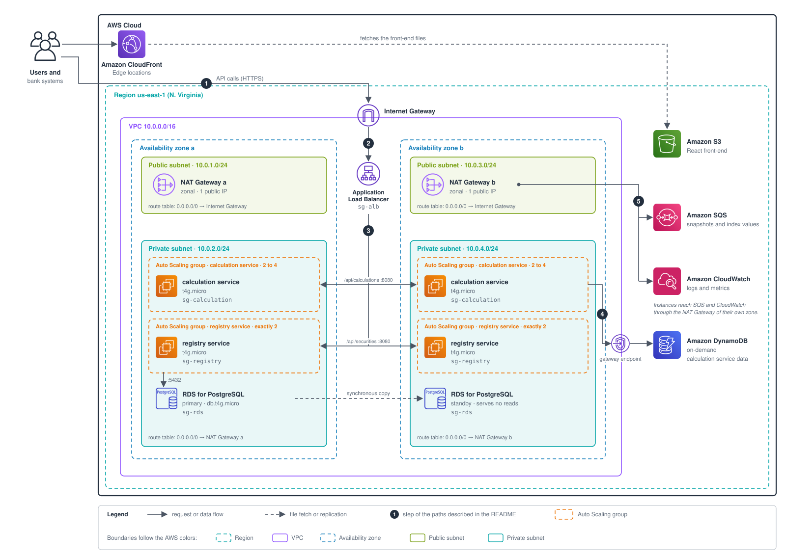
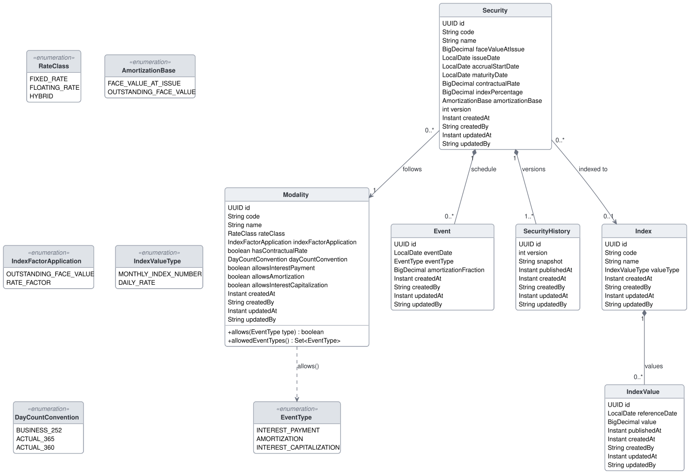

# finmathly

finmathly is a reference system for Brazilian fixed-income securities. It records debt securities, such as government bonds, debentures and bank deposit certificates, together with their contractual rules and event schedules, and it calculates their prices for any calculation date.

The system is made of two microservices. The **registry service** receives every change to the data and keeps the source of truth: securities, their modalities, indexes and index values. The **calculation service** answers calculation requests from its own copy of that data. For now it offers two calculations. The **par unit price** is the value of one unit under the contract's own remuneration, and it is calculated for securities of every class that pay interest. The **unit price** is the value of one unit at a market rate supplied by the user, and it is calculated for fixed-rate securities. Other calculations will be added to the same service as finmathly grows.

This document explains what finmathly contains and why. It opens with the approach used to build it and then follows four parts:

- [Approach: strategic programming with AI](#approach-strategic-programming-with-ai)
- [1. Domain: fixed-income mathematics](#1-domain-fixed-income-mathematics)
- [2. System design](#2-system-design)
- [3. Data model](#3-data-model)
- [4. Software design](#4-software-design)

---

## Approach: strategic programming with AI

AI writes code quickly, and by default it programs tactically: it makes the current request work and moves on to the next one. Each shortcut taken this way adds a little complexity, and over time the code becomes hard to understand and hard to change. finmathly is built with AI help, so the approach is designed to counter that tendency.

**Tactical programming** has one goal: **working code now**. Whatever design the code ends up with is a by-product of getting the change to work. **Strategic programming** has a different goal: **a good design**. Working code is still necessary, but it is not enough, and every change invests a little in the design. The reason is that complexity is incremental. It does not arrive in one large decision but accumulates one shortcut at a time, so it can only be contained if every change takes care of it. Both terms come from John Ousterhout's [*A Philosophy of Software Design*](https://web.stanford.edu/~ouster/cgi-bin/book.php).

**Good design**, in this sense, is design that keeps complexity low, so that the system stays **easy to understand and easy to change**. finmathly reasons about it at two scales. **[System design](#2-system-design)** deals with how the system runs: on which machines, databases and networks, and how its parts talk to each other. Its quality requirements are availability, scalability, consistency, cost and security, and it applies two architecture patterns, [CQRS](#23-cqrs) and the [transactional outbox](#24-transactional-outbox). **[Software design](#4-software-design)** deals with how the code inside each service is organized. Its central quality requirement is maintainability, which combines analysability and modifiability, together with testability and correctness. It is built on principles such as information hiding, cohesion, precise names, [SOLID](#437-solid) and [simple design](#438-simplicity), and on three [design patterns](#44-design-patterns): Strategy, Repository and Adapter.

Both scales are reasoned about in the same four steps:

1. the **quality attribute** that is wanted;
2. the **symptom** that shows the attribute is missing;
3. the **cause** that produces the symptom;
4. the **principle** that removes the cause.

The AI is directed through **[skills](#46-ai-assisted-development)**: written instructions that the coding assistant loads when it works in this repository. **finmathly-strategic-coder** makes it program strategically, using the names, principles and architecture described in this document. **finmathly-committer** makes it write commit messages in the Conventional Commits format.

The person stays in control through review and tests. Every line of the back-end is read and approved by a person before it is committed, and the tests state the business rules together with their expected values. Readable code is what makes this review possible, which is why readability is treated as a requirement rather than a preference.

---

## 1. Domain: fixed-income mathematics

This part describes the business domain: the financial concepts finmathly works with and the formulas it applies. It follows the conventions published by [ANBIMA](https://www.anbima.com.br/), the Brazilian financial markets association, and by the [Brazilian National Treasury](https://www.tesourodireto.com.br/). Each concept has one English name, and the same name, in camelCase, is used in the code.

### 1.1 Securities and their parts

#### 1.1.1 Loan and security

A loan has a **borrower**, who received the money and must pay it back, and a **lender**, who has the right to receive it back. The **principal** (`principal`) is the amount the borrower must repay, without interest. It belongs to the debt itself: it does not depend on who holds the debt or on the price paid for it.

A **security** (`security`) is a loan divided into equal **units** that can be traded separately. The borrower of a security is called the **issuer**, and the lender, who holds its units, is called the **investor**.

#### 1.1.2 Dates

Four dates frame the life of a security. The **issue date** (`issueDate`) is the date the security is created. The **accrual start date** (`accrualStartDate`) is the date from which monetary adjustment and interest start to accrue; it is usually the issue date, but the contract may set another one. The **maturity date** (`maturityDate`) is the last date of the contract, on which the remaining principal is repaid and the accrued interest is paid. Finally, the **calculation date** (`calculationDate`) is the date for which prices are calculated, and it always lies between the accrual start date and the maturity date.

#### 1.1.3 Principal and its evolution

The **face value at issue** (`faceValueAtIssue`) is the principal of one unit, fixed in the contract at issue. It never changes.

The principal is repaid through **amortizations** (`amortization`), each of which repays part of it. The contract defines the fraction repaid on each date and the **amortization base** (`amortizationBase`) that the fraction applies to, which is either the face value at issue or the outstanding face value.

The **outstanding face value** (`outstandingFaceValue`) is what remains of the principal at a given moment, without monetary adjustment. It starts at the face value at issue; each interest capitalization adds the capitalized interest divided by the adjustment factor, and each amortization subtracts the part of the principal it repays.

Many securities are tied to an **index** (`index`), such as the IPCA consumer price index, the IGP-M general price index, the DI interbank rate or the Selic policy rate. The **index factor** (`indexFactor`) is the product of the index's variations between two dates, with the index percentage already applied. For 100% of an index published as an index number, such as the IPCA, it is simply the ratio between the index numbers of the two dates.

The index factor can enter the calculation in one of two places, and the **index factor application** (`indexFactorApplication`) says which. It can multiply the outstanding face value, which is how inflation indexes such as the IPCA work and how the Treasury applies the Selic rate in its LFT bonds. Or it can multiply the rate factor, which is how the DI rate works. When the index factor multiplies the outstanding face value, it is called the **adjustment factor** (`adjustmentFactor`), measured from the accrual start date to the calculation date; otherwise the adjustment factor is 1.

The **adjusted face value** (`adjustedFaceValue`) is the outstanding face value multiplied by the adjustment factor. It is the current principal of one unit, and the base on which interest is calculated.

#### 1.1.4 Remuneration and events

The **contractual rate** ($i_c$, `contractualRate`) is the interest rate fixed in the contract, and it does not change with the market. The part of the interest that comes from it is the **rate factor** (`rateFactor`), equal to $(1 + i_c)^n$, or 1 when the security has no contractual rate.

When a security pays a percentage of an index, that **index percentage** (`indexPercentage`) is applied in each compounding period of the index, before the periods are accumulated. This is the market convention for securities that pay a percentage of the DI rate.

What happens to a security over its life is described by its **event schedule**. Each **event** (`event`) has a date and one of three types. In an **interest payment**, also called a coupon, the accrued interest is paid. In an **amortization**, part of the principal is repaid. In an **interest capitalization**, the accrued interest is not paid but added to the principal. Maturity is not part of the schedule, because on the maturity date the security always pays the accrued interest and amortizes the remaining balance. A **grace period** is an initial stretch of the schedule without interest payments, without amortizations, or without both.

The **payment** ($p_j$) on a date is the amount paid per unit on that date: the interest paid plus the amortization.

#### 1.1.5 Classes and modalities

finmathly classifies securities by how they are paid. A **fixed-rate** security is paid only by its contractual rate, so all its payments are known at issue. A **floating-rate** security is paid by a percentage of an index and has no contractual rate. A **hybrid** security is paid by a percentage of an index plus a contractual rate.

The fixed part of a hybrid is always called the **rate**, never the spread, because "spread" keeps its other meanings in finance, the bid-ask spread and the credit spread. This classification is finmathly's own. In the Brazilian market, "hybrid" usually refers only to inflation plus a rate, and the DI rate plus a rate is usually called a floating rate with a spread.

The rules shared by a kind of security are held by a **modality**. A modality defines the class, where the index factor applies, whether there is a contractual rate, the day count convention and which event types are allowed. The LTN, a zero-coupon Treasury bill, is an example of a fixed-rate modality without a contractual rate and without interest events: it pays only its face value at maturity.

### 1.2 Time and rates

All rates and percentages in finmathly are written as **decimals**, so 10% is written as 0.10. The rule holds everywhere: in the formulas, in the code, in the databases, in the messages and in the API.

#### 1.2.1 Compound interest

$$FV = PV \cdot (1+i)^n \qquad PV = \frac{FV}{(1+i)^n}$$

$$\text{compounding factor} = (1+i)^n \qquad \text{discounting factor} = \frac{1}{(1+i)^n}$$

The **present value** $PV$ is the value at the start of the term, and the **future value** $FV$ is the present value plus interest at the end of it, so the **interest** is $FV - PV$. In these formulas $i$ is always an effective rate, and $n$ is measured in the same unit of time as the period of the rate. **Compounding** carries a value forward in time by multiplying it by the compounding factor. **Discounting** brings a value back in time by multiplying it by the discounting factor, which is the inverse of the compounding factor.

#### 1.2.2 Effective, nominal and equivalent rates

A rate is **effective** when its period is the same as its compounding period. Two effective rates in different periods are **equivalent** when they yield the same amount over the same term. Converting between them uses $k$, the number of short periods contained in one long period:

$$i_{long} = (1+i_{short})^k - 1 \qquad i_{short} = (1+i_{long})^{1/k} - 1$$

Both formulas are the same identity, $(1+i_{long}) = (1+i_{short})^k$, solved for one rate or the other.

A rate is **nominal** when it is quoted for a long period that contains several compounding periods. It is converted into the effective rate of the compounding period proportionally, using $m$, the number of compounding periods contained in the nominal rate's period:

$$i_{effective} = \frac{i_{nominal}}{m} \qquad i_{nominal} = i_{effective} \cdot m$$

Because this conversion is proportional, the nominal rate and the effective rate obtained from it are **not** equivalent: over the same period they yield different amounts. The direction is also fixed, with the nominal rate always in the long period and the effective rate always in the compounding period. To move the resulting effective rate to another period, the equivalence above is applied afterwards.

#### 1.2.3 Day count conventions

Rates are quoted per year, but the terms between dates are counted in days, so every calculation needs a rule that turns days into years. That rule is the **day count convention** (`dayCountConvention`). It defines two things together: the type of day that is counted, and the number of those days in a year (`daysInYear`). The days can be **business days** ($bd$), which exclude weekends and the national holidays of the ANBIMA calendar, or **calendar days** ($cd$), which count every day. In both cases the start date is counted and the end date is not.

finmathly supports three conventions. `BUSINESS_252` counts business days over a year of 252 days, so the term in years is $bd / 252$; it is the Brazilian standard, and a mistake to watch for is writing 256 instead of 252. `ACTUAL_365` counts calendar days over 365, giving $cd / 365$. `ACTUAL_360` counts calendar days over 360, giving $cd / 360$.

The convention belongs to the **modality**. It applies to the contractual rate and to the market rate, but not to the index factor, which follows the index's own rule; the DI rate, for example, always compounds per business day, whatever the modality says.

The three conventions are defined as a list of valid pairs, rather than as a type of day and a number of days chosen separately. With separate choices, pairs that do not exist in the market, such as business days over 365, could be recorded, and something would have to reject them. With a list of valid pairs, those combinations simply cannot be represented.

### 1.3 Payment schedule

The payments of a security are calculated by processing its events in date order. Each event starts from the outstanding face value left by the previous one and applies the following relations:

$$\text{adjusted face value} = \text{outstanding face value} \cdot \text{adjustment factor}$$

$$\text{compounding factor} = \text{rate factor} \cdot \text{index factor}$$

$$\text{interest} = \text{adjusted face value} \cdot (\text{compounding factor} - 1)$$

$$\text{amortization} = \text{fraction} \cdot \text{amortization base} \cdot \text{adjustment factor}$$

$$p_j = \text{interest paid} + \text{amortization}$$

$$\text{new outstanding face value} = \text{outstanding face value} + \frac{\text{interest capitalized}}{\text{adjustment factor}} - \text{fraction} \cdot \text{amortization base}$$

The adjustment factor runs from the accrual start date to the event. The rate factor and the index factor in the compounding factor run from the last payment or capitalization to the event. The index factor enters **exactly one place**, according to the modality's index factor application: either in the outstanding face value, as the adjustment factor, or in the rate factor, inside the compounding factor. In the other place its value is 1.

The interest calculated for an event is paid if the event is an interest payment, and added to the principal if it is an interest capitalization; otherwise it keeps accruing. When several events fall on the same date, they form a **single payment**. At maturity, the accrued interest is paid and the amortization brings the outstanding face value to zero.

### 1.4 Prices

#### 1.4.1 Par unit price

The **par unit price** ($P_{par}$, `parUnitPrice`) is the value of one unit on the calculation date under the contract's own remuneration. It equals the adjusted face value plus the interest accrued since the last payment or capitalization:

$$P_{par} = \text{adjusted face value} \cdot \text{compounding factor}$$

This formula holds for securities of **any class that pays interest**, because it only uses index values up to the calculation date. For fixed-rate securities, the par unit price can also be written as the future payments discounted at the contractual rate, and both forms give the same result:

$$P_{par} = \sum_j \frac{p_j}{(1+i_c)^{n_j}}$$

With an index, this second form cannot be used, because the future payments depend on future index values, which are unknown. For the same reason, the calculation date cannot be later than the last published value of the security's index. A security without interest, such as the LTN, has no par unit price.

#### 1.4.2 Unit price

The **unit price** ($P$, `unitPrice`) is the value of one unit on the calculation date at the **market rate** ($i_m$, `marketRate`), which is the effective annual rate a buyer requires today. Each market rate corresponds to exactly one unit price:

$$P = \sum_j \frac{p_j}{(1+i_m)^{n_j}} \qquad P_{LTN} = \frac{\text{face value at issue}}{(1+i_m)^{n}}$$

Here $n_j$ is the term in years from the calculation date to payment $j$, given by the modality's day count convention. The formula is the fixed-rate form of the par unit price, with the market rate in place of the contractual rate. For the LTN, which has a single payment, it reduces to the face value at issue discounted to the calculation date.

The definition holds for any class, but only fixed-rate securities have future payments known in advance. With an index, the market price is exact only when the market rate is quoted over the same index and the same percentage as the security, plus a rate; in every other case it requires a projection of the index.

The market rate may be **negative**. The formula is valid for any rate greater than −1, so only rates less than or equal to −1 are rejected.

#### 1.4.3 Reading a price

Comparing the unit price with the par unit price tells whether a security trades **at par**, when the two are equal; at a **premium**, when the unit price is higher; or at a **discount**, when it is lower. A security without interest has no par unit price, so its unit price is compared with its face value at issue instead, and the LTN always trades at a discount to it.

Comparing today's unit price with the price an investor paid tells whether the security has had **appreciation** or **depreciation**. An investor who holds a security until maturity earns the rate at which it was bought, barring credit risk. An investor who sells earlier receives the price of the day of the sale, which may be higher or lower than the price paid.

### 1.5 What finmathly calculates

The calculation service currently offers two calculations: the par unit price of securities of any class that pay interest, using historical index values, and the unit price of fixed-rate securities, including the LTN, at a market rate supplied by the user. New calculations will be added to the same service.

For now, finmathly does not calculate the unit price of securities with an index, because that would require projecting the index. It does not model primary or secondary market operations or broker fees, which fall outside its purpose as a reference system. It does not model contract changes such as rate renegotiation, which would require knowing from which date each version of a contract applies. And it does not support the 30/360 convention, which has its own end-of-month rules and is not needed yet.

Prices are **not stored**. Each price is calculated and returned on request, so no stored result can become outdated.

### 1.6 Glossary

Each concept of the domain has one English name and one Portuguese name, and each name is used for that concept and for nothing else. The frontend uses the Portuguese term in its Portuguese interface. When the market uses two names for the same concept, both are listed. Each English term links to the section that defines it. **Name in code** is the English term in camelCase or, for a value of an enum, the enum value. **Name in database** is the table and column, in snake_case, where the registry service stores the value, as in the [class diagram](#31-class-diagram-of-the-write-side); a dash means that the value is not stored.

| English term | Portuguese term | Name in code | Name in database |
| --- | --- | --- | --- |
| **Compound interest and time** | | | |
| [Present value](#121-compound-interest) | Capital | `presentValue` | — |
| [Future value](#121-compound-interest) | Montante | `futureValue` | — |
| [Interest](#121-compound-interest) | Juros | `interest` | — |
| [Compounding](#121-compound-interest) | Capitalizar | `compounding` | — |
| [Discounting](#121-compound-interest) | Descontar | `discounting` | — |
| [Compounding factor](#121-compound-interest) | Fator de juros | `compoundingFactor` | — |
| [Discounting factor](#121-compound-interest) | Fator de desconto | `discountingFactor` | — |
| [Rate period](#122-effective-nominal-and-equivalent-rates) | Período da taxa | `ratePeriod` | — |
| [Compounding period](#122-effective-nominal-and-equivalent-rates) | Período de capitalização | `compoundingPeriod` | — |
| [Long period, short period](#122-effective-nominal-and-equivalent-rates) | Período longo, período curto | `longPeriod`, `shortPeriod` | — |
| [Effective rate](#122-effective-nominal-and-equivalent-rates) | Taxa efetiva | `effectiveRate` | — |
| [Nominal rate](#122-effective-nominal-and-equivalent-rates) | Taxa nominal | `nominalRate` | — |
| [Equivalent rates](#122-effective-nominal-and-equivalent-rates) | Taxas equivalentes | `equivalentRates` | — |
| [Business days](#123-day-count-conventions) | Dias úteis | `businessDays` | — |
| [Calendar days](#123-day-count-conventions) | Dias corridos | `calendarDays` | — |
| [Day count convention](#123-day-count-conventions) | Convenção de contagem de dias | `dayCountConvention` | `modality.day_count_convention` |
| [Business days over 252](#123-day-count-conventions) | Dias úteis sobre 252 | `BUSINESS_252` | `modality.day_count_convention` |
| [Calendar days over 365](#123-day-count-conventions) | Dias corridos sobre 365 | `ACTUAL_365` | `modality.day_count_convention` |
| [Calendar days over 360](#123-day-count-conventions) | Dias corridos sobre 360 | `ACTUAL_360` | `modality.day_count_convention` |
| [Days in year](#123-day-count-conventions) | Base anual | `daysInYear` | — |
| **Loan and security** | | | |
| [Borrower](#111-loan-and-security) | Devedor | `borrower` | — |
| [Lender](#111-loan-and-security) | Credor | `lender` | — |
| [Principal](#111-loan-and-security) | Principal | `principal` | — |
| [Security](#111-loan-and-security) | Título | `security` | `security` |
| [Unit](#111-loan-and-security) | Unidade | `unit` | — |
| [Issuer](#111-loan-and-security) | Emissor | `issuer` | — |
| [Investor](#111-loan-and-security) | Investidor | `investor` | — |
| [Code](#332-security) | Código | `code` | `security.code`, `modality.code`, `index.code` |
| [Name](#332-security) | Nome | `name` | `security.name`, `modality.name`, `index.name` |
| [Issue date](#112-dates) | Data de emissão | `issueDate` | `security.issue_date` |
| [Accrual start date](#112-dates) | Data de início da rentabilidade, data-base | `accrualStartDate` | `security.accrual_start_date` |
| [Maturity date](#112-dates) | Data de vencimento | `maturityDate` | `security.maturity_date` |
| [Calculation date](#112-dates) | Data do cálculo | `calculationDate` | — |
| [Version](#36-versioning-and-the-snapshot) | Versão | `version` | `security.version` |
| **Principal and its evolution** | | | |
| [Face value at issue](#113-principal-and-its-evolution) | Valor nominal de emissão (VNE) | `faceValueAtIssue` | `security.face_value_at_issue` |
| [Amortization](#113-principal-and-its-evolution) | Amortização | `amortization`, `AMORTIZATION` | `event.event_type` |
| [Amortization base](#113-principal-and-its-evolution) | Base de amortização | `amortizationBase` | `security.amortization_base` |
| [Amortization fraction](#333-event) | Fração de amortização | `amortizationFraction` | `event.amortization_fraction` |
| [Outstanding face value](#113-principal-and-its-evolution) | Saldo do VNE | `outstandingFaceValue` | — |
| [Index](#113-principal-and-its-evolution) | Indexador | `index` | `index` |
| [Index value](#335-index-and-index_value) | Valor do indexador | `value` | `index_value.value` |
| [Reference date](#335-index-and-index_value) | Data de referência | `referenceDate` | `index_value.reference_date` |
| [Index value type](#335-index-and-index_value) | Tipo de valor do indexador | `valueType` | `index.value_type` |
| [Monthly index number](#335-index-and-index_value) | Número-índice mensal | `MONTHLY_INDEX_NUMBER` | `index.value_type` |
| [Daily rate](#335-index-and-index_value) | Taxa diária | `DAILY_RATE` | `index.value_type` |
| [Index factor](#113-principal-and-its-evolution) | Fator do indexador | `indexFactor` | — |
| [Index factor application](#113-principal-and-its-evolution) | Incidência do fator do indexador | `indexFactorApplication` | `modality.index_factor_application` |
| [Monetary adjustment](#113-principal-and-its-evolution) | Atualização monetária, correção monetária | `monetaryAdjustment` | — |
| [Adjustment factor](#113-principal-and-its-evolution) | Fator de atualização | `adjustmentFactor` | — |
| [Adjusted face value](#113-principal-and-its-evolution) | Valor nominal atualizado (VNA) | `adjustedFaceValue` | — |
| **Remuneration and events** | | | |
| [Contractual rate](#114-remuneration-and-events) | Taxa do contrato | `contractualRate` | `security.contractual_rate` |
| [Rate factor](#114-remuneration-and-events) | Fator da taxa | `rateFactor` | — |
| [Index percentage](#114-remuneration-and-events) | Percentual do indexador | `indexPercentage` | `security.index_percentage` |
| [Event](#114-remuneration-and-events) | Evento | `event` | `event` |
| [Event type](#333-event) | Tipo de evento | `eventType` | `event.event_type` |
| [Event date](#333-event) | Data do evento | `eventDate` | `event.event_date` |
| [Interest payment, coupon payment](#114-remuneration-and-events) | Pagamento de juros, pagamento de cupom | `INTEREST_PAYMENT` | `event.event_type` |
| [Interest capitalization](#114-remuneration-and-events) | Incorporação de juros | `INTEREST_CAPITALIZATION` | `event.event_type` |
| [Event schedule](#114-remuneration-and-events) | Agenda de eventos | `eventSchedule` | — |
| [Grace period](#114-remuneration-and-events) | Carência | `gracePeriod` | — |
| [Payment](#114-remuneration-and-events) | Pagamento | `payment` | — |
| [Payment schedule](#13-payment-schedule) | Fluxo de pagamentos | `paymentSchedule` | — |
| **Classes and modalities** | | | |
| [Modality](#115-classes-and-modalities) | Modalidade | `modality` | `modality` |
| [Rate class](#331-modality) | Classe | `rateClass` | `modality.rate_class` |
| [Fixed-rate](#115-classes-and-modalities) | Prefixado | `FIXED_RATE` | `modality.rate_class` |
| [Floating-rate](#115-classes-and-modalities) | Pós-fixado | `FLOATING_RATE` | `modality.rate_class` |
| [Hybrid](#115-classes-and-modalities) | Híbrido | `HYBRID` | `modality.rate_class` |
| **Market and price** | | | |
| [Market rate](#142-unit-price) | Taxa de mercado | `marketRate` | — |
| [Unit price](#142-unit-price) | Preço unitário (PU) | `unitPrice` | — |
| [Par unit price](#141-par-unit-price) | PU ao par | `parUnitPrice` | — |
| [At par](#143-reading-a-price) | Ao par | `atPar` | — |
| [Premium](#143-reading-a-price) | Ágio | `premium` | — |
| [Discount](#143-reading-a-price) | Deságio | `discount` | — |
| [Appreciation, depreciation](#143-reading-a-price) | Valorização, desvalorização | `appreciation`, `depreciation` | — |

---

## 2. System design

System design deals with how finmathly runs as a whole: which machines, databases and networks it uses, and how its two services communicate.

### 2.1 Quality requirements

Each requirement below is described in the four steps of the [approach](#approach-strategic-programming-with-ai): the quality attribute that is wanted, the symptom of its absence, the cause of that symptom, and the principle that removes the cause, with the place where finmathly applies it.

#### 2.1.1 Availability

**Availability** means that the system answers when someone needs it. Its absence shows as a system that is down, and the usual cause is a **single point of failure**: a component without a substitute, such as one database running in a single availability zone. The principle that removes it is **redundancy**. Everything in finmathly runs in two availability zones. The registry database is an [RDS Multi-AZ](https://docs.aws.amazon.com/AmazonRDS/latest/UserGuide/Concepts.MultiAZ.html) instance, with a standby kept synchronized in the second zone, and DynamoDB keeps every table in three availability zones.

#### 2.1.2 Scalability

**Scalability** means handling more load without worse answers. Its absence shows as slow answers or errors during a spike of price queries, and its cause is **fixed capacity**: resources that neither grow nor shrink with the load. The principle that removes it is **elasticity**. The calculation service runs in an Auto Scaling group that grows from two to four instances, and DynamoDB runs in on-demand mode and scales by itself. Reads and writes are also handled by different services ([CQRS](#23-cqrs)), so a spike of price queries never reaches the registry service.

#### 2.1.3 Consistency

**Consistency** means that the registry service and the calculation service agree on the data. Its absence can show in three ways: a change confirmed in the registry service never reaches the calculation service, a change that was rolled back reaches it anyway, or the calculation service applies an old or repeated version of a security. There are two causes. The first is a **dual write**: writing to the database and publishing to the queue as two separate steps, so that one can fail without the other. The second is a queue that delivers each message **at least once and without ordering guarantees**.

Two principles answer these causes. **Atomicity**, applied through the [transactional outbox](#24-transactional-outbox), records the change and its message in one transaction, so either both happen or neither does. **Idempotency** makes processing the same message twice give the same result: a snapshot is written only if its version is higher than the stored one, and an index value only if its `updatedAt` is later than the stored one. The consistency obtained is [eventual](https://en.wikipedia.org/wiki/Eventual_consistency): after a change, the calculation service catches up within seconds.

#### 2.1.4 Cost

The **cost** requirement is to stay under a monthly ceiling of R$ 150. Its absence would show as a bill above the ceiling, and the cause would be **paying for idle capacity**. The principle is to **pay per use**. finmathly is switched on only while it is being used, about 70 hours a month, and DynamoDB is billed per request. The resulting estimate is about R$ 110 a month, detailed in the [cost](#27-cost) section.

#### 2.1.5 Security

The **security** requirement is that each part of the system reaches only what it needs. Its absence would show as a part reaching data it should not, and the cause would be network rules or credentials broader than necessary. The principle is **least privilege**. Security groups accept traffic only from other security groups. The calculation instances have an IAM profile that allows access only to the two calculation tables, and the calculation service has no network access to the registry database. No instance has port 22 open; they are reached through Session Manager instead.

### 2.2 Architecture on AWS

#### 2.2.1 Overview



The numbers in the diagram follow the paths described in [the path of a price query](#223-path-of-a-price-query) and in the [background message flow](#224-background-message-flow). The source of the diagram is [`docs/architecture.py`](docs/architecture.py), and the image above is generated from it by `docs/render.sh`, with the official AWS icons.

#### 2.2.2 Components

The front-end is a React application stored in S3 and delivered by CloudFront. Everything else runs in one VPC in the `us-east-1` region, which has a public subnet and a private subnet in each of two availability zones. The public subnets hold the Application Load Balancer and one NAT Gateway per zone. The private subnets hold the instances of both services and the registry database, and none of them has a public IP address.

The calculation service runs in an Auto Scaling group of two to four `t4g.micro` instances, because it is the service that receives the query spikes. The registry service runs in an Auto Scaling group of exactly two `t4g.micro` instances: two keep it available, and its load does not spike. The registry service stores its data in RDS for PostgreSQL and the calculation service in DynamoDB, as described under [databases](#25-databases). A single SQS Standard queue carries security snapshots and index values from the registry service to the calculation service, and CloudWatch receives the logs and metrics of both services.

#### 2.2.3 Path of a price query

A price query starts when the browser, or a bank's system, calls `/api/calculations` over HTTPS (1). The request enters the VPC through the Internet Gateway, which hands it to the load balancer (2); the load balancer has a node in each public subnet. The load balancer then picks a healthy calculation instance in either zone and forwards the request to it (3).

To answer, the calculation service reads the security snapshot and the index values it needs from DynamoDB. It reaches DynamoDB through the [DynamoDB gateway endpoint](https://docs.aws.amazon.com/vpc/latest/privatelink/vpc-endpoints-ddb.html) in the VPC (4), so this traffic does not go through the NAT Gateway. The response returns along the same path. Security groups are stateful, so the return traffic needs no rule of its own.

Calls to `/api/securities` follow the same path, but end in the registry service, which reads and writes RDS on port 5432.

#### 2.2.4 Background message flow

When a security changes, the registry service writes the new version and its snapshot in a single transaction, and a relay then publishes the snapshot to the queue. Every new or corrected index value is published in the same way. The calculation service consumes the queue and updates its copy in DynamoDB, discarding any snapshot whose version is equal to or lower than the one it already holds, and any index value whose `updatedAt` is not later than the one it already holds. The traffic to the queue and to CloudWatch leaves the private subnets through the NAT Gateway of the instance's own zone (5).

### 2.3 CQRS

#### 2.3.1 What it is

[CQRS](https://martinfowler.com/bliki/CQRS.html), or Command Query Responsibility Segregation, separates the model that changes data from the model that reads it. In finmathly, each of these models is a microservice with its own database.

#### 2.3.2 Write side: the registry service

The registry service is the write side. It receives the **commands**: creating and changing securities, modalities, indexes and index values. It validates every business rule and stores the data in normalized form, in a relational database. It is the **source of truth** of the system.

#### 2.3.3 Read side: the calculation service

The calculation service is the read side. It answers the **queries**: the par unit price and the unit price of a security on a given date. It reads only its own database, where the data is already shaped for these queries, as the complete snapshot of each security and the values of each index. It never reads the registry database and never calls the registry API.

#### 2.3.4 Synchronization

Every change in the registry service produces a message, and the calculation service updates its copy when it receives it. The two services share no code; what they share is only the contract of these messages.

Between the write in the registry service and the arrival of the message in the calculation service there is a short interval, usually under a second and at most a few seconds. During it, the calculation service still uses the previous copy: if a security's rate has just been corrected, a price requested at that instant still uses the old rate. Both sides agree again as soon as the message is processed. This is **eventual consistency**, and it is the price of keeping the two databases separate.

An [SQS Standard queue](https://docs.aws.amazon.com/AWSSimpleQueueService/latest/SQSDeveloperGuide/standard-queues.html) may deliver a message more than once, or out of order. finmathly tolerates both. A snapshot is written only if its version is higher than the stored one, which is enforced by a [DynamoDB conditional write](https://docs.aws.amazon.com/amazondynamodb/latest/developerguide/WorkingWithItems.html#WorkingWithItems.ConditionalUpdate), and an index value, keyed by its index and date, is written only if its `updatedAt` is later than the stored one, by the same kind of condition. A repeated message fails the condition and a delayed one is older, so neither repetition nor delay can corrupt the copy.

#### 2.3.5 Why

CQRS lets finmathly scale reads without scaling writes, answer quickly with data that is already in the shape of the query, and give each side the database that fits its own requirements. Above all, it keeps a spike of price queries away from the registry service.

### 2.4 Transactional outbox

#### 2.4.1 Problem

The registry service must both write to its database and publish a message to the queue, but no transaction spans the two. If it publishes **before** committing and the commit then fails, the calculation service receives a version that never existed. If it publishes **after** committing and the publication then fails, the calculation service never learns about the new version.

#### 2.4.2 Solution

The [transactional outbox](https://microservices.io/patterns/data/transactional-outbox) writes the message into the database itself, in an **outbox** table, in the same transaction as the change. A separate process, the **relay**, reads the outbox, publishes each pending row and marks it as sent. If a publication fails, the row stays pending and is retried in the next round. The requirement it meets is that every change confirmed in the registry service reaches the calculation service, and that no rolled-back change does.

#### 2.4.3 In finmathly

finmathly needs no extra tables for the outbox, because two existing tables play that role: `security_history`, which holds one snapshot per version of each security, and `index_value`, which holds the index values. Each has a `published_at` column, empty when a row is written and filled by the relay once the row is published. The relay runs on the registry service instances.

The flow has three steps. First, the registry service changes the security, increases its version and inserts the new row in `security_history` with `published_at` empty, all in one transaction. Then the relay repeats a round: it selects the pending rows, oldest first, publishes each one to the queue and marks it as published. Finally, the queue delivers each message to the calculation service at least once and without ordering, and the calculation service writes it to DynamoDB only if its version is higher than the stored one.

To find the pending rows quickly, each outbox has a [partial index](https://www.postgresql.org/docs/current/indexes-partial.html) that contains only the rows whose `published_at` is empty, ordered by `updated_at`. The relay finds the pending rows at once, and the index stays tiny, because almost every row has already been published.

Index values can be corrected after they are published. A correction clears `published_at` and sets a new `updated_at`. To avoid losing a correction made while the relay is publishing the old value, the relay marks a row as published only if its `updated_at` has not changed since the relay read it; otherwise the row stays pending and the correction goes out in the next round.

The outbox has one side effect: if the relay publishes a message and stops before setting `published_at`, the message is published again in the next round. The calculation service already tolerates repeated messages, through the snapshot version and the `updatedAt` of the index value.

### 2.5 Databases

Each side of CQRS uses the database that fits its requirements. The registry service needs integrity across tables, transactions and varied queries, which call for a relational database. The calculation service makes two fixed lookups by key and must scale by itself during a spike, which calls for a non-relational database billed per request.

#### 2.5.1 Registry service: Amazon RDS for PostgreSQL

The registry service uses one `db.t4g.micro` instance of RDS for PostgreSQL in Multi-AZ mode, with the primary in one zone and a synchronously updated standby in the other. It needs this durability and availability because it holds the source of truth. Storage is gp3 with 20 GiB, the minimum RDS allows. The database belongs to a DB subnet group made of the two private subnets and has no public IP address, and only the registry service can reach it. Backups are automatic and kept for seven days.

When finmathly is not in use, the instance is stopped. AWS starts a stopped RDS instance again after seven days, so a nightly automation stops it once more.

#### 2.5.2 Calculation service: Amazon DynamoDB

The calculation service uses DynamoDB in on-demand mode, which has no instance to manage and is billed per request. It holds two tables, `security_snapshot` and `index_value`, described in the [read side](#34-calculation-tables-dynamodb) of the data model. The calculation instances reach it through the VPC gateway endpoint, with their IAM profile.

Because DynamoDB holds only a copy, it does not need backups of its own: if the copy were lost, the registry service could republish it: a routine clears `published_at` in every row of the two outbox tables, and the relay then sends every snapshot and every index value again. When finmathly is idle there is nothing to stop, since only storage is billed, and it fits within the free tier.

### 2.6 Network

The VPC router does not appear in the diagram because it is implicit: it applies the route table of the subnet from which each packet leaves. The two public subnets, 10.0.1.0/24 in zone a and 10.0.3.0/24 in zone b, share a route table that keeps VPC traffic local and sends everything else to the Internet Gateway. Each private subnet has its own route table, so that its traffic to the internet leaves through the NAT Gateway of the same zone; losing one zone therefore never cuts off the other.

The private route tables also send DynamoDB traffic to the gateway endpoint. Their route to the DynamoDB prefix list is more specific than the default route to the NAT Gateway, so that traffic goes straight to DynamoDB, and the gateway endpoint has no cost.

<details>
<summary><strong>Route tables</strong></summary>

| Route table | Subnets | Destination | Target |
| --- | --- | --- | --- |
| Public | 10.0.1.0/24, 10.0.3.0/24 | 10.0.0.0/16 | local |
| | | 0.0.0.0/0 | Internet Gateway |
| Private a | 10.0.2.0/24 | 10.0.0.0/16 | local |
| | | DynamoDB prefix list | DynamoDB gateway endpoint |
| | | 0.0.0.0/0 | NAT Gateway a |
| Private b | 10.0.4.0/24 | 10.0.0.0/16 | local |
| | | DynamoDB prefix list | DynamoDB gateway endpoint |
| | | 0.0.0.0/0 | NAT Gateway b |

</details>

All subnets use the VPC's default network ACL, which allows traffic in both directions. Filtering is left to the security groups, which are stateful and simpler to maintain. Each rule refers to another security group instead of an IP range wherever possible.

<details>
<summary><strong>Security groups</strong></summary>

| Security group | Attached to | Inbound | Outbound |
| --- | --- | --- | --- |
| `sg-alb` | Load balancer | TCP 443 from anywhere | TCP 8080 to `sg-calculation` and `sg-registry` |
| `sg-calculation` | Calculation service instances | TCP 8080 from `sg-alb` | TCP 443 to DynamoDB, SQS, CloudWatch and updates |
| `sg-registry` | Registry service instances | TCP 8080 from `sg-alb` | TCP 5432 to `sg-rds`; TCP 443 to SQS, CloudWatch and updates |
| `sg-rds` | Database primary and standby | TCP 5432 from `sg-registry` | None: responses leave on their own |

</details>

### 2.7 Cost

finmathly is designed to run about 70 hours a month, with the database stopped the rest of the time. At on-demand prices in `us-east-1` and an exchange rate of R$ 5.15 per dollar, this comes to about US$ 20.60 a month, or about **R$ 110** once the 3.5% card tax (IOF) is added, under the R$ 150 ceiling. The largest items are the NAT Gateways and the database storage, which is doubled by Multi-AZ. Security groups, route tables, network ACLs, the VPC and the DynamoDB gateway endpoint have no cost. Each additional calculation instance, up to four, costs US$ 0.0084 per hour, and only while it exists. Prices and exchange rates change, so the estimate is checked in the [AWS Pricing Calculator](https://calculator.aws/) before resources are created.

<details>
<summary><strong>Monthly estimate by resource</strong></summary>

| Resource | Type and size | Qty | Unit price | US$/month | R$/month |
| --- | --- | --- | --- | --- | --- |
| NAT Gateway | Zonal, one per zone, with Elastic IP | 2 | US$ 0.045/hour + US$ 0.045/GB | 6.30 | 32 |
| EC2 | t4g.micro, Linux | 4 | US$ 0.0084/hour | 2.35 | 12 |
| RDS for PostgreSQL | db.t4g.micro, Multi-AZ | 1 | US$ 0.032/hour | 2.24 | 12 |
| Application Load Balancer | Internet-facing, two zones | 1 | US$ 0.0225/hour | 1.57 | 8 |
| Public IPv4 addresses | 2 for the load balancer, 2 for the NAT Gateways | 4 | US$ 0.005/hour | 1.40 | 7 |
| Load balancer capacity | About 1 LCU per hour | — | US$ 0.008/LCU-hour | 0.56 | 3 |
| EBS | gp3, 8 GiB per instance | 4 | US$ 0.08/GB-month, prorated | 0.25 | 1 |
| RDS storage | gp3, 20 GiB, doubled by Multi-AZ | 1 | US$ 0.23/GB-month | 4.60 | 24 |
| DynamoDB | On-demand, storage in the free tier | — | US$ 0.125/million reads + US$ 0.625/million writes | ~0.01 | 0 |
| SQS, S3, CloudFront, CloudWatch | Low volume | — | — | ~1.00 | 5 |
| Data transfer | ~5 GB through NAT + ~5 GB between zones | — | US$ 0.045 and US$ 0.02/GB | ~0.32 | 2 |
| **Total** | | | | **~20.60** | **~106** |
| **With IOF (3.5%)** | | | | | **~110** |

</details>

---

## 3. Data model

### 3.1 Class diagram of the write side



The diagram shows the classes and enums of the registry service, drawn with [PlantUML](https://plantuml.com/). It uses three kinds of UML relationship. An **association** links a security to objects that exist on their own: its modality and its index. A **composition** links a whole to parts that exist only inside it: a security to its events and its history, and an index to its values. A **dependency** marks that `Modality` uses the `EventType` enum in its `allows` method. Links between classes are drawn only as lines, not repeated as attributes, and enums appear as the types of the attributes that use them.

The source of the diagram is [`docs/data-model.puml`](docs/data-model.puml), and the image above is generated from it by `docs/render.sh`. To change this diagram or the architecture diagram, edit the source and run the script again, so that the source and the image never differ. The script needs Java, Python 3 and Graphviz.

### 3.2 Conventions of the registry tables

Each Java class of the registry service becomes a table named in `snake_case`, and each attribute becomes a column in `snake_case` too, so `publishedAt` becomes `published_at`. In the prose of this part, a name in camelCase is the Java attribute, and a name in `snake_case` is the table or column it becomes, as in constraints and indexes. When an attribute represents a domain concept, it carries the concept's English name from the [domain](#1-domain-fixed-income-mathematics), in camelCase.

Every table has a primary key called `id`, a [UUID version 7](https://www.rfc-editor.org/rfc/rfc9562) generated by the back-end with Hibernate's `@UuidGenerator` in the `VERSION_7` style and stored in a PostgreSQL `uuid` column. Version 7 starts with the creation time, so new ids come out in order and the index does not fragment, and the API does not expose a sequence that anyone could guess.

Enums are stored as text (`EnumType.STRING`), protected by a `CHECK` constraint. Text keeps the meaning readable in the database and survives a reordering of the enum's values. A field that does not apply to a row is left `null`, never zero, so that "not applicable" can never be mistaken for a real value. Rates and percentages are stored as decimals.

Every table also has four audit attributes: `createdAt` and `createdBy` record when and by whom a row was created, and `updatedAt` and `updatedBy` record when and by whom it was last changed. They are stored in the columns `created_at`, `created_by`, `updated_at` and `updated_by`, and Spring Data JPA fills them through `@CreatedDate`, `@CreatedBy`, `@LastModifiedDate` and `@LastModifiedBy`. The user comes from the authenticated session, and changes made by the system itself, such as those of the outbox relay, record the user `system`. These columns stay in the registry service and are not sent in messages, with one exception: the `updatedAt` of an index value travels in its message, because the calculation service uses it to discard older messages.

Most indexes come from the primary keys and the unique constraints. Three more are created explicitly. One on `security.modality_id` lists the securities of a modality, which is also how the modality lock is checked. The other two are the partial indexes of the outboxes:

```sql
CREATE INDEX security_history_pending_publication_idx
    ON security_history (updated_at) WHERE published_at IS NULL;

CREATE INDEX index_value_pending_publication_idx
    ON index_value (updated_at) WHERE published_at IS NULL;
```

Nothing is deleted. Securities, modalities and indexes have no delete operation, and the foreign keys use `ON DELETE RESTRICT`, because removing a security or a modality would erase the history on which past prices depend.

### 3.3 Registry tables (PostgreSQL)

#### 3.3.1 modality

The `modality` table holds the rules of a kind of security. Its primary key is `id`, and its `code` is unique. Every modality has a `code`, a `name` and a `rateClass`, which is `FIXED_RATE`, `FLOATING_RATE` or `HYBRID`. The `indexFactorApplication`, either `OUTSTANDING_FACE_VALUE` or `RATE_FACTOR`, is filled only for floating-rate and hybrid modalities and is `null` for fixed-rate ones. The flag `hasContractualRate` is always present, but it is a real choice only for fixed-rate modalities, since the LTN has no rate; floating-rate modalities always have it false, and hybrid modalities always have it true. The `dayCountConvention` is always present.

The event types a modality allows are recorded in three boolean columns, `allowsInterestPayment`, `allowsAmortization` and `allowsInterestCapitalization`, all false by default. Two methods tie them to the `EventType` enum: `allows` tells whether one event type is allowed, and `allowedEventTypes` returns all the allowed types as a set. The first one is:

```java
public boolean allows(EventType type) {
    return switch (type) {
        case INTEREST_PAYMENT        -> allowsInterestPayment;
        case AMORTIZATION            -> allowsAmortization;
        case INTEREST_CAPITALIZATION -> allowsInterestCapitalization;
    };
}
```

The allowed types are three columns rather than a separate table because the event types are few, defined by the market and stable. A join table would add a table, joins and code without adding any rule. The `switch` deliberately has no `default` branch: if a fourth event type is ever created, the code does not compile until this method handles it.

A modality is **locked after its first security**. Changing a rule under existing securities would silently change their prices, so to change a rule a new modality is created and the securities are moved to it. Moving a security is an ordinary change of that security, validated in full against the rules of the new modality. A modality keeps no history of its own, because the rules used by each version of a security are stored inside that version's snapshot.

#### 3.3.2 security

The `security` table holds the values of each contract. Its primary key is `id`, its `code` is unique, and `modality_id` is indexed. Every security has a `code`, a `name`, a `modality`, a `faceValueAtIssue`, an `issueDate`, an `accrualStartDate` and a `maturityDate`. The modality can be changed, as described above, and the front-end suggests the issue date as the accrual start date.

The other attributes depend on the modality. The `contractualRate` is present only if the modality has a contractual rate. The `index` and the `indexPercentage` are present only for floating-rate and hybrid securities, and the front-end suggests a percentage of 1.00, that is, 100%. The `amortizationBase`, either `FACE_VALUE_AT_ISSUE` or `OUTSTANDING_FACE_VALUE`, is present only if the schedule contains amortizations. Finally, `version` starts at 1 and increases by 1 on every change, as explained under [versioning](#36-versioning-and-the-snapshot).

#### 3.3.3 event

The `event` table holds the event schedule. Its primary key is `id`, and the combination of `security_id`, `event_date` and `event_type` is unique, so a security never has two events of the same type on the same date. Every event has its `security`, an `eventDate` and an `eventType`, and the `amortizationFraction` is filled only for `AMORTIZATION` events. Event types are an enum and not a table, for the same reason the modality's flags are columns.

Maturity is not a row in this table. On the maturity date, the accrued interest is always paid and the remaining balance always amortized, so there is no need to check that a maturity event exists.

#### 3.3.4 security_history

The `security_history` table holds one row per version of each security, and it also serves as the outbox for snapshots. Its primary key is `id`, the combination of `security_id` and `version` is unique, and it has the partial index on pending rows. Each row stores the `security`, the `version` and the `snapshot` as JSON in a `jsonb` column. Its `publishedAt` is empty when the row is written and is filled once the snapshot is sent to the queue. While a row is pending, `updated_at` equals `created_at`, so the relay reads the oldest rows first.

#### 3.3.5 index and index_value

The `index` table lists the indexes, with primary key `id` and a unique `code`, and the `index_value` table holds their published values, with primary key `id`, the combination of `index_id` and `reference_date` unique, and the partial index on pending rows. Every index has a `code`, a `name` and a `valueType`, and every value has its `index`, a `referenceDate` and a `value`. The `publishedAt` of a value is empty when it is written and again after every correction, and the relay fills it only if `updatedAt` has not changed since it read the row.

The `valueType` determines how a value is read and how the index factor is calculated. `MONTHLY_INDEX_NUMBER` means one index number per month, as for IPCA and IGP-M, and the factor is the ratio between two index numbers. `DAILY_RATE` means one annual rate per business day, written as a decimal, as for DI and Selic, and the factor is the product of the daily factors.

Indexes are data, not code. A new index is registered, receives its values and can be used without a new deployment, as long as its value type already exists. Once an index has its first value, its `code` and its `valueType` are locked, because messages and snapshots use the code as a key. A corrected value produces a new message with the same key, the index and the date, and with the new `updatedAt`; the calculation service replaces its copy only if that `updatedAt` is later than the stored one.

### 3.4 Calculation tables (DynamoDB)

In DynamoDB each record is called an **item**, and each field of an item an **attribute**. Only the keys are declared when a table is created; the other attributes need no schema.

The `security_snapshot` table holds one item per security, containing its latest snapshot. Its key is the partition key `securityId`, which is the registry UUID written as text. Besides `version`, each item carries every field of the snapshot, and the event schedule is stored as a list attribute with one map per event.

The `index_value` table holds one item per published index value. Its key combines the partition key `indexCode`, which groups the values of one index, and the sort key `referenceDate`, written as `YYYY-MM-DD`, which keeps the values in date order and makes it possible to read all values between two dates. Each item also carries the `valueType`, the `value` and the `updatedAt` that the conditional write compares.

DynamoDB has no foreign keys, so the snapshot stores the index code as a plain value, and it is the registry service that guarantees the code exists. The table `index_value` has the same name as the registry table, but it lives in another database and has another shape: it is denormalized, with the code and the value type repeated in every item.

### 3.5 Validations

Rules that involve more than one table are validated in the back-end, every time a security is created or changed. The whole security is checked against the rules of its modality, and if the modality has changed, the new modality's rules apply. A fixed-rate security must have no index, while floating-rate and hybrid securities must have an index and a percentage. The contractual rate must be present if, and only if, the modality has one. Every event must be of a type the modality allows, which the back-end checks with `modality.allows(event.eventType())`. The accrual start date must lie between the issue and maturity dates, and every event must fall after the accrual start date and before maturity. A fixed-rate modality without a rate allows no interest events.

Rules that concern a single row are enforced by the database itself: `NOT NULL` on the columns that are always required, `CHECK` constraints on the enum values and on the amortization fraction, which may be present only for `AMORTIZATION`, and foreign keys with `ON DELETE RESTRICT`.

### 3.6 Versioning and the snapshot

A security and its event schedule are **versioned together**, because the calculation uses both: a change to either one produces a new version. JPA's `@Version` annotation, with the `OPTIMISTIC_FORCE_INCREMENT` lock mode, increases the version even when only the schedule has changed. The same mechanism provides optimistic locking, so two concurrent edits cannot silently overwrite each other.

Every time a security is created or changed, in the same transaction, its version increases and a new row is added to `security_history`. This history records who changed what and when; it does not model contract changes over time.

The **snapshot** stored in that row carries everything the calculation needs: the security's data, the rules of its modality, the code and value type of its index, and its event schedule. The same JSON is stored in `security_history`, sent to the queue and copied into `security_snapshot`:

```json
{
  "schemaVersion": 1,
  "securityId": "0192f4a1-7c3e-7b2a-9d41-5e8f2c6a1b03",
  "version": 3,
  "code": "DEB-XYZ-2030",
  "rateClass": "HYBRID",
  "indexFactorApplication": "OUTSTANDING_FACE_VALUE",
  "hasContractualRate": true,
  "dayCountConvention": "BUSINESS_252",
  "faceValueAtIssue": 1000.00,
  "issueDate": "2026-01-15",
  "accrualStartDate": "2026-01-15",
  "maturityDate": "2030-01-15",
  "contractualRate": 0.06,
  "index": "IPCA",
  "indexValueType": "MONTHLY_INDEX_NUMBER",
  "indexPercentage": 1.00,
  "amortizationBase": "FACE_VALUE_AT_ISSUE",
  "events": [
    { "eventDate": "2027-01-15", "eventType": "INTEREST_PAYMENT" },
    { "eventDate": "2029-01-15", "eventType": "AMORTIZATION", "amortizationFraction": 0.5 }
  ]
}
```

The formats of the messages are the only knowledge that both services must share, so they are treated as explicit contracts. The first is the snapshot. The field `schemaVersion` identifies its format, and every change to it must be backward compatible. The second is the index value message, which carries the index code, the reference date, the value type, the value and the `updatedAt`, the same attributes as an item of the `index_value` table of the calculation service.

---

## 4. Software design

Software design deals with how the code inside each service is organized: its classes, methods, names and tests.

### 4.1 Quality requirements

finmathly's code is generated with AI help and read in full by a person, who must understand it and approve it before it is committed. The quality requirements of the code follow from that situation.

#### 4.1.1 Maintainability

**Maintainability** is the central requirement. It combines **analysability**, meaning the code is easy to understand, and **modifiability**, meaning it is easy to change without breaking something else. Filipe Deschamps calls this changeability and treats it as the main requirement of any software. Ricardo Albuquerque adds the reason it matters even more with AI: code generated by AI must stay readable, so that a person can supervise it. The absence of maintainability shows through the three symptoms of [complexity](#42-complexity), its causes are dependencies and obscurity, and the [principles](#43-principles) of this part are what remove them.

#### 4.1.2 Testability

**Testability** means that each part of the code can be tested on its own. In finmathly the price calculation is pure logic, with no database access and no JSON parsing inside it, and it reaches its data only through interfaces. Its tests can therefore run with in-memory implementations of those interfaces, without AWS.

#### 4.1.3 Correctness

**Correctness** means that the prices are right. Several of the principles serve it directly: precise names, so that business days are never confused with calendar days; errors that are either made impossible or reported at once; tests built on reference values published by the Treasury and ANBIMA; and `BigDecimal` for every amount and rate.

#### 4.1.4 Efficiency

**Efficiency** means an adequate use of time and memory. Its principle is to [optimize only after measuring](https://en.wikipedia.org/wiki/Program_optimization#When_to_optimize): the code is first made correct and clear, and only a part that a measurement shows to be slow is optimized. The use of `BigDecimal` is an example of this priority. It is slower than `double`, but `double` gets cents wrong.

### 4.2 Complexity

**Complexity** is anything in the structure of software that makes it hard to understand and change. The framework used here is John Ousterhout's, from [*A Philosophy of Software Design*](https://web.stanford.edu/~ouster/cgi-bin/book.php).

Complexity shows through three symptoms. **Change amplification** happens when a simple change requires edits in many places. **Cognitive load** is how much a developer needs to know in order to make a change. **Unknown unknowns** happen when it is not even clear what must be known or changed; this is the worst of the three, because nothing warns the developer that something is missing.

The symptoms have two causes. **Dependencies** exist when a piece of code cannot be understood or changed on its own. They cannot be avoided, so the aim is to keep them few, concentrated and evident. **Obscurity** exists when important information is not visible, for example behind a vague name or an unexplained rule.

Complexity is **incremental**, and that is why the difference between tactical and strategic programming, described in the [approach](#approach-strategic-programming-with-ai), matters so much. The same four steps used for [system design](#21-quality-requirements) apply at this smaller scale. Take the rule that decides whether an event type is allowed: if it were repeated in `if` statements throughout the code, that scattered dependency would be the cause, and change amplification the symptom, since a new rule would require editing every copy. The principle that removes the cause is high cohesion, applied by `Modality.allows`, which keeps the rule next to the flags it reads. The attribute gained is modifiability.

### 4.3 Principles

#### 4.3.1 Modules and information hiding

A **module** is any unit of code with an **interface** and an **implementation**: a method, a class, a package or a whole service. A **deep module** hides a lot of work behind a small interface, while a **shallow module** has an interface almost as complex as what it does and therefore hides little.

[**Information hiding**](https://en.wikipedia.org/wiki/Information_hiding), a principle introduced by David Parnas, means that each module hides its internal decisions from the others. Its opposite is **information leakage**, which happens when the same decision is reflected in several modules, so that changing it requires changing all of them. Between finmathly's two services, one leakage cannot be avoided: both must know the formats of the messages, the snapshot and the index value. They are therefore made explicit, as contracts, and the snapshot is versioned.

These ideas hold at every scale. The calculation API hides all of the mathematics behind a few operations, which makes the calculation service a deep module at system scale. Inside it, `calculateParUnitPrice` hides the adjusted face value and the factors behind a single call.

#### 4.3.2 Cohesion, coupling and behavior with its data

[**Cohesion**](https://en.wikipedia.org/wiki/Cohesion_(computer_science)) means that what changes together stays together. [**Coupling**](https://en.wikipedia.org/wiki/Coupling_(computer_programming)) measures how much one module depends on another, and it is kept low. The fact that the calculation service never calls the registry API is an example of low coupling between the two services.

A related rule decides where each behavior goes: **behavior lives with the data it uses**. A method that only works with the data of another class, or that forces another class to expose its internal operations, shows [feature envy](https://martinfowler.com/bliki/CodeSmell.html), and it belongs in that other class.

#### 4.3.3 Names

A name must be **precise**: a reader should know what a thing is from its name alone. A variable called `days` would leave open whether it counts business days or calendar days. Both are integers, so a wrong guess compiles and silently produces a wrong price; `businessDays` leaves no doubt. In the same way, finmathly has five kinds of factor, so the code never says just `factor` but `compoundingFactor` or `indexFactor`, and it has two rates, so it says `marketRate` and never just `rate`.

A name must also be **consistent**: the same concept always has the same name, the one given in the [domain](#1-domain-fixed-income-mathematics). And no name may have **two meanings**, because a reader who recognizes a word does not stop to check it, which turns the ambiguity into an unknown unknown. The word "base" is an example. In the domain it means both what an amortization fraction applies to and the number of days in a year of a day count convention, so the code never says just `base`: it says `amortizationBase` for the first meaning and `daysInYear` for the second. Whenever a new concept arrives, its name is checked against the names already in use.

Rules that apply everywhere are stated once, as project rules, instead of being repeated in every name. Since all rates are decimals, no name needs to say so.

#### 4.3.4 Functions

A function does **one thing, at one level of abstraction**. The calculation of the par unit price reads like its formula:

```java
BigDecimal calculateParUnitPrice(SecuritySnapshot snapshot, IndexValues values, LocalDate calculationDate) {
    BigDecimal adjustedFaceValue = adjustedFaceValue(snapshot, values, calculationDate);
    BigDecimal compoundingFactor = compoundingFactor(snapshot, values, calculationDate);
    return adjustedFaceValue.multiply(compoundingFactor);
}
```

Details such as counting business days or multiplying the daily factors of DI live in the functions it calls, so a reader understands the whole calculation in three lines and goes down into the details only when needed.

On the size of functions, two authors disagree. [Robert C. Martin](https://en.wikipedia.org/wiki/Robert_C._Martin) argues for very small functions, while Ousterhout warns that splitting too much produces shallow functions, which force the reader to jump between them to follow a single idea. finmathly reconciles the two by splitting a function only when the extracted part has **its own domain concept**, with a domain name. `adjustedFaceValue` has one: the adjusted face value. A helper called `multiplyValues` would not, so that multiplication stays inline.

#### 4.3.5 Comments

The code first tries to explain itself, through names and through functions named after concepts. A comment then says what the code cannot: **why** it is written this way, the business rule behind it, or the contract of a public method, meaning its inputs, its outputs, their units and the cases in which it fails. A comment never repeats the code, because such comments go stale as the code changes and end up contradicting it.

A comment describes the **contract, not the product**. It says that "the queue delivers each message at least once and without ordering" rather than naming SQS, so that it stays true if the queue product changes. The comment that explains the conditional write is an example:

```java
// The queue delivers each message at least once and without ordering.
// Only write if the version is higher, so a newer snapshot is never overwritten.
```

#### 4.3.6 Errors

The best way to handle an error is to **define it out of existence**: to model things so that the error cannot happen, which leaves every caller with one less case to handle. finmathly does this in three places. Maturity is implicit, so a security without a maturity event cannot exist. The day count convention has one value per valid pair, so business days over 365 cannot be represented. And a negative market rate is valid input, because the formula holds for it. The same idea, applied to types, is to **make invalid states unrepresentable**.

When an error cannot be eliminated, the code **fails early and clearly**. The calculation stops at its input, with a message that says what happened and how to fix it, for example: "No IPCA value for 2026-10-15; the last published value is for 2026-09-30." It never returns zero, `null` or a wrong price that would cause a failure far from its cause.

#### 4.3.7 SOLID

[SOLID](https://en.wikipedia.org/wiki/SOLID) gathers five principles popularized by Robert C. Martin.

The **single responsibility principle** (S) says that a class has one reason to change, meaning a single source of change requests. Counting business days changes when the holiday calendar changes, which is a different reason from a change in the price formulas. That is why it lives in its own class, `BusinessDayCalendar`, outside the price calculation, and why the DI factor can reuse it.

The **open/closed principle** (O) says that code is open for extension and closed for modification: a new variant enters as new code, without editing code that already works. Each value of `DayCountConvention` computes its own year fraction, so a new convention does not touch the calculation. The principle pays off where change is likely. A `switch` without `default` over an enum, kept **in one place and next to its data**, is acceptable, as in `Modality.allows` and `CashFlowState.apply`. The same `switch` repeated across the system is the signal to use polymorphism instead.

The [**Liskov substitution principle**](https://en.wikipedia.org/wiki/Liskov_substitution_principle) (L) says that any implementation of an interface must work wherever the interface is expected, with no hidden rule. Both implementations of the index factor calculation accept any date and handle their own rules internally. An `instanceof`, or an `if` on the concrete type, in code that should treat every implementation alike is the sign of a violation.

The **interface segregation principle** (I) says that clients should not depend on methods they do not use. The calculation API only reads snapshots, so it uses `SecuritySnapshotReader`; the queue consumer only writes them, so it uses `SecuritySnapshotWriter`; and a single DynamoDB class implements both. This is least privilege applied inside the code. Interfaces are not split when there are no different clients, because that would only produce shallow modules.

The **dependency inversion principle** (D) says that the business rules define the interfaces they need, and technology implements them. The price calculation uses `SecuritySnapshotReader` without knowing that DynamoDB exists, and the outbox relay publishes messages without knowing that SQS exists. Spring injecting the implementations is only the mechanism that connects the pieces; the inversion lies in the fact that the business side owns the interfaces. Pure logic such as `BusinessDayCalendar` has no technology behind it, so it needs no interface.

#### 4.3.8 Simplicity

[**Kent Beck's rules of simple design**](https://martinfowler.com/bliki/BeckDesignRules.html) give four properties of a simple design, in order of priority:

1. it passes the tests;
2. it reveals its intention;
3. it has no duplication;
4. it has the fewest elements.

When the second and third rules conflict, clarity wins: a little obvious repetition is better than an obscure abstraction. When duplication can be removed without loss of clarity, it is. The fixed-rate prices, for instance, share a single `presentValue(payments, rate, convention)` function, because the present value of discounted payments is a concept of the domain.

[**KISS**](https://en.wikipedia.org/wiki/KISS_principle) asks for the simplest solution that works. [**YAGNI**](https://martinfowler.com/bliki/Yagni.html) asks that nothing be built before it is needed. Code built for the future costs maintenance from the start, is usually built for a future that turns out differently, and adds cognitive load. finmathly therefore has no 30/360 convention, stores no results, has no table of event types, does not model contract changes, and keeps no copy of old snapshot versions in the calculation service, since that history already exists in the registry service. YAGNI forbids building future features, but not keeping the code easy to change: implementing 30/360 now would break it, while having an enum into which 30/360 can later enter without touching the calculation is simply good design.

#### 4.3.9 Tests and refactoring

**Refactoring** changes the structure of code without changing its behavior, and it is how every principle above is applied in practice, a little at a time. **Tests** are what prove that a refactoring changed nothing. Without them, code that is risky to touch is never improved, and it only gets worse.

The calculation is tested without AWS, using in-memory readers. Its tests include **reference cases** built from rates and prices published by the Treasury and ANBIMA, which check correctness against the market rather than against the code's own opinion. They include **edge cases**, such as a calculation date on maturity, an event on the calculation date, a negative rate, and a date after the last index value. And they follow the rule of **one test per business rule**, named after the rule, so that the tests also document the rules.

With AI-generated code, the tests are where the person supervises correctness. Reading the code remains necessary for maintainability, but correctness is guaranteed by checking that the tests state the right rules with the right values, and that all of them pass.

### 4.4 Design patterns

Design patterns are concrete ways of applying the principles above. [Strategy and Adapter](https://en.wikipedia.org/wiki/Design_Patterns) come from the Gang of Four's book, and [Repository](https://martinfowler.com/eaaCatalog/repository.html) comes from Martin Fowler and Eric Evans.

In the calculation, the three patterns fit together, and each layer hides something from the layer above it. The price calculation asks a **strategy** for the index factor, without knowing how the factor is calculated. The strategy asks a **repository** for the index values, without knowing where they are stored. An **adapter** implements the repository with DynamoDB, and it is the only part of the code that knows AWS exists. If the index values ever came from another source, such as a public API, only the adapter would change.

#### 4.4.1 Strategy

The [Strategy](https://en.wikipedia.org/wiki/Strategy_pattern) pattern solves the problem of a step that can be done in several ways, when the caller should not need to know which way is running. It defines one interface for the step and one implementation for each way, and the choice is made in a single place. In finmathly, each index value type has its own implementation:

```java
interface IndexFactorCalculator {
    BigDecimal indexFactor(String indexCode, LocalDate start, LocalDate end, BigDecimal indexPercentage);
}

class MonthlyIndexNumberCalculator implements IndexFactorCalculator { /* ratio of index numbers: IPCA, IGP-M */ }
class DailyRateCalculator implements IndexFactorCalculator { /* product of daily factors with the percentage: DI, Selic */ }
```

The pattern is used when each variant is a **complete and different algorithm**, as here. A "strategy" that would only forward a call back to its caller is shallow, and in that case a `switch` next to the data is clearer.

#### 4.4.2 Repository

The [Repository](https://martinfowler.com/eaaCatalog/repository.html) pattern solves the problem of business rules that need to find and store objects without knowing how they are stored. It offers an interface that looks like a collection of domain objects and speaks the language of the business:

```java
interface IndexValueReader {
    List<IndexValue> findBetween(String indexCode, LocalDate start, LocalDate end);
}
```

It is dependency inversion applied to data access, since the interface belongs to the business side.

#### 4.4.3 Adapter

The [Adapter](https://en.wikipedia.org/wiki/Adapter_pattern) pattern solves the problem of a ready-made part, such as the AWS SDK, whose interface does not match the one the code expects. A class in between implements the interface the code expects and translates each call into the ready-made part:

```java
interface MessagePublisher {
    void publish(String body);
}

class SqsMessagePublisher implements MessagePublisher {
    private final SqsClient sqs;
    private final String queueUrl;

    public void publish(String body) {
        sqs.sendMessage(request -> request.queueUrl(queueUrl).messageBody(body));
    }
}
```

The DynamoDB implementations of the readers and writers are adapters as well. Each translates a call such as `findBetween` into a query on the partition key and a range of the sort key.

### 4.5 Design of the calculation

#### 4.5.1 Day count conventions

Each day count convention knows its own rule, so the calculation only calls `convention.yearFraction(...)`:

```java
public enum DayCountConvention {
    BUSINESS_252 { BigDecimal yearFraction(LocalDate start, LocalDate end, BusinessDayCalendar calendar) {
        return divide(calendar.businessDaysBetween(start, end), 252); } },
    ACTUAL_365   { BigDecimal yearFraction(LocalDate start, LocalDate end, BusinessDayCalendar calendar) {
        return divide(DAYS.between(start, end), 365); } },
    ACTUAL_360   { BigDecimal yearFraction(LocalDate start, LocalDate end, BusinessDayCalendar calendar) {
        return divide(DAYS.between(start, end), 360); } };

    abstract BigDecimal yearFraction(LocalDate start, LocalDate end, BusinessDayCalendar calendar);
}
```

The behavior lives in the enum because the rule **is** the convention: the knowledge it uses belongs to the convention itself.

#### 4.5.2 Effect of each event

The payment schedule is processed by a `CashFlowState`, which holds the outstanding face value, the accrued interest and the payment of the day, and applies each event to them:

```java
class CashFlowState {
    void apply(Event event) {
        switch (event.eventType()) {
            case INTEREST_PAYMENT        -> payAccruedInterest();
            case AMORTIZATION            -> amortize(event.amortizationFraction());
            case INTEREST_CAPITALIZATION -> capitalizeAccruedInterest();
        }
    }

    private void payAccruedInterest() { /* ... */ }
    private void amortize(BigDecimal fraction) { /* ... */ }
    private void capitalizeAccruedInterest() { /* ... */ }
}
```

The `switch` is here, and not in a method of each `EventType` value, because the knowledge of how to pay, amortize and capitalize lives with the state's data. A method on each enum value would only call back into the state, and the state would then have to make those operations public. With the `switch` inside the state, the operations stay private, and its public interface is a single method, `apply`.

The calculation service has its own `EventType`. It shares no code with the registry service, only the snapshot contract, in which the event type travels as text.

#### 4.5.3 Snapshot versions

The calculation service does not compare versions with an `if` before writing a snapshot, because two consumers could read the same old version, both pass the check, and both write. Instead, it sends the write together with the condition "only if the new version is greater than the stored one", and DynamoDB evaluates the condition and the write as one atomic operation. When the condition fails, the message is an old or a repeated one, so it is discarded and not treated as an error. Index values use the same kind of condition, comparing `updatedAt` instead of the version.

#### 4.5.4 Technology at the edges

The calculation depends on the interfaces `SecuritySnapshotReader` and `IndexValueReader`, and the queue consumer depends on `SecuritySnapshotWriter`. On the registry side, the outbox relay depends on `MessagePublisher`, whose contract is to publish a message that will be delivered at least once and without ordering. Adapters implement all of these interfaces with DynamoDB and SQS, so the business rules never touch the AWS SDK directly.

### 4.6 AI-assisted development

The principles of this part are also written as two skills, which [Claude Code](https://docs.claude.com/en/docs/claude-code/overview) loads whenever it works in this repository. [finmathly-strategic-coder](.claude/skills/finmathly-strategic-coder/SKILL.md) makes it write, refactor and review code strategically, with the names, principles and architecture described in this document. [finmathly-committer](.claude/skills/finmathly-committer/SKILL.md) makes it write commit messages in the [Conventional Commits](https://www.conventionalcommits.org/en/v1.0.0/) format. Keeping the skills in the repository means that the rules are versioned together with the code they govern.
